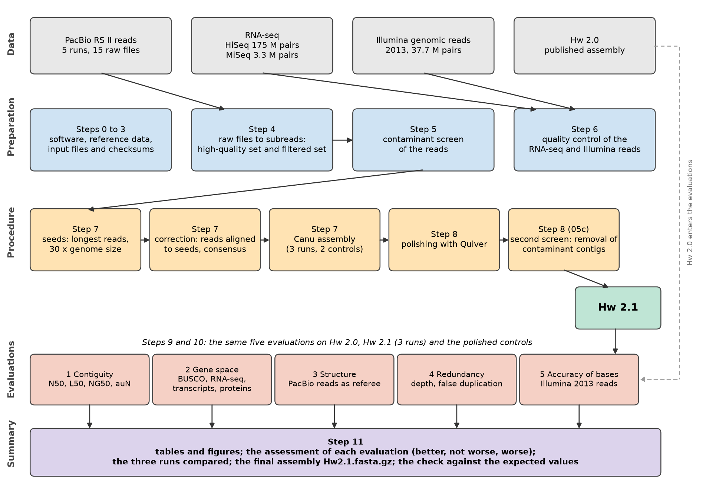
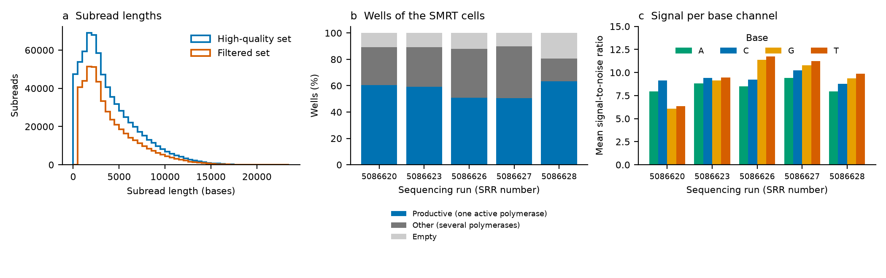
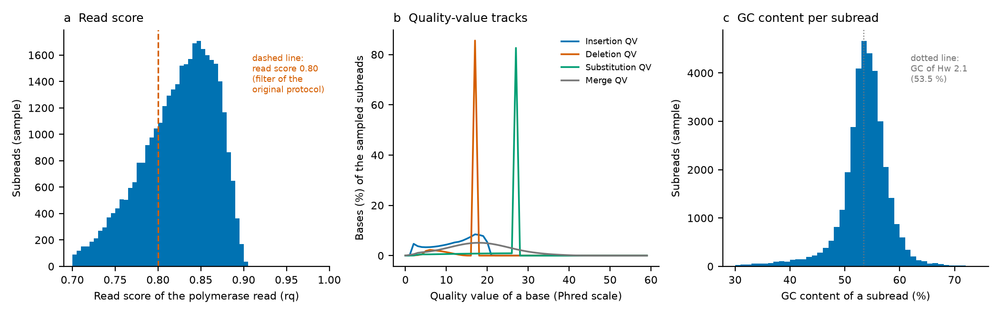
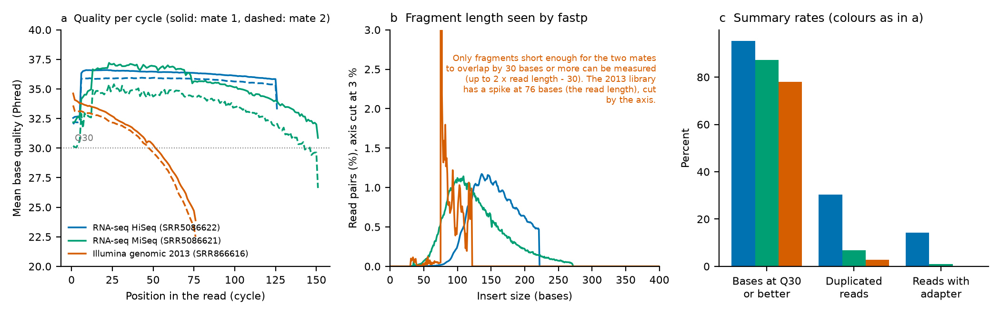
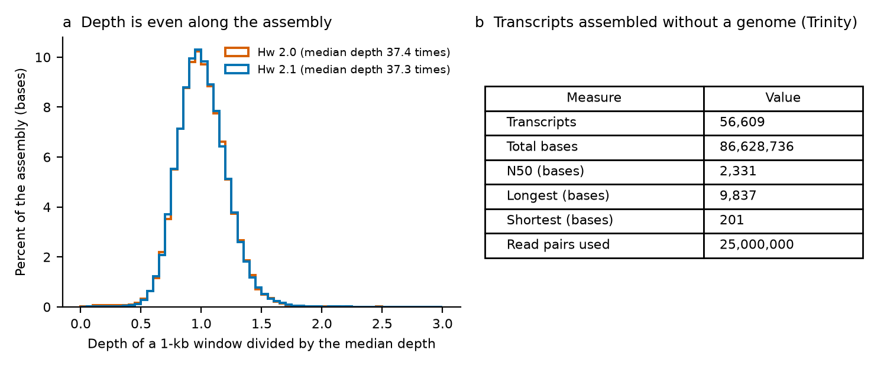
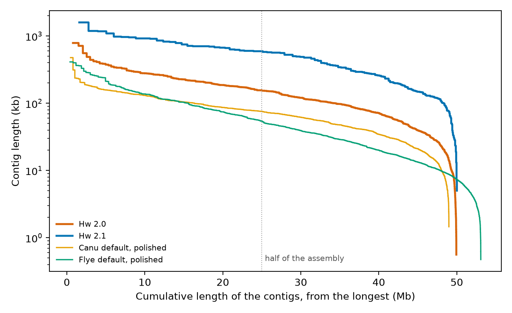
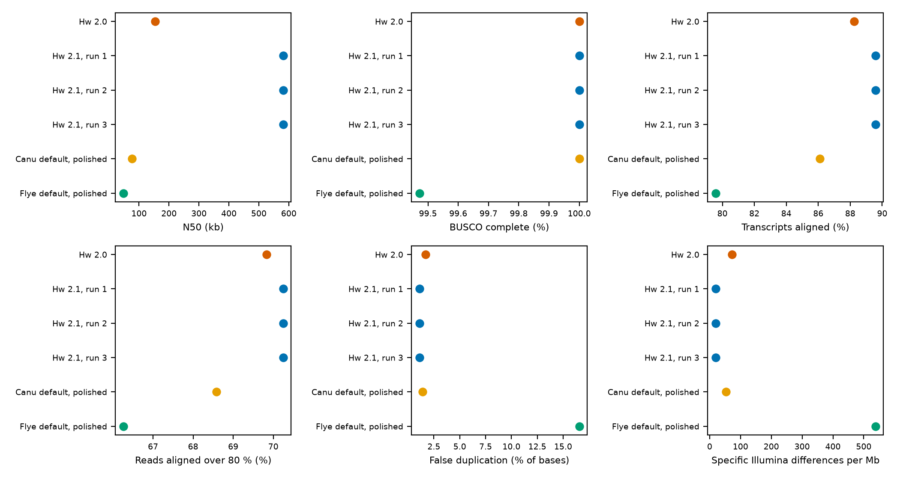

# Hw 2.1: a new genome assembly of the black yeast Hortaea werneckii from the published PacBio reads, with a reproducible workflow

This workflow assembles the genome of the black yeast *Hortaea werneckii* (strain EXF-2000) from the PacBio reads of Sinha et al. (2017), using a procedure that gives a new assembly, here called **Hw 2.1**, and evaluates Hw 2.1 against the published assembly of the same study, **Hw 2.0**. Both assemblies come from the same sequencing data. The workflow contains the scripts, the settings, the evaluations and the results, so that every step can be repeated and understood.

Preliminary analyses to improve the assembly (not shown) led to the procedure described here. This document starts from that procedure: it explains the data and the procedure, explains how the assembly is evaluated, gives the results, and then gives the commands to run every step in order.

Sections marked with a triangle open on a click. They hold explanations that are used further on in the text, the details of each step and the definitions of the measures.

## Run everything: quick start

What is needed: a computer cluster with the SLURM job scheduler (the program that queues and runs jobs), micromamba or conda, internet access for the downloads, and about 400 GB of free disk space (about 200 GB of working files, 85 GB of reference databases and 80 GB of input files; the software environments add about 15 GB in about 304,000 files). The time of the downloads depends on the speed of the network: in a test from empty folders the speed was about 1 to 2 MB/s during the first six hours, so that both download jobs reached their time limit and the script submitted them again; the second jobs, with a faster network, took 17 and 47 minutes. The analysis used 203 core-hours of processor time in the run reported here (section 5). From the submission of the first job to the end of the last job it took 4 h 07 min, 5 h 00 min, 5 h 01 min, 5 h 10 min and 5 h 19 min in five complete runs of a fresh clone, on a computer with short queue waits (the longest single job, one run of the procedure, took 2 h 16 min, 3 h 15 min, 2 h 41 min, 3 h 13 min and 2 h 58 min); count on longer when the queue is busy.

1. **Get the repository** and go into its folder: `git clone https://github.com/maunei/hortaea_werneckii_genome_assembly.git` and `cd hortaea_werneckii_genome_assembly`.
2. **Fill in `settings.yaml`.** It has one line for each value: the scheduler account, your e-mail address, how many messages you want, the software modules of your cluster (if any), and three folders for large files outside the repository. The work folder must be new and empty for each run. Nothing else has to be edited.
3. **Run `bash setup_and_run_all.sh all`.** It checks the settings, creates the software environments, downloads the reference databases and the input files, checks that everything works from a compute node, and submits the whole analysis (97 jobs with their dependencies). Then wait.
4. **When the analysis has finished** (one message arrives if you asked for messages, saying COMPLETED, or FAILED if the analysis did not finish or its results are outside the expected values of `validation/expected.tsv`; `squeue -u $USER` shows nothing), the results are in `results/`: the assembly Hw 2.1 in `results/assembly/`, the verdict on the five evaluations in `results/09_summary/verdict.tsv` and the check against the expected values in `results/10_validation/`.

```
git clone https://github.com/maunei/hortaea_werneckii_genome_assembly.git
cd hortaea_werneckii_genome_assembly
# edit settings.yaml
bash setup_and_run_all.sh all
```

<details><summary>The stages one by one (to run a part, or to repeat after a problem)</summary>

The command is `bash setup_and_run_all.sh STAGE`. Every stage can be repeated: what is already there is not made again, and the script stops with a message at the first problem.

| Stage | What it does |
|---|---|
| `settings` | checks `settings.yaml` (nothing left at the example values, folders given as absolute paths), creates the three folders and writes `config/local.sh`, the file from which all jobs read the values |
| `software` | creates the ten software environments from the lock files (step 1) |
| `databases` | downloads and indexes the reference databases (step 2); skipped when they are present; if a download job reaches its time limit (slow network) it is submitted again, up to five times, and continues with the files that are missing |
| `inputs` | downloads the input files (step 3), or links them from the folder `input_source` of `settings.yaml` when that is given; skipped when every file of `input/CHECKSUMS.md5` is present; a download job that reaches its time limit is submitted again, up to five times |
| `check` | checks the folders, programs, databases and input files, refuses a work folder that holds the files of an earlier run, runs a one-minute job on a compute node that tests them, and prints how many jobs the run will submit |
| `run` | submits the whole analysis (`scripts/submit_all.sh`) and one short job that sends a message when the last job has ended, COMPLETED or FAILED (`DRYRUN=1` prints the submissions only) |
| `all` | `settings`, `software`, `databases`, `inputs`, `check` and `run`, in this order |

The job files are not changed. The script passes the account and the mail settings to every job when it is submitted, which overrides the placeholders `<ACCOUNT>` and `<ADDRESS>` in the header of each job file. A person who submits a single job by hand (section 5) replaces the placeholders as described in step 0.

</details>

## Overview of the analysis



The workflow of the whole analysis, from top to bottom. Each box is a step (numbers as in section 5) and each arrow shows which result is used by the next step. Colours: grey, the data; blue, preparation of the data (steps 0 to 6); orange, the procedure that gives the new assembly (steps 7 and 8); green, the new assembly Hw 2.1; pink, the five evaluations (steps 9 and 10); purple, the summary (step 11). The dashed grey line shows that the published assembly Hw 2.0 goes through the same five evaluations.

## Summary

**Result.** Hw 2.1 has 169 contigs and Hw 2.0 has 651. N50 is 581,225 bases, against 153,735, and L50 is 31 contigs, against 100. The longest contig is 1,587,410 bases long in Hw 2.1 and 787,827 bases in Hw 2.0. The longer contigs are supported by the evaluations of completeness, structure, redundancy and accuracy.

| Evaluation | Hw 2.0 | Hw 2.1 | Assessment by the criteria defined |
|---|---|---|---|
| 1. Contiguity | 651 contigs; N50 153,735; L50 100 | 169 contigs; N50 581,225; L50 31 | better |
| 2. Completeness of the gene space | BUSCO complete 100.0 %; transcripts aligned 88.26 % | BUSCO complete 100.0 %; transcripts aligned 89.57 % | not worse (BUSCO equal, transcripts better) |
| 3. Structure | reference | the reads support Hw 2.1 at 377 of 393 decided disagreements (95.9 %) | better |
| 4. Redundancy and collapse | false duplication 1.68 % | false duplication 1.12 % | better |
| 5. Accuracy of the bases | 72.1 specific differences per Mb | 19.5 specific differences per Mb | better |

> By the criteria defined for the comparison (section 3), **Hw 2.1 is better than Hw 2.0**: better in evaluation 1 and in at least one other evaluation, and worse in none.

- The assembly is the file `results/assembly/Hw2.1.fasta.gz`: the polished contigs with the contaminant contigs removed (the removal deletes whole contigs and changes no base in the others).
- Everything is run by `bash scripts/submit_all.sh` after the set-up of steps 0 to 3 (section 5); each step can also be run on its own.
- The three runs of the procedure gave the same contigs, so the noise scale is practically zero.

## 1. The organism, the published assembly and the data

*Hortaea werneckii* is a black yeast that grows in very salty environments. Sinha et al. (2017) sequenced the strain EXF-2000 (Ex Culture Collection, Ljubljana; isolated from a saltern at Sečovlje, Slovenia) on a PacBio RS II instrument (chemistry P4-C2, five SMRT cells; SMRT: single-molecule real-time sequencing) and published an assembly made with SMRT Analysis 2.3 and its HGAP protocol (hierarchical genome assembly process) at default parameters. That assembly is **Hw 2.0**: 651 contigs, 49,942,992 bases, N50 153,735 bases.

**Aim.** To find out whether the same PacBio reads give an assembly in fewer and longer pieces that is at least as complete and as accurate as Hw 2.0, with a procedure that is fully described and can be repeated by anyone. The new assembly is called **Hw 2.1**. In file names and commands it appears as `proc_r1`, `proc_r2` and `proc_r3`: the same procedure was run three times, and the three runs gave the same contigs.

| Data | Accessions | What it is | Used for |
|---|---|---|---|
| PacBio RS II reads | SRR5086620, SRR5086623, SRR5086626, SRR5086627, SRR5086628 | five SMRT cells (movies), three raw `.bax.h5` files each; reads of about 4 kb on average (N50 about 5.8 kb) with about 15 percent errors, mostly insertions and deletions | assembly and polishing; as referee in the evaluations of structure and redundancy |
| Filtered subreads deposited by the authors | SRR5086624 | the reads the authors used after the default read filter | comparison with the reads made here (no other use) |
| RNA-seq, cells grown in 10 percent NaCl | SRR5086622 (HiSeq, 175,019,208 read pairs), SRR5086621 (MiSeq, 3,333,452 pairs) | sequenced RNA of the same strain | evaluation of gene-space completeness (HiSeq); quality control only (MiSeq) |
| Illumina genomic reads, 2013 | SRR866616 | 37,667,637 read pairs of 76 bases, from another culture of the strain | evaluation of the accuracy of the bases |
| Hw 2.0 (the published assembly) | GitHub repository stajichlab/Hortaea_werneckii, file assemblies/Hw2/Hw2.fasta.gz (commit a13e8a1dc0055dc311081446008955c59ecde8a2); NCBI GCA_002127715.1 | the assembly of the study | the reference point of every evaluation |

<details><summary>Terms for the PacBio reads, used throughout</summary>

- **Polymerase read and subread.** The instrument reads a circular DNA molecule (a SMRTbell) around and around. The whole record is a polymerase read; cut at the adapters, each pass over the insert is a **subread**. Subreads of the same molecule are copies of the same sequence, each with its own errors.
- **ZMW** (zero-mode waveguide): one sequencing well of a SMRT cell. A well is *productive* when it holds a single active polymerase.
- **High-quality set (`hq`).** All subreads, cut to the high-quality part of each polymerase read, of the productive wells. It is used where every read helps: polishing and the evaluations in which the reads act as referee.
- **Filtered set (`filtered`).** The subreads of the `hq` set that also pass the default read filter of the original protocol: polymerase read score of at least 0.80 (a score the instrument gives to each read) and a length of at least 500 bases. It is used to make the corrected reads and the assembly, as in the original protocol.
- **Screened sets (`hq_clean`, `filtered_clean`).** The same sets after the contaminant screen (step 02b), which removes whole reads that match bacteria, human or cloning vectors and no fungus. These are the reads that the later steps use.
- **Error rate.** A raw subread has about 15 percent errors. The errors are random, so the consensus of several reads of the same place is far more accurate than any read; the procedure below is built on this.

</details>

### Quality control of the sequence data

Every kind of data was checked with the usual quality-control measures before it was used (and the depth of the reads over the assemblies afterwards): read length and N50, the instrument's own indicators for the PacBio reads (fraction of productive wells, read score, signal-to-noise ratio), base quality (the proportion of bases at Phred quality 30 or better, Q30, meaning an error probability of 1 in 1,000 or less), GC content, duplication, adapter content, and, for the assembly, the evenness of the read depth. The figures below are made by `scripts/09_qc_figures.py` and the full list of statistics is in `results/09_summary/qc_stats.tsv`.



PacBio reads. a: lengths of the subreads. Horizontal axis: subread length in bases (classes of 500 bases); vertical axis: the number of subreads of that length; blue, the high-quality set; orange, the filtered set. b: the wells of each of the five SMRT cells. Horizontal axis: the sequencing run; vertical axis: the percentage of the wells of the cell that are productive (blue; one active polymerase), other (grey; several polymerases) or empty (light grey). c: signal strength. Horizontal axis: the sequencing run; vertical axis: the mean signal-to-noise ratio of the detection of each base (A, C, G, T).



Quality information that comes with the PacBio reads, from a sample of every 20th subread of the five runs. a: the read score. Horizontal axis: the read score of the polymerase read (0 to 1; the instrument's estimate of read accuracy); vertical axis: the number of sampled subreads; the dashed line is the 0.80 limit of the original read filter. b: the quality-value tracks. Horizontal axis: the quality value of a base on the Phred scale (10 means a 1 in 10 chance that the base is wrong in that way, 20 means 1 in 100); vertical axis: the percentage of the sampled bases with that value; one line for each track. c: GC content. Horizontal axis: the percentage of G and C bases in a subread; vertical axis: the number of sampled subreads; the dotted line is the GC content of Hw 2.1. The four tracks are defined in the block below this figure.

<details><summary>The four quality-value tracks of the PacBio reads: scale and meaning</summary>

Besides the base itself, the RS II instrument records for every base four estimates of the chance that the base is wrong in a particular way. They are the quality-value (QV) tracks. The conversion of step 4 (`bax2bam`) stores them in the BAM files (the binary alignment file format) as the tags `iq`, `dq`, `sq` and `mq`, one character per base (the value plus 33, written as a text character). The FASTQ files made from the same reads do not keep them, which is why the figure is made from the BAM files.

- **Scale.** A quality value Q is on the Phred scale: Q = -10 x log10(p), where p is the estimated probability of the error. Q10 means 1 chance in 10, Q20 1 in 100 and Q30 1 in 1,000. A higher value means a more reliable base. In the figure, the horizontal axis is Q and the vertical axis is the percentage of the sampled bases with that value.
- **The values are estimates of the instrument.** They are computed during base calling from the signal of the base, without a reference genome, and are not measured against the true sequence.

| Track (BAM tag) | The error that it estimates for a base | Companion tag |
|---|---|---|
| Insertion QV (`iq`) | the base is an extra base that is not in the true sequence; a low value marks a probable spurious base | none |
| Deletion QV (`dq`) | a true base is missing from the read just before this base | `dt`: the base that is most probably missing |
| Substitution QV (`sq`) | the base is the wrong base (a different base is in the true sequence) | `st`: the base that is most probably the true one |
| Merge QV (`mq`) | this base stands for two identical neighbouring bases (a homopolymer, such as two adenine bases in a row) that were called as one, so the read is one base short | none |

- **Why the merge track exists.** Two identical bases that are incorporated in quick succession can give one light pulse instead of two, and the base caller then reports one base. This is one of the ways in which a homopolymer run can be shortened in a read.
- **What Quiver does with them.** Quiver, the polisher of step 8, weighs each base of a read by these four values when it recomputes the consensus: a base with a low value for one kind of error counts less as evidence for the base itself and more for the alternatives (the companion tags give the alternative base).
- **Reading the figure.** The means of the sampled bases are 12.6 (insertion), 15.7 (deletion), 25.2 (substitution) and 26.0 (merge). The mean of a quality value is not the average error rate, which is dominated by the bases with low values; the order of the tracks nevertheless shows that insertions and deletions are the main errors of these reads and that substitutions and merges are rarer. The deletion and substitution tracks take almost a single value in these data, so only the insertion and merge tracks vary much from base to base.
- **Source.** The tag names and the encoding are fixed by the PacBio BAM format specification (PacBio, PacBioFileFormats); the error models in which the tracks are used are those of the Quiver algorithm of the HGAP protocol (Chin et al. 2013).

</details>

- The high-quality set has 718,442 subreads and 2.80 Gb (mean length 3,894 bases, N50 5,786 bases), about 56 times the genome; the filtered set has 470,231 subreads and 1.87 Gb (N50 5,587 bases), about 37 times the genome.
- Wells: 56.8 % of the wells are productive (they hold one active polymerase; per run 50 to 63 %). The mean read score of productive wells is 0.83, and 74.2 % of them reach the read score of 0.80 that the default filter of the original protocol requires.
- Signal-to-noise ratio, mean of the five runs for the bases A, C, G and T: 8.5, 9.4, 9.3, 9.7. The five runs lie in a similar range, so none was set aside.
- The reads are long and noisy as expected for this instrument (a raw subread has about 15 percent errors, see below); the later steps are built for that.



RNA-seq and Illumina genomic reads (before any filtering; blue, HiSeq RNA-seq; green, MiSeq RNA-seq; orange, Illumina genomic reads of 2013). a: quality along the read. Horizontal axis: the position in the read (the sequencing cycle); vertical axis: the mean base quality on the Phred scale at that position (30 means 1 error in 1,000 bases); solid lines, first mate; dashed lines, second mate. b: fragment length. Horizontal axis: the length of the sequenced DNA fragment (the insert) in bases; vertical axis: the percentage of read pairs with that length, cut at 3 percent; only fragments whose two reads overlap can be measured (explained below). c: three summary rates. Horizontal axis: the rate; vertical axis: the percentage of the bases (first group) or of the reads (second and third groups); same colours as in a.

- RNA-seq, HiSeq run (used for the alignment of RNA-seq pairs and for the transcripts): 175,019,208 read pairs of 126 bases, 95.2 % of the bases at Q30 or better, GC 56.3 %, duplication 30.3 % (expected in RNA-seq, where abundant transcripts are read many times), adapter found in 14.3 % of the pairs (not trimmed, see the limits).
- RNA-seq, MiSeq run (quality control only): 3,333,452 pairs, 87.3 % Q30, GC 55.7 %. It is smaller and its quality falls in the last cycles, one more reason for using the HiSeq run.
- Illumina genomic reads of 2013 (accuracy of the bases): 37,667,637 pairs of 76 bases, 77.9 % Q30, GC 51.3 %, duplication 2.7 %. The mean quality falls along the read (below Q25 in the last cycles). The accuracy evaluation uses only bases of quality 25 or better and alignments of mapping quality 30 or better (step 10), so the weakest bases are not used to call differences.
- PacBio quality information (panels of the PacBio quality figure): the read score is the instrument's estimate of the accuracy of a polymerase read; in the sample its mean is 0.809, with the original filter at 0.80. The four quality-value tracks give, for every base, the instrument's estimate that the base is wrong by an insertion, a deletion, a substitution or a merge; their means are 12.6 / 15.7 / 25.2 / 26.0 on the Phred scale. The insertion and deletion tracks have the lowest values, in agreement with an error profile dominated by insertions and deletions. The deletion and substitution tracks take almost a single value in these data, so only the insertion and merge tracks vary much from base to base. Quiver uses these tracks to polish the contigs. GC content per subread averages 53.5 percent, close to the 53.5 percent of the assembly.
- Can FastQC be used on the PacBio reads? It runs on the FASTQ files, but the base qualities in a FASTQ made from these files are not informative: every base carries the same quality value (Q33; a check of the first 100,000 subreads found no other value, and the table `results/02_pacbio_reads/merged_seqkit_stats.tsv` gives a mean of 33 and 100 percent of bases at Q20 and Q30), so the per-base quality plots of FastQC would show a flat line. The real quality information of the instrument is in the quality tracks, which the BAM files keep and the FASTQ files do not; it is shown in the figure above together with read length and GC content.

<details><summary>How the fragment length (insert size) of the figure is measured, and what it shows</summary>

- In a paired-end run the DNA fragment (the insert) is read from both ends: the first mate reads the start of the fragment, the second mate reads the other end. If the fragment is shorter than two reads, the two mates overlap in the middle: they read some of the same bases.
- fastp compares the first mate with the reverse complement of the second mate and looks for the overlap (it needs at least 30 bases). When it finds one, the insert size is the length of the first read plus the length of the second read minus the overlap. This is a real measurement of the length of the fragments of the library, not noise.
- When the fragment is longer than two reads minus 30 bases, the mates do not overlap and fastp cannot find the size; these pairs are reported as unknown: 3.1 percent of the HiSeq pairs, 1.3 percent of the MiSeq pairs and 12.4 percent of the pairs of 2013. For this reason each curve ends at the longest measurable fragment (222 bases for the HiSeq reads of 126 bases, 122 bases for the reads of 76 bases); it does not mean that longer fragments do not exist.
- The curves therefore show the lengths of the shorter fragments: for RNA-seq mostly 100 to 220 bases. The spike at 76 bases for the 2013 library is at the read length: it is consistent with many fragments that are as short as or shorter than one read, whose mates overlap completely; I did not check this further.

</details>



a: the evenness of the PacBio read depth. The assembly is cut into windows of 1 kb and the depth of each window (the average number of reads over its bases) is divided by the median depth of the assembly. Horizontal axis: this relative depth, in classes of 0.05; vertical axis: the percentage of all the bases of the assembly that lie in windows of that class (so the bars of one assembly add up to 100 percent). One curve for Hw 2.0 (orange) and one for Hw 2.1 (blue). A single narrow peak at 1 means an even depth. b: the transcripts assembled without a genome.

- Depth of the high-quality PacBio reads over Hw 2.1: median 37.3 times; 97.9 % of the bases lie in windows at 0.5 to 1.5 times the median (Hw 2.0: 97.5 %). An even depth means that the reads cover the whole genome and that no region is collapsed or very rare.
- Transcripts assembled without a genome: 56,609 transcripts, 86,628,736 bases, N50 2,331 bases, from 25,000,000 read pairs (1:33:16; 123.3 GB).
- Contig lengths of the assemblies are in the figure of section 4.

**Overall.** The PacBio reads give 56 times depth with the expected read lengths and signal in all five runs; the HiSeq RNA-seq run is of high base quality (95.2 % Q30); the weakest data are the Illumina reads of 2013 (77.9 % Q30), whose low-quality bases are excluded by the thresholds of the accuracy evaluation; the depth of the PacBio reads is even over both assemblies. No data set was removed or trimmed because of these checks.

<details><summary>All quality-control statistics (table)</summary>

| Data | Measure | Value |
|---|---|---|
| PacBio high-quality set | subreads | 718,442 |
| PacBio high-quality set | bases (Gb) | 2.80 |
| PacBio high-quality set | mean length (bases) | 3,894 |
| PacBio high-quality set | N50 (bases) | 5,786 |
| PacBio high-quality set | median length (bases) | 3,030 |
| PacBio high-quality set | depth over 50 Mb | 56 times |
| PacBio filtered set | subreads | 470,231 |
| PacBio filtered set | bases (Gb) | 1.87 |
| PacBio filtered set | mean length (bases) | 3,980 |
| PacBio filtered set | N50 (bases) | 5,587 |
| PacBio filtered set | median length (bases) | 3,062 |
| PacBio filtered set | depth over 50 Mb | 37 times |
| PacBio wells | productive wells (%) | 56.8 |
| PacBio wells | mean read score of productive wells | 0.83 |
| PacBio wells | productive wells with read score of at least 0.80 (%) | 74.2 |
| PacBio wells | mean signal-to-noise ratio (A, C, G, T) | 8.5, 9.4, 9.3, 9.7 |
| PacBio quality tracks (sample) | subreads sampled (every 20th of the five runs) | 35,925 |
| PacBio quality tracks (sample) | mean read score (rq) | 0.809 |
| PacBio quality tracks (sample) | mean quality value, insertion / deletion / substitution / merge | 12.6 / 15.7 / 25.2 / 26.0 |
| PacBio quality tracks (sample) | mean GC of a subread (%) | 53.5 |
| RNA-seq HiSeq (SRR5086622) | read pairs | 175,019,208 |
| RNA-seq HiSeq (SRR5086622) | read length (bases) | 126 |
| RNA-seq HiSeq (SRR5086622) | bases at Q30 or better (%) | 95.2 |
| RNA-seq HiSeq (SRR5086622) | GC content (%) | 56.3 |
| RNA-seq HiSeq (SRR5086622) | insert size at the peak (bases) | 136 |
| RNA-seq HiSeq (SRR5086622) | duplication (%) | 30.3 |
| RNA-seq HiSeq (SRR5086622) | reads with adapter trimmed (%) | 14.3 |
| RNA-seq MiSeq (SRR5086621) | read pairs | 3,333,452 |
| RNA-seq MiSeq (SRR5086621) | read length (bases) | 122 |
| RNA-seq MiSeq (SRR5086621) | bases at Q30 or better (%) | 87.3 |
| RNA-seq MiSeq (SRR5086621) | GC content (%) | 55.7 |
| RNA-seq MiSeq (SRR5086621) | insert size at the peak (bases) | 109 |
| RNA-seq MiSeq (SRR5086621) | duplication (%) | 6.9 |
| RNA-seq MiSeq (SRR5086621) | reads with adapter trimmed (%) | 1.1 |
| Illumina genomic 2013 (SRR866616) | read pairs | 37,667,637 |
| Illumina genomic 2013 (SRR866616) | read length (bases) | 76 |
| Illumina genomic 2013 (SRR866616) | bases at Q30 or better (%) | 77.9 |
| Illumina genomic 2013 (SRR866616) | GC content (%) | 51.3 |
| Illumina genomic 2013 (SRR866616) | insert size at the peak (bases) | 76 |
| Illumina genomic 2013 (SRR866616) | duplication (%) | 2.7 |
| Illumina genomic 2013 (SRR866616) | reads with adapter trimmed (%) | 0.0 |
| PacBio depth over Hw 2.0 | median depth (times) | 37.4 |
| PacBio depth over Hw 2.0 | bases in windows at 0.5 to 1.5 times the median (%) | 97.5 |
| PacBio depth over Hw 2.1 | median depth (times) | 37.3 |
| PacBio depth over Hw 2.1 | bases in windows at 0.5 to 1.5 times the median (%) | 97.9 |
| Transcripts assembled without a genome | transcripts | 56,609 |
| Transcripts assembled without a genome | total bases | 86,628,736 |
| Transcripts assembled without a genome | N50 (bases) | 2,331 |
| Transcripts assembled without a genome | read pairs used | 25,000,000 |
| Transcripts assembled without a genome | wall time and peak memory | 1:33:16; 123.3 GB |

</details>

## 2. The procedure that gives Hw 2.1

The procedure follows the design of the HGAP protocol (Chin et al. 2013), with current programs where the original ones no longer exist. It has six stages, run once with fixed settings; the three runs differ only in the number of threads.

1. **Reads (steps 02a and 02b).** The raw files are converted to subreads; the two read sets are made; reads that match contaminant sequence are removed.
2. **Seeds.** The longest reads of the filtered set are chosen until they add up to 30 times the genome size (30 x 50 Mb = 1.5 Gb).
3. **Correction.** Every filtered read is aligned to the seeds, and the consensus of the reads that align to a seed is the corrected read. A corrected read is far more accurate than a raw read.
4. **Assembly.** The corrected reads are assembled with Canu, which joins two corrected reads only if the region where they overlap differs by at most 2.5 percent (about one base in 40). The result is the set of assembled contigs, made from the corrected reads.
5. **Polishing (step 05).** The contigs of the assembly from the previous stage are polished: the raw subreads are aligned back to those contigs, and Quiver, the polisher of the original protocol (it also uses the quality-value tracks of the instrument), recomputes the consensus at every position. Where the consensus differs from the contig, the contig is changed: a base is replaced (substitution), a missing base is added (insertion) or an extra base is removed (deletion). Polishing is the stage after the assembly that changes bases; the number of changes by type is in `results/05_polish/<name>/quiver_changes.tsv`.
6. **Removal of contaminant contigs (step 05c).** This is a second screen for contaminants, done on the finished contigs after the assembly and the polishing. The first screen (step 02b) works on the reads before the assembly and removes only reads; a few reads with cloning-vector sequence passed it and a vector contig was still assembled. The polished contigs are therefore screened again with the same tool and criteria, and a contig that is cloning-vector or other contaminant sequence is removed as a whole. No base of the contigs that remain changes in this stage. The result is Hw 2.1.

<details><summary>Why the reads are corrected before they are assembled</summary>

A raw PacBio subread has about 15 percent errors, so two raw reads of the same place differ from each other by roughly a quarter of their bases. The two copies of a similar region of this genome differ by only a few percent: 78.3 percent of the bases of Hw 2.0 have their best partner elsewhere in the assembly at 80 to 95 percent identity. With raw reads, an assembler that must decide whether two reads overlap cannot tell an overlap of two reads from the same copy from an overlap of reads from the two copies, because the errors are larger than the difference between the copies. A loose error limit merges the copies; a strict one loses true overlaps.

The correction removes most of the error first. The longest reads are the seeds; every other read is aligned to them; at each seed the consensus of the aligned reads is the corrected read. With substitution errors only and 15 percent per read, a majority vote of 4 reads is wrong at about 2.8 percent of the positions and of 10 reads at about 0.03 percent. After correction, a strict limit (here 2.5 percent) keeps the true overlaps and rejects the overlaps between copies. This is the idea behind the procedure; the control assemblies below and the evaluation of redundancy test it.

</details>

<details><summary>The stages in detail: programs, settings and what each produces</summary>

| Stage | Program (version) | Settings | Produces |
|---|---|---|---|
| Seeds | seqkit 2.14 | reads of the filtered, screened set sorted by length; the longest taken until 30 x 50,000,000 bases | 254,125 seeds; the shortest has 2,783 bases |
| Alignment of reads to seeds | BLASR 5.3.5 | for each read, the 24 best alignments at most are kept (see the explanation below); an exact match of 12 bases is needed to anchor an alignment; `--noSplitSubreads` | alignments in BLASR text format (m5), sorted by seed |
| Consensus per seed | pbdagcon 0.1 | at least 4 reads covering, corrected reads of at least 500 bases | 218,837 corrected reads (0.84 Gb, N50 4,946 bases) |
| Assembly | Canu 2.2, assembly only (no correction by Canu) | genome size 50 Mb, corrected-read error limit 0.025 | the assembled contigs, made from the corrected reads (before polishing) |
| Polishing | pbalign 0.3.2 and Quiver (GenomicConsensus 2.3.3) | subreads of the screened `hq` set with their quality tracks; one round; parameter set of the chemistry P4-C2 | polished contigs |
| Removal of contaminant contigs (second screen) | minimap2 2.31 (preset `asm20`) against the reference collection of the screen | a contig is removed if at least half of it matches contaminant sequence and no part matches fungal sequence | the final assembly Hw 2.1 |

The genome size of 50 Mb is the length of Hw 2.0 rounded to 50 Mb; it is used for the seeds, for Canu and for NG50.

</details>

<details><summary>How a read is aligned to the seeds: what "up to 24 alignments" and "exact match of 12" mean</summary>

- The seeds are the longest filtered reads, chosen until they add up to 30 times the genome size (254,125 seeds). Together they cover every place of the genome about 30 times.
- Every filtered read is then aligned to the seeds. A read from some place of the genome overlaps all the seeds that cover that place, so it can align to several seeds. BLASR keeps, for each read, at most its 24 best alignments (the best by alignment score). The number 24 is a ceiling on how many alignments are kept per read; it is not a number of copies that a read must have.
- A read can therefore have fewer than 24 alignments, down to none (for example a read from a place that no seed covers, or a read that is mostly noise): such a read contributes nothing to the correction. A read that overlaps more than 24 seeds keeps only its 24 best alignments; the other overlaps are not used.
- The ceiling is linked to the 30-fold coverage of the seeds, as in the original protocol: with seeds at about 30 times, a read typically overlaps many seeds, and keeping the best 24 limits the cost of the alignment.
- The "exact match of 12 bases" is how BLASR finds the places where to try an alignment: it looks for words of 12 bases that are identical in the read and in a seed and extends the alignment from there. With 15 percent errors, exact words are short, so the word is kept short (12).
- What happens next: for every seed, the reads that aligned to it are stacked, and the consensus of the stack is the corrected read (positions with at least 4 reads; see the next row of the table). So a seed receives alignments from many reads, and each read may be used for several seeds.

</details>

<details><summary>The control assemblies: what the programs give without the correction step</summary>

Two control assemblies, made from the same filtered reads and the same genome size, show what the two assembly programs give at their default settings without the correction step of the procedure:

- **Canu at default settings** (`ctrl_canu`), including Canu's own correction of the reads.
- **Flye at default settings** (`ctrl_flye`), which includes Flye's own default polishing.

Both controls are then polished with Quiver and their contaminant contigs are removed in the same way as for Hw 2.1 (`ctrl_canu_quiver`, `ctrl_flye_quiver`), so that they can be compared with Hw 2.1 on every evaluation, including the accuracy of the bases. These polished controls are the ones shown in the results.

</details>

<details><summary>Three runs of the procedure: the noise scale</summary>

Programs that use several threads can give different results from the same input when the number of threads changes. The procedure is therefore run three times from the same reads with different thread settings (16, 12 and 8 threads for the correction and the assembly; 32, 24 and 16 threads for the polishing). The runs are `proc_r1`, `proc_r2` and `proc_r3`. For every measure, the range over the three runs is the **noise scale**: the variation the procedure shows when nothing but the thread count changes. A difference between Hw 2.1 and Hw 2.0 is counted as real only when it is larger than this range. Hw 2.0 is a single run, so its own variation is unknown.

</details>

## 3. How Hw 2.1 is evaluated

The question is whether Hw 2.1 is better than Hw 2.0. A single number cannot answer it: a wrong join between two pieces makes an assembly look more contiguous, and an assembly that is too short looks accurate. Hw 2.1 is therefore examined in five evaluations that look at different ways of being wrong. The same programs, settings and thresholds are applied to every assembly: Hw 2.0 (as published, without any change), Hw 2.1 and the two control assemblies.

| Evaluation | Question | Measures | Data used |
|---|---|---|---|
| 1. Contiguity | How long are the pieces? | number of contigs, N50, L50, NG50, auN, longest contig | the assembly alone |
| 2. Completeness of the gene space | Are the genes present, whole and in the right number? | BUSCO genes; RNA-seq read pairs aligned; transcripts assembled without a genome and aligned; Swiss-Prot fungal proteins found whole | the assembly, RNA-seq (HiSeq), protein sequences of fungi |
| 3. Structure | Are the pieces joined correctly? | PacBio reads aligned back to the assembly (read-back); places where two assemblies disagree, decided by the reads | the raw PacBio reads, which are the only record of the genome that does not depend on any assembly |
| 4. Redundancy and collapse | Is any region present twice by error, or two copies merged into one? | PacBio read depth along the contigs; alignment of the contigs to each other | PacBio reads, the assembly alone |
| 5. Accuracy of the bases | Are the bases right? | positions where independent Illumina reads disagree with the assembly, counted per megabase | the Illumina reads of 2013, which play no part in building either assembly |

Each evaluation ends in one of three assessments: Hw 2.1 is **better**, **not worse** (equal) or **worse** than Hw 2.0. The criteria are written below. Hw 2.1 is called better than Hw 2.0 overall when it is better in evaluation 1 and in at least one other evaluation and is worse in none; otherwise the five assessments are reported as they are.

<details><summary>Contiguity measures: N50, L50, NG50 and auN, with an example</summary>

- **N50.** Sort the contigs from the longest. Add their lengths until the sum reaches half of the assembly. The length of the contig at which this happens is the N50. A higher N50 means longer pieces.
- **L50.** The number of contigs that were needed to reach that half. A lower L50 means fewer pieces.
- **NG50.** The same as N50 but with half of the *genome size* (here 50 Mb) instead of half of the assembly, so that assemblies of different total length are compared fairly.
- **auN.** The sum of the squared contig lengths divided by the sum of the contig lengths. It is the answer to this question: if one base of the assembly is picked at random, how long is the contig that contains it, on average? A contig of length L holds a fraction L/total of the bases, so it is picked with probability L/total; the average of the picked lengths is the sum over contigs of L x (L/total), which is the formula. Unlike N50, auN changes smoothly whenever any contig changes length.

Example: an assembly of two contigs of 90 kb and 10 kb. Half of the assembly is 50 kb, reached with the first contig, so N50 = 90 kb and L50 = 1. The auN is (90 x 90 + 10 x 10) / (90 + 10) = 82 kb, because nine bases in ten lie in the 90 kb contig. The mean contig length is only 50 kb.

A wrong join raises N50 just as a right join does, so contiguity is never read alone; the other four evaluations check that the longer contigs are correct.

</details>

<details><summary>Gene-space completeness: the four measures</summary>

- **BUSCO** (Benchmarking Universal Single-Copy Orthologs): 758 genes (lineage `fungi_odb10`) that almost every fungus carries once. The genes are searched in the assembly and counted as complete (single or duplicated), fragmented or missing. Complete is better. In this genome most of the genes are found twice in every assembly, so the duplicated percentage is reported but not scored.
- **RNA-seq read pairs aligned to one place** (STAR, which aligns RNA reads across introns): the proportion of the 175 million HiSeq pairs that align to one place of the assembly. A gene that is missing or broken in an assembly lowers the proportion. The small MiSeq run of the same condition is used for quality control only.
- **Transcripts assembled without a genome (Trinity), aligned to the assembly.** The transcripts are assembled from the RNA-seq reads without using any genome, so no assembly is favoured; the same transcripts are aligned to every assembly. A transcript passes when at least 90 percent of it aligns at 95 percent identity or more. The proportion that passes is higher when more genes are whole in the assembly.
- **Swiss-Prot fungal proteins found whole** (miniprot, which aligns a protein to DNA across introns): the proportion of 38,451 reviewed fungal proteins whose best alignment covers at least 90 percent of the protein.

</details>

<details><summary>Structure: the PacBio reads as referee, and what "decided" means</summary>

Each PacBio read is a piece of the real genome. Where an assembly joins two pieces, reads that cross the junction should exist; if no read crosses it, the join is not supported. This is used in two ways.

- **Read-back.** All raw high-quality subreads that passed the contaminant screen (not the corrected reads) are aligned to the assembly. The evaluation counts the reads that align over most of their length, the reads that align only in pieces, the places inside contigs that no read crosses (bases not spanned) and the junctions where the two sides of a read land in different places (discordant junctions).
- **Disagreements between two assemblies, decided by the reads.** The two assemblies are aligned to each other and every place is listed where they arrange the same sequence differently (one joins two pieces that the other keeps apart, one has a segment that the other lacks, a segment is inverted). For each place, the reads that cross it are counted for each arrangement: reads that carry the arrangement of Hw 2.0 and reads that carry the arrangement of Hw 2.1.

A place is **decided** for one assembly when at least 3 reads support its arrangement and the number of reads that support it is at least twice the number that support the other arrangement. Examples, as reads for Hw 2.1 / reads for Hw 2.0: 8 / 3 is decided for Hw 2.1 (8 is more than twice 3); 4 / 0 is decided for Hw 2.1; 1 / 0 or 2 / 0 is not decided because fewer than 3 reads cross the place; 5 / 4 is not decided because neither side has twice the reads of the other (for instance when a repeat is collapsed, so both arrangements occur in the reads). The evaluation reports the proportion of the decided places that go to Hw 2.1, with a 95 percent Wilson interval (explained below).

<details><summary>How the 95 percent Wilson interval of this proportion is made</summary>

Each decided place is treated as one trial with two possible outcomes: the reads decide for Hw 2.1 or for Hw 2.0. With n decided places of which k go to Hw 2.1, the proportion is p = k / n. The Wilson interval is a statement about how much this proportion could change if the same kind of places were drawn again from the genome. It is computed from n and k alone with the Wilson formula for a proportion (assuming that the places are independent trials), and it does not come from the variation among the three runs of the procedure. With z = 1.96 (the value for 95 percent), the Wilson interval is  (p + z^2/(2n) +/- z x sqrt(p(1-p)/n + z^2/(4n^2))) / (1 + z^2/n).

Example. With 1,000 decided places of which 700 go to Hw 2.1, p = 0.70, and the Wilson interval is 67.1 to 72.8 percent. Half is 50 percent, which lies far outside the Wilson interval, so the places clearly go more to Hw 2.1 than to Hw 2.0. With only 10 decided places and 7 for Hw 2.1, the same proportion gives 40 to 89 percent, which includes 50 percent: so few places cannot show a preference. The more decided places, the narrower the Wilson interval.

The criterion for evaluation 3 asks that the Wilson interval excludes 50 percent in each of the three runs; the three runs are computed separately (they give the same result here).

</details>

</details>

<details><summary>Redundancy and collapse, and the accuracy of the bases</summary>

- **Depth.** The PacBio reads are aligned to the assembly, and the assembly is cut into consecutive windows of 1 kb (1,000 bases). The depth of a window is the average number of reads that cover its bases. The median depth is the middle value of the depths of all windows (each window counted by its length). Every window is then expressed relative to the median: its depth divided by the median. A window with a relative depth of 1 has the typical depth. Where two copies of a region were merged into one contig, the reads of both copies pile up and the relative depth is about 2; where a region is present twice by error, the reads are shared between the two copies and the relative depth of each is about 0.5. **The measure** is the proportion of the assembly that lies in windows with a relative depth between 0.5 and 1.5: the total length of those windows divided by the total length of all windows. For example, 97.9 percent means that 97.9 of every 100 bases of the assembly lie in windows with a typical depth.
- **False duplication.** The contigs are aligned to each other, so that every stretch of the assembly that resembles another stretch is found. An alignment is a block: a stretch of one contig matched to a stretch of another contig (a contig is not aligned to itself). Only blocks of at least 1,000 aligned positions are kept (the aligned positions are the columns of the alignment: each column pairs one base of the first stretch with one base of the second). The identity of a block is the proportion of its columns in which the two stretches carry the same base. A base of the assembly can lie in several blocks. Among the blocks that cover it, the one with the highest identity is the base's best block, and the stretch on the other side of that block is its partner stretch. The measure is then a proportion of the assembly: the bases whose best block has an identity of 98 percent or more are counted as **false duplication** (the same region present twice), and the measure is their number divided by the number of bases of the assembly. Bases whose best block has an identity of 80 to 95 percent are real similar copies of this genome, not errors. The unit is the base, so that the result is a proportion of the length of the assembly; a base does not have a partner of its own, it takes the partner of the block it lies in.
- **Accuracy of the bases.** The Illumina reads of 2013 are aligned to the assembly. A position is a *difference* when at least 90 percent of the reads that cover it (at least 10 reads, mapping quality 30, base quality 25) carry another base, or an insertion or a deletion, instead of the assembly base. Only *callable* positions are used: depth of 10 reads or more and at most twice the median depth. The number of differences is divided by the number of callable megabases (Mb, million bases): 20 per Mb, for example, means 20 differences in each million callable bases, about one difference every 50,000 bases. It does not mean that part of the assembly lacks reads.
- **Shared and specific differences.** The Illumina reads come from another culture of the strain, sequenced at another time. A position where they disagree with Hw 2.0 and with Hw 2.1 in the same way (the same sequence context and the same base) is a *shared* difference: it cannot be blamed on either assembly procedure, and is probably a real difference between the cultures or a systematic error of the PacBio data that both assemblies carry. Differences found in only one assembly are *specific*, and only these are compared.

</details>

<details><summary>The criteria for better, not worse and worse</summary>

| Evaluation | Better if | Not worse if | Worse if |
|---|---|---|---|
| 1. Contiguity | N50, NG50 and auN higher and L50 lower | equal within the noise scale | lower beyond the noise scale |
| 2. Completeness | complete BUSCO genes and aligned transcripts higher | equal within the noise scale | lower beyond the noise scale |
| 3. Structure | of the decided disagreements, more go to Hw 2.1 than to Hw 2.0, with a 95 percent Wilson interval (explained above) that excludes one half, in each of the three runs | the Wilson interval includes one half | the Wilson interval lies below one half |
| 4. Redundancy and collapse | less false duplication and a higher proportion of bases at 0.5 to 1.5 times the median depth | equal within the noise scale | more false duplication or collapse |
| 5. Accuracy of the bases | fewer specific differences per Mb | equal within the noise scale | more specific differences per Mb |

The noise scale is the range of a measure over the three runs of the procedure (section 2). The criteria are applied by `scripts/09_summary.py` without any judgement in between.

</details>

## 4. Results

| Evaluation | Measure | Hw 2.0 | Hw 2.1 | Assessment | Canu default, polished | Flye default, polished |
|---|---|---|---|---|---|---|
| 1. Contiguity | Contigs | 651 | 169 | better | 1,035 | 2,263 |
|  | Total length (bases) | 49,942,992 | 50,019,054 | about the same | 48,988,189 | 53,079,263 |
|  | N50 (bases) | 153,735 | 581,225 | better | 76,496 | 48,026 |
|  | L50 (contigs) | 100 | 31 | better | 212 | 260 |
|  | NG50 (bases, genome size 50 Mb) | 153,735 | 581,225 | better | 75,374 | 54,098 |
|  | auN (bases) | 188,568 | 589,091 | better | 87,756 | 81,693 |
|  | Longest contig (bases) | 787,827 | 1,587,410 | better | 477,127 | 411,992 |
| 2. Completeness of the gene space | BUSCO complete (%) | 100.0 | 100.0 | same | 100.0 | 99.5 |
|  | BUSCO complete, duplicated (%) | 72.3 | 76.5 | higher (descriptive, not scored) | 70.3 | 51.5 |
|  | RNA read pairs aligned to one place | 88.66 % | 88.92 % | slightly better | 88.23 % | 81.86 % |
|  | Transcripts aligned over 90 % of length at 95 % identity | 88.26 % | 89.57 % | better | 86.10 % | 79.58 % |
|  | Swiss-Prot fungal proteins found whole | 41.25 % | 41.37 % | slightly better | 41.10 % | 39.80 % |
| 3. Structure | PacBio reads aligned over 80 % of their length | 69.83 % | 70.25 % | slightly better | 68.58 % | 66.26 % |
|  | PacBio reads aligned in pieces | 9.52 % | 8.70 % | better | 10.22 % | 12.15 % |
|  | Bases not spanned by any read across a junction | 1,949 | 55 | better | 4,564 | 710,611 |
|  | Interior junctions with discordant read pairs | 10,264 | 9,975 | better | 10,299 | 11,008 |
|  | Disagreements with Hw 2.0 decided for this assembly (proportion of decided) | - | 95.9 % | better: the reads support Hw 2.1 at 377 of 393 decided disagreements (95.9 %; 95 % Wilson interval 93.5 to 97.5) | 15.6 % | 22.7 % |
| 4. Redundancy and collapse | Bases in windows at 0.5 to 1.5 times the median PacBio depth | 97.52 % | 97.89 % | slightly better | 97.40 % | 71.27 % |
|  | Bases with a best partner at 98 % identity or more | 1.68 % | 1.12 % | better | 1.39 % | 16.56 % |
|  | Bases with a best partner at 80 to 95 % identity | 78.3 % | 79.7 % | higher (descriptive, not scored) | 77.5 % | 47.1 % |
| 5. Accuracy of the bases | Illumina differences per Mb (all) | 100.3 | 47.7 | better | 80.1 | 557.1 |
|  | Specific differences per Mb (all) | 72.1 | 19.5 | better | 53.2 | 537.8 |
|  | Specific single-base differences per Mb | 4.7 | 4.3 | better | 6.0 | 240.6 |
|  | Specific insertions and deletions per Mb | 67.4 | 15.1 | better | 47.2 | 297.2 |
|  | Illumina read pairs mapped (%) | 94.26 | 94.47 | slightly better | 93.59 | 92.90 |

Hw 2.1 is the final assembly of the procedure; the three runs gave the same contigs, so one value is shown. The two last columns are the control assemblies made with Canu and Flye at default settings from the same reads, polished in the same way (section 2). "Assessment" says how Hw 2.1 compares with Hw 2.0 on each measure, taking into account in which direction a measure is better (for example fewer contigs, longer N50, less false duplication); "slightly" marks a change of less than 1 percent; measures without a direction of better are marked as descriptive.



Contig lengths of each assembly. Horizontal axis: the cumulative length of the contigs (in megabases, Mb), adding contigs from the longest to the shortest. Vertical axis: the length of the contig reached at that point (in kilobases, kb; logarithmic scale). The dotted line marks half of the assembly. A curve that is higher means longer contigs: Hw 2.1 (blue) has fewer and longer contigs than Hw 2.0 (orange) and than the control assemblies made with Canu (yellow) and Flye (green).



Six key measures, one panel each. In every panel each row is one assembly and the position of its dot along the horizontal axis is the value of the measure named below the axis (N50 in kb; the three percentages; specific Illumina differences per megabase of callable sequence). The three runs of the procedure (Hw 2.1, runs 1 to 3) coincide. Higher is better for N50, BUSCO, transcripts and reads aligned over 80 percent; lower is better for false duplication and for differences. The control assemblies were made with Canu and Flye at default settings and polished in the same way as Hw 2.1.

### Evaluation 1. Contiguity: better

- Hw 2.1 has 169 contigs; Hw 2.0 has 651.
- N50 is 581,225 bases (153,735 for Hw 2.0); L50 is 31 contigs (100); NG50 581,225 (153,735); auN 589,091 (188,568).
- The longest contig is 1,587,410 bases (787,827).
- The total length is 50,019,054 bases (49,942,992): the longer contigs do not come from a larger assembly.

### Evaluation 2. Completeness of the gene space: not worse (BUSCO equal, transcripts better)

- BUSCO: all 758 genes are complete in both assemblies (100.0 %); the percentage found in two copies is 76.5 % for Hw 2.1 and 72.3 % for Hw 2.0 (descriptive, not scored).
- RNA-seq read pairs aligned to one place: 88.92 % (Hw 2.0: 88.66 %).
- Transcripts assembled without a genome that pass (at least 90 % aligned at 95 % identity): 89.57 % (Hw 2.0: 88.26 %).
- Swiss-Prot fungal proteins found whole (the best alignment of the protein to the assembly covers at least 90 % of it): 15,908 of the 38,451 reviewed fungal proteins of the reference set (41.37 %); Hw 2.0: 15,860 (41.25 %). The set holds proteins of many fungi, including species distant from this one, so the percentage is far below 100 for any assembly; it is used to compare assemblies, not as a measure of completeness.
- BUSCO is at its maximum in both assemblies, so it cannot separate them.

**Transcripts assembled without a genome.** Trinity 2.5.1 assembled 56,609 transcripts (86,628,736 bases, N50 2,331 bases, longest 9,837) from the first 25,000,000 read pairs of the HiSeq run (wall time 1:33:16, peak memory 123.3 GB). Each transcript is aligned to the assembly and counted as passing when at least 90 % of its length aligns at 95 % identity or more.

| Transcripts (Trinity) | Hw 2.0 | Hw 2.1 |
|---|---|---|
| Aligned at all | 55,919 (98.78 %) | 55,944 (98.83 %) |
| Aligned over at least 50 % of their length | 55,803 (98.58 %) | 55,844 (98.65 %) |
| Aligned over at least 90 % of their length, any identity | 52,148 (92.12 %) | 52,515 (92.77 %) |
| Passing (at least 90 % of the length at 95 % identity or more) | 49,961 (88.26 %) | 50,706 (89.57 %) |
| Passing and on a single contig | 49,137 (86.80 %) | 49,976 (88.28 %) |
| Passing and spanning at least one intron | 24,371 | 24,767 |
| Trinity genes (groups of isoforms) | 22,197 | 22,197 |
| Genes whose longest isoform passes | 19,997 (90.09 %) | 20,261 (91.28 %) |

### Evaluation 3. Structure: better

- The two assemblies disagree at 431 places. At 377 the PacBio reads support the arrangement of Hw 2.1, at 16 the arrangement of Hw 2.0, and 38 are not decided. Of the decided places, 95.9 % go to Hw 2.1 (95 % Wilson interval 93.5 to 97.5 %).
- Most of the disagreements are joins that Hw 2.1 makes and Hw 2.0 does not (386), as expected from its longer contigs; the reads support 372 of them.
- Read-back: 70.25 % of the PacBio reads align over at least 80 % of their length (Hw 2.0: 69.83 %); 8.70 % align in pieces (Hw 2.0: 9.52 %).
- Bases inside contigs that no read crosses: 55 (Hw 2.0: 1,949); junctions with discordant read pairs: 9,975 (Hw 2.0: 10,264).

### Evaluation 4. Redundancy and collapse: better

- False duplication (bases whose best partner elsewhere in the assembly is 98 % identical or more): 1.12 % of the bases (Hw 2.0: 1.68 %).
- Bases at 0.5 to 1.5 times the median PacBio depth: 97.89 % (Hw 2.0: 97.52 %); this change is small.

### Evaluation 5. Accuracy of the bases: better

- The Illumina reads of 2013 map equally well to both assemblies (94.47 % of read pairs for Hw 2.1, 94.26 % for Hw 2.0).
- Differences specific to one assembly: 19.5 per Mb for Hw 2.1, about one every 51,400 bases, and 72.1 per Mb for Hw 2.0, about one every 13,866 bases.
- By type, per Mb: single-base differences 4.3 against 4.7; insertions (bases the Illumina reads carry and the assembly lacks) 12.1 against 43.2; deletions (bases the assembly carries and the reads lack) 3.0 against 24.3.
- Shared differences, where the Illumina reads disagree with both assemblies in the same way: 1,372 for Hw 2.1 and 1,358 for Hw 2.0. They are left out of the comparison.

### The control assemblies

- Canu at default settings, polished: 1,035 contigs, N50 76,496, 53.2 specific differences per Mb. Of the decided disagreements with Hw 2.0, only 15.6 % go to this assembly, against 95.9 % for Hw 2.1.
- Flye at default settings, polished: 2,263 contigs, N50 48,026, total length 53,079,263 bases, 16.56 % false duplication, 537.8 specific differences per Mb.
- The procedure gives longer contigs, more reads consistent with the structure and fewer differences than the same programs at default settings with the same reads.

### What the assemblies contain besides the nuclear genome

**The 22 sequences of Hw 2.0 that the NCBI record of Hw 2.0 leaves out.** The GitHub file of Hw 2.0 holds 22 sequences more than the NCBI record. They were examined, and Hw 2.0 is used as published, with them included:

- they add up to 165,666 bases (1,051 to 20,300 bases each);
- 21 of the 22 are second copies of other contigs of Hw 2.0 (at least 90 % of the sequence covered at 98 % identity or more);
- 5 align to ribosomal DNA; none is mitochondrial;
- one (unitig_426, 11,317 bases) is the sequence of a cloning vector: it carries the whole beta-lactamase gene, and its depth with all high-quality subreads is 1,718 times against a nuclear median of 35.73 times (119 times after the contaminant screen of the reads).

Hw 2.0 therefore contains one contig of cloning vector. It is left in Hw 2.0 because Hw 2.0 is evaluated as published; its size is a very small part of the assembly.

**The mitochondrial genome.** Every assembly holds one contig that is mitochondrial by the rules of step 07 (core gene families found, low GC, depth a multiple of the nuclear depth). The mitochondrial genome is not part of the five evaluations.

| Assembly | Contig | Length (bases) | GC | GC of the nuclear contigs | Depth relative to the nuclear median | Core gene families found (of 14) | Ends overlap (circular) | Length of one copy (bases) |
|---|---|---|---|---|---|---|---|---|
| Hw 2.0 | unitig_320 | 33,327 | 0.281 | 0.535 | 7.2 | 14 | yes | 27,892 |
| Hw 2.1 | tig00000139 | 36,367 | 0.284 | 0.535 | 6.6 | 14 | yes | 27,891 |
| Canu default | tig00000322 | 38,337 | 0.285 | 0.534 | 6.2 | 14 | yes | 27,868 |
| Flye default | contig_2786 | 27,885 | 0.286 | 0.536 | 8.7 | 14 | no end overlap found |  |

In a circular genome the contig runs once around and then repeats its start, so the contig is longer than one copy of the genome; where the ends overlap, the length of one copy is the contig length minus the overlap. The estimated length of one copy is within a few bases for Hw 2.0, Hw 2.1 and the Canu control; the Flye control has no detectable end overlap, and its contig is about the length of one copy.

**Removal of contaminant contigs (step 05c).** This is the second screen for contaminants; the first one, on the reads, was made before the assembly (step 02b). The screen of the contigs removes the contigs that match contaminant sequence and no fungal sequence:

| Assembly | Contigs before | Removed | Which | Contigs after (final assembly) |
|---|---|---|---|---|
| Hw 2.1 | 170 | 1 | tig00000158 (4,337 bases, Cloning vector pBR322) | 169 |
| Canu default, polished | 1,036 | 1 | tig00000863 (4,300 bases, Cloning vector pBR322) | 1,035 |
| Flye default, polished | 2,263 | 0 | none | 2,263 |

Of the 22 extra sequences of Hw 2.0, 20 are found in Hw 2.1 with at least 90 % of their length aligned at 98 % identity or more (`results/07_comparator/the22/vs_assemblies/the22_vs_proc_r1.tsv` lists the best contig of each).

### The final assembly Hw 2.1

- `results/assembly/Hw2.1.fasta.gz`: the final assembly. It is the polished assembly of the procedure (Quiver) with the contaminant contigs removed. Bases are changed only by the polishing (Quiver); the removal of contaminant contigs deletes whole contigs and changes no base in the contigs that remain. This is the file to use as Hw 2.1.
- `results/assembly/Hw2.1_contigs.tsv`: for every contig, its name in Hw 2.1 (`Hw2.1_001`, `Hw2.1_002`, ... from the longest to the shortest contig), the name that the assembler gave it, the length, the class of the contaminant screen, whether it is the mitochondrial contig and the checksum of its sequence. The names and the order of the contigs are fixed by the length and by the checksum of the sequence, and the gzip header holds no time, so that the same sequences give the same file, byte by byte, in every run (checksum of the file in the run reported here after this change: `5b2f2469e969199b9e59430dbaf37951`).
- The three runs of the procedure (`proc_r1`, `proc_r2`, `proc_r3`) gave the same contigs; the file is made from run 1.

### Are the three runs the same?

- The corrected reads of the three runs (16, 12 and 8 threads) are the same set of reads (compared as sets: only the order in the file differs).
- The raw assemblies are the same, and the polished assemblies have the same contigs (only the order of contigs in the file differs).
- The measures of the evaluations differ between the runs only in the fifth decimal or later (largest range relative to the mean: 0.020 percent, in the number of junctions with discordant read pairs). The noise scale is therefore practically zero and a difference of any size counts under the criteria; the size of each difference is given so that small differences can be recognised (for example the proportion of bases at the expected depth).

## 5. Running the workflow step by step

Each step below can be run on its own, in the order given. Every code block is a sequence of commands to paste one after the other in the same shell session (the job numbers are kept in shell variables, so that a job starts only when the job it needs has finished). Steps 0 to 3 prepare the software, the data and the settings; steps 4 to 11 are the analysis.

> **All at once.** After steps 0 to 3, the command `bash scripts/submit_all.sh` submits every job of steps 4 to 11 with its dependencies, including the final summary job. Nothing else is needed to obtain all the results of this report. `DRYRUN=1 bash scripts/submit_all.sh` prints the commands without running them; the printout is below.

<details><summary>Printout of DRYRUN=1 bash scripts/submit_all.sh: the commands that submit_all.sh runs, in order</summary>

Every line is a job submission; `<name>` stands for the number of the job of that name, which the dependency (`--dependency=afterok:...`) waits for. The last job is the summary.

```
bash scripts/01_prepare_hw2.sh
sbatch  jobs/01_check_inputs.sbatch
sbatch  --array=0-4 jobs/02_pacbio_reads.sbatch
sbatch --dependency=afterok:<pacbio> jobs/02_merge_reads.sbatch
sbatch --dependency=afterok:<merge> jobs/02_compare_deposited.sbatch
sbatch  jobs/02_screen_db_index.sbatch
sbatch --dependency=afterok:<merge>:<dbindex> jobs/02_screen_reads.sbatch
sbatch  --export=ALL,RUN=SRR5086621,GROUP=rna,EXPECTED=3333452 --time=01:00:00 --cpus-per-task=8 jobs/03_convert.sbatch
sbatch  --export=ALL,RUN=SRR5086622,GROUP=rna,EXPECTED=175019208 --time=08:00:00 --cpus-per-task=16 jobs/03_convert.sbatch
sbatch  --export=ALL,RUN=SRR866616,GROUP=illumina2013,EXPECTED=37667637 --time=04:00:00 --cpus-per-task=16 jobs/03_convert.sbatch
sbatch --dependency=afterok:<conv_miseq>:<conv_hiseq>:<conv_ill> jobs/03_qc.sbatch
sbatch --dependency=afterok:<screen_reads> --export=ALL,RUN=r1,THREADS=16 jobs/04_procedure.sbatch
sbatch --dependency=afterok:<screen_reads> --export=ALL,RUN=r2,THREADS=12 --cpus-per-task=12 jobs/04_procedure.sbatch
sbatch --dependency=afterok:<screen_reads> --export=ALL,RUN=r3,THREADS=8 --cpus-per-task=8 jobs/04_procedure.sbatch
sbatch --dependency=afterok:<screen_reads> jobs/04_control_canu.sbatch
sbatch --dependency=afterok:<screen_reads> jobs/04_control_flye.sbatch
sbatch --dependency=afterok:<proc_r1> --export=ALL,RAW=proc_r1_raw,OUTNAME=proc_r1,THREADS=16 --cpus-per-task=16 jobs/05_align_subreads.sbatch
sbatch --dependency=afterok:<align_r1> --export=ALL,RAW=proc_r1_raw,OUTNAME=proc_r1,THREADS=32 --cpus-per-task=32 jobs/05_polish.sbatch
sbatch --dependency=afterok:<polish_r1> --export=ALL,OUTNAME=proc_r1 jobs/05_remove_contaminant_contigs.sbatch
sbatch --dependency=afterok:<proc_r2> --export=ALL,RAW=proc_r2_raw,OUTNAME=proc_r2,THREADS=12 --cpus-per-task=12 jobs/05_align_subreads.sbatch
sbatch --dependency=afterok:<align_r2> --export=ALL,RAW=proc_r2_raw,OUTNAME=proc_r2,THREADS=24 --cpus-per-task=24 jobs/05_polish.sbatch
sbatch --dependency=afterok:<polish_r2> --export=ALL,OUTNAME=proc_r2 jobs/05_remove_contaminant_contigs.sbatch
sbatch --dependency=afterok:<proc_r3> --export=ALL,RAW=proc_r3_raw,OUTNAME=proc_r3,THREADS=8 --cpus-per-task=8 jobs/05_align_subreads.sbatch
sbatch --dependency=afterok:<align_r3> --export=ALL,RAW=proc_r3_raw,OUTNAME=proc_r3,THREADS=16 --cpus-per-task=16 jobs/05_polish.sbatch
sbatch --dependency=afterok:<polish_r3> --export=ALL,OUTNAME=proc_r3 jobs/05_remove_contaminant_contigs.sbatch
sbatch --dependency=afterok:<ctrl_canu> --export=ALL,RAW=ctrl_canu,OUTNAME=ctrl_canu_quiver jobs/05_align_subreads.sbatch
sbatch --dependency=afterok:<align_ctrl_canu> --export=ALL,RAW=ctrl_canu,OUTNAME=ctrl_canu_quiver jobs/05_polish.sbatch
sbatch --dependency=afterok:<polish_ctrl_canu> --export=ALL,OUTNAME=ctrl_canu_quiver jobs/05_remove_contaminant_contigs.sbatch
sbatch --dependency=afterok:<ctrl_flye> --export=ALL,RAW=ctrl_flye,OUTNAME=ctrl_flye_quiver jobs/05_align_subreads.sbatch
sbatch --dependency=afterok:<align_ctrl_flye> --export=ALL,RAW=ctrl_flye,OUTNAME=ctrl_flye_quiver jobs/05_polish.sbatch
sbatch --dependency=afterok:<polish_ctrl_flye> --export=ALL,OUTNAME=ctrl_flye_quiver jobs/05_remove_contaminant_contigs.sbatch
sbatch --dependency=afterok:<conv_hiseq> jobs/06_trinity_denovo.sbatch
sbatch  jobs/07_genbank_files.sbatch
sbatch --dependency=afterok:<screen_reads> --export=ALL,ASM=hw2 jobs/07_mito.sbatch
sbatch --dependency=afterok:<genbank>:<mito_hw2> jobs/07_the22.sbatch
sbatch --dependency=afterok:<the22> jobs/07_depth_unscreened.sbatch
sbatch --dependency=afterok:<proc_r1>:<conv_hiseq>:<screen_reads> --export=ALL,ASM=proc_r1_raw jobs/06_tests.sbatch
sbatch --dependency=afterok:<proc_r1>:<trinity> --export=ALL,ASM=proc_r1_raw jobs/06_transcript_alignment.sbatch
sbatch --dependency=afterok:<proc_r1>:<conv_ill> --export=ALL,ASM=proc_r1_raw,FASTA=/path/to/work/asm/proc_r1_raw/final.fasta jobs/08_illumina_accuracy.sbatch
sbatch --dependency=afterok:<proc_r1> --export=ALL,ASM=proc_r1_raw,FASTA=/path/to/work/asm/proc_r1_raw/final.fasta jobs/02_screen_contigs.sbatch
sbatch --dependency=afterok:<remove_r1>:<conv_hiseq>:<screen_reads> --export=ALL,ASM=proc_r1 jobs/06_tests.sbatch
sbatch --dependency=afterok:<remove_r1>:<trinity> --export=ALL,ASM=proc_r1 jobs/06_transcript_alignment.sbatch
sbatch --dependency=afterok:<remove_r1>:<conv_ill> --export=ALL,ASM=proc_r1,FASTA=/path/to/work/asm/proc_r1/final.fasta jobs/08_illumina_accuracy.sbatch
sbatch --dependency=afterok:<remove_r1> --export=ALL,ASM=proc_r1,FASTA=/path/to/work/asm/proc_r1/final.fasta jobs/02_screen_contigs.sbatch
sbatch --dependency=afterok:<remove_r2>:<conv_hiseq>:<screen_reads> --export=ALL,ASM=proc_r2 jobs/06_tests.sbatch
sbatch --dependency=afterok:<remove_r2>:<trinity> --export=ALL,ASM=proc_r2 jobs/06_transcript_alignment.sbatch
sbatch --dependency=afterok:<remove_r2>:<conv_ill> --export=ALL,ASM=proc_r2,FASTA=/path/to/work/asm/proc_r2/final.fasta jobs/08_illumina_accuracy.sbatch
sbatch --dependency=afterok:<remove_r2> --export=ALL,ASM=proc_r2,FASTA=/path/to/work/asm/proc_r2/final.fasta jobs/02_screen_contigs.sbatch
sbatch --dependency=afterok:<remove_r3>:<conv_hiseq>:<screen_reads> --export=ALL,ASM=proc_r3 jobs/06_tests.sbatch
sbatch --dependency=afterok:<remove_r3>:<trinity> --export=ALL,ASM=proc_r3 jobs/06_transcript_alignment.sbatch
sbatch --dependency=afterok:<remove_r3>:<conv_ill> --export=ALL,ASM=proc_r3,FASTA=/path/to/work/asm/proc_r3/final.fasta jobs/08_illumina_accuracy.sbatch
sbatch --dependency=afterok:<remove_r3> --export=ALL,ASM=proc_r3,FASTA=/path/to/work/asm/proc_r3/final.fasta jobs/02_screen_contigs.sbatch
sbatch --dependency=afterok:<ctrl_canu>:<conv_hiseq>:<screen_reads> --export=ALL,ASM=ctrl_canu jobs/06_tests.sbatch
sbatch --dependency=afterok:<ctrl_canu>:<trinity> --export=ALL,ASM=ctrl_canu jobs/06_transcript_alignment.sbatch
sbatch --dependency=afterok:<ctrl_canu>:<conv_ill> --export=ALL,ASM=ctrl_canu,FASTA=/path/to/work/asm/ctrl_canu/final.fasta jobs/08_illumina_accuracy.sbatch
sbatch --dependency=afterok:<ctrl_canu> --export=ALL,ASM=ctrl_canu,FASTA=/path/to/work/asm/ctrl_canu/final.fasta jobs/02_screen_contigs.sbatch
sbatch --dependency=afterok:<ctrl_flye>:<conv_hiseq>:<screen_reads> --export=ALL,ASM=ctrl_flye jobs/06_tests.sbatch
sbatch --dependency=afterok:<ctrl_flye>:<trinity> --export=ALL,ASM=ctrl_flye jobs/06_transcript_alignment.sbatch
sbatch --dependency=afterok:<ctrl_flye>:<conv_ill> --export=ALL,ASM=ctrl_flye,FASTA=/path/to/work/asm/ctrl_flye/final.fasta jobs/08_illumina_accuracy.sbatch
sbatch --dependency=afterok:<ctrl_flye> --export=ALL,ASM=ctrl_flye,FASTA=/path/to/work/asm/ctrl_flye/final.fasta jobs/02_screen_contigs.sbatch
sbatch --dependency=afterok:<remove_ctrl_canu>:<conv_hiseq>:<screen_reads> --export=ALL,ASM=ctrl_canu_quiver jobs/06_tests.sbatch
sbatch --dependency=afterok:<remove_ctrl_canu>:<trinity> --export=ALL,ASM=ctrl_canu_quiver jobs/06_transcript_alignment.sbatch
sbatch --dependency=afterok:<remove_ctrl_canu>:<conv_ill> --export=ALL,ASM=ctrl_canu_quiver,FASTA=/path/to/work/asm/ctrl_canu_quiver/final.fasta jobs/08_illumina_accuracy.sbatch
sbatch --dependency=afterok:<remove_ctrl_canu> --export=ALL,ASM=ctrl_canu_quiver,FASTA=/path/to/work/asm/ctrl_canu_quiver/final.fasta jobs/02_screen_contigs.sbatch
sbatch --dependency=afterok:<remove_ctrl_flye>:<conv_hiseq>:<screen_reads> --export=ALL,ASM=ctrl_flye_quiver jobs/06_tests.sbatch
sbatch --dependency=afterok:<remove_ctrl_flye>:<trinity> --export=ALL,ASM=ctrl_flye_quiver jobs/06_transcript_alignment.sbatch
sbatch --dependency=afterok:<remove_ctrl_flye>:<conv_ill> --export=ALL,ASM=ctrl_flye_quiver,FASTA=/path/to/work/asm/ctrl_flye_quiver/final.fasta jobs/08_illumina_accuracy.sbatch
sbatch --dependency=afterok:<remove_ctrl_flye> --export=ALL,ASM=ctrl_flye_quiver,FASTA=/path/to/work/asm/ctrl_flye_quiver/final.fasta jobs/02_screen_contigs.sbatch
sbatch --dependency=afterok:<conv_hiseq>:<screen_reads> --export=ALL,ASM=hw2 jobs/06_tests.sbatch
sbatch --dependency=afterok:<trinity> --export=ALL,ASM=hw2 jobs/06_transcript_alignment.sbatch
sbatch --dependency=afterok:<conv_ill> --export=ALL,ASM=hw2,FASTA=/path/to/work/asm/hw2/final.fasta jobs/08_illumina_accuracy.sbatch
sbatch  --export=ALL,ASM=hw2,FASTA=/path/to/work/asm/hw2/final.fasta jobs/02_screen_contigs.sbatch
sbatch --dependency=afterok:<acc_proc_r1_raw>:<acc_hw2> --export=ALL,ASM_A=proc_r1_raw,ASM_B=hw2 jobs/08_shared_differences.sbatch
sbatch --dependency=afterok:<acc_proc_r1>:<acc_hw2> --export=ALL,ASM_A=proc_r1,ASM_B=hw2 jobs/08_shared_differences.sbatch
sbatch --dependency=afterok:<remove_r1> --export=ALL,A_ASM=proc_r1,B_ASM=hw2 jobs/07_compare_adjudicate.sbatch
sbatch --dependency=afterok:<remove_r1> --export=ALL,ASM=proc_r1 jobs/07_mito.sbatch
sbatch --dependency=afterok:<remove_r1> --export=ALL,ASM=proc_r1 jobs/07_the22_vs_assembly.sbatch
sbatch --dependency=afterok:<acc_proc_r2>:<acc_hw2> --export=ALL,ASM_A=proc_r2,ASM_B=hw2 jobs/08_shared_differences.sbatch
sbatch --dependency=afterok:<remove_r2> --export=ALL,A_ASM=proc_r2,B_ASM=hw2 jobs/07_compare_adjudicate.sbatch
sbatch --dependency=afterok:<remove_r2> --export=ALL,ASM=proc_r2 jobs/07_mito.sbatch
sbatch --dependency=afterok:<remove_r2> --export=ALL,ASM=proc_r2 jobs/07_the22_vs_assembly.sbatch
sbatch --dependency=afterok:<acc_proc_r3>:<acc_hw2> --export=ALL,ASM_A=proc_r3,ASM_B=hw2 jobs/08_shared_differences.sbatch
sbatch --dependency=afterok:<remove_r3> --export=ALL,A_ASM=proc_r3,B_ASM=hw2 jobs/07_compare_adjudicate.sbatch
sbatch --dependency=afterok:<remove_r3> --export=ALL,ASM=proc_r3 jobs/07_mito.sbatch
sbatch --dependency=afterok:<remove_r3> --export=ALL,ASM=proc_r3 jobs/07_the22_vs_assembly.sbatch
sbatch --dependency=afterok:<acc_ctrl_canu>:<acc_hw2> --export=ALL,ASM_A=ctrl_canu,ASM_B=hw2 jobs/08_shared_differences.sbatch
sbatch --dependency=afterok:<ctrl_canu> --export=ALL,A_ASM=ctrl_canu,B_ASM=hw2 jobs/07_compare_adjudicate.sbatch
sbatch --dependency=afterok:<ctrl_canu> --export=ALL,ASM=ctrl_canu jobs/07_mito.sbatch
sbatch --dependency=afterok:<ctrl_canu> --export=ALL,ASM=ctrl_canu jobs/07_the22_vs_assembly.sbatch
sbatch --dependency=afterok:<acc_ctrl_flye>:<acc_hw2> --export=ALL,ASM_A=ctrl_flye,ASM_B=hw2 jobs/08_shared_differences.sbatch
sbatch --dependency=afterok:<ctrl_flye> --export=ALL,A_ASM=ctrl_flye,B_ASM=hw2 jobs/07_compare_adjudicate.sbatch
sbatch --dependency=afterok:<ctrl_flye> --export=ALL,ASM=ctrl_flye jobs/07_mito.sbatch
sbatch --dependency=afterok:<ctrl_flye> --export=ALL,ASM=ctrl_flye jobs/07_the22_vs_assembly.sbatch
sbatch --dependency=afterok:<acc_ctrl_canu_quiver>:<acc_hw2> --export=ALL,ASM_A=ctrl_canu_quiver,ASM_B=hw2 jobs/08_shared_differences.sbatch
sbatch --dependency=afterok:<remove_ctrl_canu> --export=ALL,A_ASM=ctrl_canu_quiver,B_ASM=hw2 jobs/07_compare_adjudicate.sbatch
sbatch --dependency=afterok:<acc_ctrl_flye_quiver>:<acc_hw2> --export=ALL,ASM_A=ctrl_flye_quiver,ASM_B=hw2 jobs/08_shared_differences.sbatch
sbatch --dependency=afterok:<remove_ctrl_flye> --export=ALL,A_ASM=ctrl_flye_quiver,B_ASM=hw2 jobs/07_compare_adjudicate.sbatch
sbatch --dependency=afterok:<trans_hw2>:<qc>:<trans_ctrl_canu_quiver>:<proc_r2>:<proc_r3>:<acc_proc_r1_raw>:<proc_r1>:<scr_hw2>:<acc_ctrl_canu>:<remove_r2>:<remove_r3>:<remove_r1>:<the22_ctrl_flye>:<pacbio>:<scr_proc_r1_raw>:<the22_ctrl_canu>:<polish_ctrl_flye>:<remove_ctrl_canu>:<trans_ctrl_flye_quiver>:<mito_ctrl_flye>:<mito_ctrl_canu>:<acc_ctrl_canu_quiver>:<polish_ctrl_canu>:<tests_ctrl_canu_quiver>:<shared_ctrl_canu>:<scr_ctrl_canu>:<acc_ctrl_flye>:<screen_reads>:<align_ctrl_flye>:<shared_ctrl_flye>:<compare_ctrl_canu_quiver>:<conv_miseq>:<conv_hiseq>:<tests_ctrl_canu>:<scr_ctrl_flye>:<trans_proc_r1_raw>:<compare_proc_r2>:<compare_proc_r3>:<compare_proc_r1>:<align_r1>:<align_r3>:<align_r2>:<mito_proc_r1>:<mito_proc_r2>:<mito_proc_r3>:<genbank>:<scr_ctrl_flye_quiver>:<tests_proc_r1_raw>:<trans_proc_r1>:<trans_proc_r3>:<trans_proc_r2>:<remove_ctrl_flye>:<trinity>:<tests_ctrl_flye>:<acc_hw2>:<align_ctrl_canu>:<deposited>:<tests_hw2>:<tests_proc_r1>:<tests_proc_r2>:<tests_proc_r3>:<depth_unscreened>:<conv_ill>:<shared_proc_r1_raw>:<compare_ctrl_flye>:<acc_proc_r1>:<acc_proc_r2>:<acc_proc_r3>:<shared_proc_r2>:<shared_proc_r3>:<shared_proc_r1>:<tests_ctrl_flye_quiver>:<compare_ctrl_flye_quiver>:<shared_ctrl_flye_quiver>:<the22>:<scr_proc_r3>:<scr_proc_r2>:<compare_ctrl_canu>:<scr_proc_r1>:<shared_ctrl_canu_quiver>:<ctrl_flye>:<the22_proc_r2>:<the22_proc_r3>:<the22_proc_r1>:<mito_hw2>:<acc_ctrl_flye_quiver>:<ctrl_canu>:<trans_ctrl_flye>:<polish_r3>:<polish_r2>:<polish_r1>:<scr_ctrl_canu_quiver>:<trans_ctrl_canu>:<check_inputs>:<dbindex>:<merge> jobs/09_summary.sbatch
Everything is submitted; the last job (09_summary) runs when all others have finished and writes results/09_summary/ and results/assembly/.
```

</details>

<details><summary>Step 0. Get the workflow and set the locations</summary>

Steps 0 to 3 and the run are done by `setup_and_run_all.sh` (see "Run everything: quick start" at the beginning of this document); this section describes them one by one, for a person who wants to run a step by hand. The workflow is a folder of scripts, settings and documents. Large files (reads, alignments, assemblies), the software and the reference databases are kept outside it; their places are set once. All commands below are run from the workflow folder, because the scheduler logs are written relative to it. Every job file in `jobs/` starts with header lines for the scheduler; two of them name the account to be charged and the address for notices: `#SBATCH --account=<ACCOUNT>` and `#SBATCH --mail-user=<ADDRESS>`. The `sed` command below puts your two values in these lines of all job files at once.

**Commands, in the order in which they are run:**

```
git clone https://github.com/maunei/hortaea_werneckii_genome_assembly.git    # or copy the folder
cd hortaea_werneckii_genome_assembly
export HW_WORK=/path/to/work          # about 200 GB: reads, alignments, assemblies
export HW_ENVS=/path/to/environments  # the software environments of step 1
export HW_DBS=/path/to/databases      # reference databases, about 90 GB
ACCOUNT=<your scheduler account>      # fill in, for example the account of your group
ADDRESS=<your e-mail address>         # fill in; job notices go there (to switch them off, delete the two --mail lines of each job file instead)
sed -i "s/^#SBATCH --account=.*/#SBATCH --account=$ACCOUNT/; s/^#SBATCH --mail-user=.*/#SBATCH --mail-user=$ADDRESS/" jobs/*.sbatch
source config/config.sh               # run this at the start of every session
```

**Expected output:** no output. `config/config.sh` defines the folders used by every script (`$WORK`, `$INPUT`, `$RESULTS`, ...) and the places of the programs.

<details><summary>Expected tree of the results of this step</summary>

No result files. The step places the repository on the computer and (through setup_and_run_all.sh) writes config/local.sh from settings.yaml. The folders results/ and logs/ exist and are empty, each with one .gitkeep file.

</details>

</details>

<details><summary>Step 1. Create the software environments</summary>

The programs are not part of the workflow. They are created from lock files that name the exact version and build of every program (`envs/lockfiles/`; the programs and versions are listed in the section on software).

**Commands, in the order in which they are run:**

```
bash scripts/make_environments.sh
```

**Expected output:** ten environments in `$HW_ENVS` and the link that the older PacBio programs need (`libcompat`). The ten environments hold about 304,000 files (15 GB). A computer with a limit on the number of files in the scratch area may need a folder with a larger file allowance for `envs_dir`: the test of the step from an empty folder, in project space, took 2 h 23 min of elapsed time and ended with all 30 programs that the jobs use present (some of them also run) and package lists identical to those of the environments used for the reported run.

<details><summary>Expected tree of the results of this step</summary>

Tree of the files of this step, from a run of a fresh clone of the repository. A folder that holds the same files as its siblings is shown once, as {a, b, c}/; <name> and <run> stand for the name of the assembly or of the sequencing run in a file name; (xN) means N files of that kind. Large files are in the work folder ($HW_WORK) and are listed with their number and size.

```
$HW_ENVS/   (outside the repository)
├── 04_A_rna/   (636M)
├── 04_B_qc/   (3.2G)
├── 04_B_trinity/   (1.1G)
├── 04_I_qc/   (3.2G)
├── 04_I_var/   (484M)
├── 04_pacbio_hdf518/   (580M)
├── 04_pacbio_legacy/   (382M)
├── 04_pacbio_modern/   (2.5G)
├── 04_probe/   (1.5G)
├── 04_screen/   (898M)
└── libcompat_r2/   (4.0K)
```

</details>

</details>

<details><summary>Step 2. Fetch the reference data and index the screen database</summary>

Three reference sets are needed: the BUSCO lineage and the Swiss-Prot fungal proteins (evaluation 2), and the reference collection of the contaminant screen (step 02b). They are downloaded once by a job and used offline afterwards. The screen collection is then indexed by a second job. The same download job also fetches the small reference sequences of step 07 (the mitochondrial genomes of five fungi, the ribosomal DNA of *Hortaea werneckii* and the beta-lactamase marker). In a test of the stage from an empty folder, the screen collection, the BUSCO lineage and the index were identical to the copies used for the reported run (same checksums of the four database parts, same index sizes). Two points of the download can differ: a download that is stopped by the time limit of the job continues with the files that are missing, and the Swiss-Prot set is taken from the live UniProt interface, which gave 38,451 proteins in the reported run and 38,309 proteins a week later under the same release label (2026_03), so that the number of Swiss-Prot proteins found whole can change slightly when the data are downloaded again.

**Commands, in the order in which they are run:**

```
F=$(sbatch --parsable jobs/02_fetch_databases.sbatch)                           # BUSCO lineage fungi_odb10, Swiss-Prot fungal proteins and the reference collection of the screen (about 83 GB, about 30 minutes for the collection)
I=$(sbatch --parsable --dependency=afterok:$F jobs/02_screen_db_index.sbatch)   # four minimap2 indexes; about 10 minutes
```

**Expected output:** files in `$HW_DBS` and the source, version and checksum of every reference set recorded in `envs/databases.tsv`.

Time in the run reported here: the longest job took 0.1 hours of elapsed time; all jobs of the step together used 0.3 core-hours of processor time; the largest peak memory was 86 GB.

<details><summary>Expected tree of the results of this step</summary>

Tree of the files of this step, from a run of a fresh clone of the repository. A folder that holds the same files as its siblings is shown once, as {a, b, c}/; <name> and <run> stand for the name of the assembly or of the sequencing run in a file name; (xN) means N files of that kind. Large files are in the work folder ($HW_WORK) and are listed with their number and size.

```
$HW_DBS/   (outside the repository; 85G)
├── busco_downloads/   (279M)
├── mito_refs/   (840K)
├── proteins/   (25M)
├── rdna_refs/   (12K)
└── screen/   (83G)
```

</details>

</details>

<details><summary>Step 3. Input files, their checksums and the published assembly Hw 2.0</summary>

The input files are downloaded from the archives and checked: the checksums of the archive files are compared with the checksums published by the archive, and the checksum of every input file is listed in `input/CHECKSUMS.md5` so that another person can verify that the same data are used. The published assembly Hw 2.0 is then made available as the file that all later steps read for it.

**Commands, in the order in which they are run:**

```
F=$(sbatch --parsable jobs/01_fetch_inputs.sbatch)               # skip if the files are already in input/
sbatch --dependency=afterok:$F jobs/01_check_inputs.sbatch       # checksums of the files and of the archive records
# when the download has finished:
bash scripts/01_prepare_hw2.sh                                    # Hw 2.0 as $WORK/asm/hw2/final.fasta
```

**Expected output:** `results/01_inputs/archive_check.tsv` with the status `ok` for every archive file and an empty `results/01_inputs/checksums_failed.txt`.

Time in the run reported here: the longest job took 0.0 hours of elapsed time; all jobs of the step together used 0.0 core-hours of processor time; the largest peak memory was 7 GB.

<details><summary>Explanation, settings and details of this step</summary>

**What is checked and why**

Every later number depends on the input files being exactly the files of the archives. The workflow keeps its inputs in the folder `input/`: the 15 PacBio files of the five sequencing runs (`.bax.h5`, the raw output of the RS II instrument), the SRA archive files of the two RNA-seq runs and of the Illumina run of 2013, and the published assembly Hw 2.0 as it is stored in the GitHub repository of the paper and in the NCBI record GCA_002127715.1. The commit of the repository that was used is written in `input/hw2/github_commit.txt`.

Two checks are made, and both can be repeated by anyone who uses the same data. First, every archive file is compared with the md5 checksum and the size that the archive itself publishes (`input/manifests/*.tsv`, one table per data group): this shows that the files are the files of the archive. Second, the md5 checksum of every input file used here is listed in `input/CHECKSUMS.md5`, so that another person can compute the checksums of their own copy and compare them with this list, and know that the same data are used as in the results reported below.

**Output files**

- `results/01_inputs/archive_check.tsv`: one row per archive file with the published checksum, the checksum found and the status.
- `results/01_inputs/checksums_failed.txt`: empty when every file agrees with `CHECKSUMS.md5`.

</details>

<details><summary>Expected tree of the results of this step</summary>

Tree of the files of this step, from a run of a fresh clone of the repository. A folder that holds the same files as its siblings is shown once, as {a, b, c}/; <name> and <run> stand for the name of the assembly or of the sequencing run in a file name; (xN) means N files of that kind. Large files are in the work folder ($HW_WORK) and are listed with their number and size.

```
results/01_inputs/   (3 files)
├── archive_check.tsv   - one row for each archive file: checksum published by the archive, checksum found, status
└── checksums_failed.txt   - empty when every file agrees with input/CHECKSUMS.md5

input/   (outside git: 80G; the repository itself holds CHECKSUMS.md5, manifests/ and hw2/github_commit.txt)
├── hw2/   (684 files, 5.5G)
│   ├── github_Hortaea_werneckii/   (672 files, 5.5G)
│   └── ncbi_GCA_002127715.1/   (11 files, 32M)
├── illumina2013/   (3 files, 3.2G)
│   └── SRR866616/   (2 files, 3.2G)
├── manifests/   (4 files, 20K)
├── pacbio/   (33 files, 56G)
│   ├── SRR5086620/   (6 files, 13G)
│   ├── SRR5086623/   (6 files, 13G)
│   ├── SRR5086626/   (6 files, 11G)
│   ├── SRR5086627/   (6 files, 12G)
│   └── SRR5086628/   (8 files, 8.3G)
├── pacbio_deposited/   (3 files, 1.4G)
│   └── SRR5086624/   (2 files, 1.4G)
├── rnaseq/   (5 files, 14G)
│   ├── SRR5086621/   (2 files, 494M)
│   └── SRR5086622/   (2 files, 14G)
└── CHECKSUMS.md5   - md5 checksum of every input file
```

</details>

</details>

<details><summary>Step 4. PacBio reads: conversion, the two read sets, comparison with the authors' file</summary>

The raw `.bax.h5` files are converted to subreads with their quality tracks (one task per sequencing run), merged into the high-quality set and the filtered set, and the filtered set is compared with the file that the authors deposited.

**Commands, in the order in which they are run:**

```
A=$(sbatch --parsable jobs/02_pacbio_reads.sbatch)                              # array of five tasks, one per run
M=$(sbatch --parsable --dependency=afterok:$A jobs/02_merge_reads.sbatch)       # the two read sets
sbatch --dependency=afterok:$M jobs/02_compare_deposited.sbatch                 # optional comparison with SRR5086624
```

**Expected output:** `results/02_pacbio_reads/merged_seqkit_stats.tsv` (reads and bases of the two sets) and `deposited_fastq_comparison.json`.

Time in the run reported here: the longest job took 0.1 hours of elapsed time; all jobs of the step together used 0.0 core-hours of processor time; the largest peak memory was 8 GB.

<details><summary>Explanation, settings and details of this step</summary>

**What is made and why**

The assembler of the paper started from the subreads of the five runs. A *subread* is one pass of the polymerase around the circular template of one sequencing well (a zero-mode waveguide, ZMW). The `.bax.h5` files hold, for every well, the whole polymerase read and the positions of the high-quality region; adapters are cut out when subreads are made.

Two read sets are made, because the procedure uses them for different purposes.

1. **The high-quality set (`hq`).** All subreads from the high-quality region of every productive well, converted with `bax2bam` (version listed in the software table) and written as FASTQ. It is used where every read helps: polishing and the read-based tests of the assemblies.
2. **The filtered set (`filtered`).** The subreads of the `hq` set that pass the default read filter of the original protocol: the well is productive, the polymerase read score is at least 0.80, and the subread is at least 500 bases long. It is used for the seeds, for the correction and for the control assemblies. The filter is applied by `scripts/filter_subreads.py`, which reads the metrics of the wells from the `.bax.h5` files.

The two sets contain 718,442 and 470,231 subreads, and 2.80 and 1.87 Gb (N50 5,786 and 5,587 bases). Divided by the genome size of 50 Mb used throughout, that is about 56-fold and 37-fold depth.

The scraps (parts of the polymerase reads outside the high-quality regions) are not kept.

**Comparison with the authors' file**

The authors deposited the filtered subreads they used as FASTQ (accession SRR5086624, file `Hw_PacBio.filtered_subreads.fastq.bz2`). `scripts/compare_deposited_fastq.py` compares it with the filtered set made here, read by read, by well number and subread coordinates. 334,997 of the 334,998 wells of the set made here are in the deposited file, 404,987 reads are identical, and 65,233 reads differ only in the end coordinate of the last subread of a well (one base), the sequence of one being contained in the other. The set made here has one extra well with one read. The two sets are therefore the same data for all practical purposes, and the set made here is used because it can be remade from the raw files by anyone.

**Output files**

- `results/02_pacbio_reads/<RUN>_seqkit_stats.tsv`, `<RUN>_bax_metrics.json`: read statistics and well metrics of each run.
- `results/02_pacbio_reads/merged_seqkit_stats.tsv`: statistics of the two merged sets (the reads themselves are kept in the work folder).
- `results/02_pacbio_reads/deposited_fastq_comparison.json`: the comparison above.

</details>

<details><summary>Expected tree of the results of this step</summary>

Tree of the files of this step, from a run of a fresh clone of the repository. A folder that holds the same files as its siblings is shown once, as {a, b, c}/; <name> and <run> stand for the name of the assembly or of the sequencing run in a file name; (xN) means N files of that kind. Large files are in the work folder ($HW_WORK) and are listed with their number and size.

```
results/02_pacbio_reads/   (95 files)
├── <run>_bax_metrics.json   (x5)   - well and read metrics of the run
├── <run>_seqkit_stats.tsv   (x5)   - reads, bases and length statistics of the run
├── deposited_fastq_comparison.json   - comparison with the file deposited by the authors (SRR5086624)
└── merged_seqkit_stats.tsv   - statistics of the high-quality and the filtered read set

$HW_WORK/pacbio_bam/   (20 files, 21G)
└── {SRR5086620, SRR5086623, SRR5086626, SRR5086627, SRR5086628}/
    ├── <name>.filtered_subreads.fastq
    ├── <name>.hq_subreads.fastq
    ├── <name>.subreads.bam
    └── <name>.subreads.bam.pbi

$HW_WORK/reads/pacbio/   (6 files, 18G)
├── READY_02
├── READY_02A
├── filtered_clean.fastq
├── filtered_subreads.fastq
├── hq_clean.fastq
└── hq_subreads.fastq
```

</details>

</details>

<details><summary>Step 5. Contaminant screen of the reads</summary>

Reads that match contaminant sequence and no fungal sequence are removed whole; the screened read sets are what the later steps use. The optional self-test checks the sensitivity of the screen on simulated reads of known origin.

**Commands, in the order in which they are run:**

```
bash scripts/fetch_screen_test_genomes.sh                  # optional: three small genomes for the self-test
sbatch --dependency=afterok:$I jobs/02_screen_selftest.sbatch   # optional
S=$(sbatch --parsable --dependency=afterok:$M:$I jobs/02_screen_reads.sbatch)
```

**Expected output:** `hq_clean.fastq` and `filtered_clean.fastq` in `$WORK/reads/pacbio/` (with the marker `READY_02`) and the tables of `results/02_pacbio_reads/screen/`.

Time in the run reported here: the longest job took 0.1 hours of elapsed time; all jobs of the step together used 2.2 core-hours of processor time; the largest peak memory was 86 GB.

<details><summary>Explanation, settings and details of this step</summary>

**What this step does**

Before assembly, every PacBio read is compared with reference sequences of bacteria, archaea, viruses, human and cloning vectors, and with fungal genomes. A read is excluded only if it matches a contaminant over most of its length and has no fungal match. Reads are removed whole; no base of any read is edited or masked. The number of reads and bases excluded is reported for each read set. The same criterion is later applied to the contigs of every assembly (including the published assembly Hw 2.0), so that the contigs flagged as contaminants can be examined without any reference to what Hw 2.0 contains.

The screen uses no sequence of the strain under study: the reference collection holds no *Hortaea* genome, and Hw 2.0 is not used at any point of the read screen.

Outputs (all small tables are in the workflow; the clean read sets are on the work storage):

| File | Content |
|---|---|
| `results/02_pacbio_reads/screen/counts_by_set.tsv` | per read set (`hq`, `filtered`): number of reads and bases by class and by contaminant group |
| `results/02_pacbio_reads/screen/<set>_excluded_reads.txt` | names of the excluded reads, one per line |
| `results/02_pacbio_reads/screen/<set>_per_read.tsv.gz` | one row per read: fraction of its length covered by fungi and by each contaminant group, closest contaminant reference, class |
| `results/02_pacbio_reads/screen/<set>_by_organism.tsv` | excluded reads, and reads protected by a fungal match, grouped by the closest reference organism |
| `results/02_pacbio_reads/screen/criterion.txt`, `<set>_criterion.json` | the criterion and every parameter as applied |
| `$WORK/reads/pacbio/hq_clean.fastq`, `filtered_clean.fastq` | read sets used by the assemblers (the original files without the excluded reads); the marker `READY_02` is created when both exist |
| `results/02_pacbio_reads/screen_contigs/<ASM>/` | the same tables for the contigs of assembly `<ASM>` |
| `results/02_pacbio_reads/screen_test/selftest_sensitivity.tsv` | result of the self-test with simulated reads of known origin |
| `results/02_pacbio_reads/screen_db/` | sequences and bases per database part, the RefSeq release, and the table linking every database key to its organism |

Results of the run: 9,727 of the `hq` reads and 7,737 of the `filtered` reads were excluded (24,669,124 of 2,797,705,404 bases of `hq`). The clean sets are real files (not links), because reads were excluded.

**The criterion**

The rule is: a read is excluded only if it matches a contaminant over most of its length and has no fungal match. The step turns each phrase into a measurement:

1. **Match.** An alignment of the read to a reference sequence counts only if it is at least `MIN_ALN_LEN` = 300 bases long and its identity (residue matches divided by alignment length) is at least 0.70 for contaminant references and at least 0.65 for fungal references. Contaminant matches need stronger evidence because wrongly excluding a read is the costly error; wrongly keeping one is not. Identity here is computed over the alignment including gaps. PacBio reads of this chemistry have about 14 % errors, so a read from a sequence that is in the database aligns at an identity near 0.87, not 1.0.
2. **Most of its length.** The aligned parts of the read on contaminant references (all contaminant groups together; overlapping parts counted once) must cover at least `MIN_CONTAM_FRAC` = 0.5 of the read length.
3. **No fungal match.** No counted alignment of the read to a fungal genome of the database. Any single fungal alignment of 300 bases or more protects the read. This is deliberately conservative: it keeps fungal reads that resemble bacterial or human sequences (ribosomal DNA, mitochondrial DNA, repeats, genes acquired from bacteria).

Every read falls into exactly one class: `excluded`; `contaminant_majority_but_fungal_match_kept`; `contaminant_minor_kept` (some contaminant match but less than half of the read); `fungal_match_only_kept`; `no_match_kept`. Because most reads of a fungus whose close relatives are not sequenced match nothing in the database, `no_match_kept` is the largest class; it means "not recognised as a contaminant", not "recognised as the target species".

The three numbers are set once in `scripts/screen_common.sh` (variables `MIN_ALN_LEN`, `MIN_IDENTITY`, `MIN_IDENTITY_CONTAM`, `MIN_CONTAM_FRAC`) and written to `criterion.txt` with every run. The same values are used for reads and for contigs.

**The tool used (minimap2) and the reference collection**

The reads are long (several kilobases) and carry roughly 14 % errors (the figure used for this chemistry in the simulations; real alignments to correct references reach an identity near 0.87), mostly insertions and deletions. The screen therefore uses an aligner that tolerates such errors: minimap2 with the preset `map-pb` (words of 19 bases collapsed in homopolymer runs, chaining of word hits, base-level alignment with the option `-c`). It aligns each read to a reference collection built for this screen and reports the aligned interval of every read, so the fraction of the read that is covered by a contaminant follows directly from the reported intervals, and the screen of all reads runs in minutes. The same program, with the preset `asm20` (accurate sequences, up to 20 % divergence), is used for contigs.

**Reference collection.** It is built by `scripts/fetch_screen_databases.sh` from the public NCBI FTP site (run through the job `jobs/02_fetch_databases.sbatch`). Sequence names are rewritten as `GROUP|KEY|original name`, so that the group of every alignment is read from the name of its target. The database is split in four parts (sizes in `results/02_pacbio_reads/screen_db/parts_stats.tsv`), each with its own minimap2 index (`jobs/02_screen_db_index.sbatch`), because a single index of all parts would need about four times the memory.

| Part | Content | Group names |
|---|---|---|
| `bacteria_1`, `bacteria_2` | one RefSeq genome per bacterial genus (reference genome first, then complete genome, then the longest) | bacteria |
| `fungi` | one RefSeq genome per fungal genus; *Hortaea* excluded (RefSeq holds none) | fungi |
| `other` | one genome per archaeal genus; additional species (rows with `part=extra` in `envs/screen_genomes.tsv`) that are frequent contaminants of sequencing (reagent and laboratory bacteria such as *Pseudomonas*, *Staphylococcus*, *Ralstonia*, *Cutibacterium*; human gut archaea) or live in salt-rich habitats (*Halomonas*, *Halobacterium*); all RefSeq viral genomes (release file `viral.1.1.genomic.fna.gz`); the human genome T2T-CHM13 version 2.0; UniVec (the NCBI collection of vector, adapter and linker sequences) | archaea, bacteria, virus, human, vector |

The number of sequences and bases of each part is in `results/02_pacbio_reads/screen_db/parts_stats.tsv`; the exact list of genomes (accession, organism, assembly level, download address) is `envs/screen_genomes.tsv`, and it is reused when the databases are fetched again, so that a re-fetch gives identical files (checked: the checksums of the parts are in `envs/databases.tsv`). The selection rules are written at the top of `scripts/select_screen_genomes.py`. The RefSeq release used is in `results/02_pacbio_reads/screen_db/refseq_release.txt`. The database lives in `$DBS/screen` on scratch storage, outside the workflow. Few large files are used on purpose (four sequence files and four indexes), because the storage limits the number of files.

Why one genome per genus and not every genome: all RefSeq bacterial assemblies together hold more than two trillion bases, far beyond what one alignment job can hold. One genome per genus covers every bacterial genus of RefSeq at a size that fits (the two bacterial parts in `parts_stats.tsv`). The consequence is a limit of sensitivity that the self-test measures (next section): a contaminant is recognised if a reference exists within roughly 10 % sequence divergence of it.

**Self-test with reads of known origin**

`scripts/screen_selftest.sh` (job `jobs/02_screen_selftest.sbatch`) simulates PacBio-like reads (14 % errors; insertions, deletions and substitutions in the proportion 55:28:17) from known sequences, mixes them with a 2 % random sample of the real `hq` reads, and screens the mixture with the production script. Test genomes that are not in the database (other strains or other species of a genus that is) are fetched by `scripts/fetch_screen_test_genomes.sh`. Diverged copies (substitutions at 5, 10, 15 and 20 %) stand for relatives that are absent from the database, and chimeric reads (3 kb of a bacterial genome joined to 1.5 kb of a diverged fungal genome) test the fungal protection.

The table `results/02_pacbio_reads/screen_test/selftest_sensitivity.tsv` gives, for each kind of control read, the number of reads in each class and the fraction excluded. How to read it:

- Reads from sequences that are in the database (bacterium, archaeon, virus, human) are excluded in nearly all cases (1.000 for the bacterial control). The few human reads that are kept carry a fungal match; this is the protective rule at work.
- Sensitivity falls with divergence from the closest reference: 0.820 at 10 % divergence, 0.300 at 15 %, 0.040 at 20 %. Other strains of a species in the database and species of a genus in the database lie in between and depend on the real distance (see the rows for *Escherichia coli* strain CFT073, *Pseudomonas stutzeri* and *Staphylococcus haemolyticus*). The screen therefore detects contaminants that have a close relative in RefSeq; a contaminant with no relative within about 10 % cannot be detected by this procedure, whatever its abundance.
- Fungal control reads are never excluded (0.000), and neither are reads of a diverged fungal relative.
- The row `real_reads_sample` shows the classes of the real reads of the sample; the simulation is an approximation of the real error process, so the sensitivity numbers are estimates.

**Reading the outputs**

- `per_read.tsv.gz` (and `per_contig.tsv.gz`): `frac_<group>` is the fraction of the length covered by counted alignments to that group; `frac_contaminant_any` is the fraction covered by any contaminant group (overlaps counted once); `best_contaminant_organism` is the reference of the group with the largest covered fraction. The name of this organism is the closest entry of the database, not the identification of the contaminant: a read from an unsequenced bacterium is labelled with its nearest relative in the collection.
- `by_organism.tsv`: which references account for the excluded reads, and which for the reads that carry a contaminant majority but a fungal match. A concentration on one or two references (for example a cloning vector) points to a single source of contamination; many references with a few reads each suggest chance matches.
- For contigs, the output has the same layout. A contig of class `excluded` is a candidate contaminant; a contig of class `contaminant_majority_but_fungal_match_kept` needs a look at the two fractions (a contig that is mostly contaminant-like and partly fungal can be a repeat, a ribosomal or mitochondrial sequence, or a contaminant that carries a fungal-like gene). This step only flags contigs; the removal of the contigs it excludes from an assembly is step 05c. Hw 2.0 is analysed as published and nothing is removed from it.

**Limits**

- Sensitivity depends on the reference collection (see the self-test); absence of a flag is not proof of absence of contamination. Reads of contaminants with no relative within about 10 % divergence in RefSeq stay in the data.
- The fungal collection holds one genome per genus and no genome of the genus *Hortaea*; most real reads therefore have no fungal match, and the fungal protection acts mainly on conserved or repeated sequence.
- UniVec holds many short adapter and linker sequences; matches shorter than 300 bases are ignored, so only long vector sequences (whole plasmids) cause an exclusion.
- The self-test uses a random 2 % sample of the reads, only to test the scripts and thresholds; the production screen used every read.
- The screen of the contigs of Hw 2.0 (`results/02_pacbio_reads/screen_contigs/hw2/`) was run as a test of the contig script and is descriptive; the interpretation of flagged contigs belongs to the comparison steps.

**References**

- Li H (2018) Minimap2: pairwise alignment for nucleotide sequences. Bioinformatics 34:3094-3100. doi:10.1093/bioinformatics/bty191
- Nurk S, Koren S, Rhie A, et al. (2022) The complete sequence of a human genome. Science 376:44-53. doi:10.1126/science.abj6987

(authors, year, volume, pages and DOI checked against Crossref)

</details>

<details><summary>Expected tree of the results of this step</summary>

Tree of the files of this step, from a run of a fresh clone of the repository. A folder that holds the same files as its siblings is shown once, as {a, b, c}/; <name> and <run> stand for the name of the assembly or of the sequencing run in a file name; (xN) means N files of that kind. Large files are in the work folder ($HW_WORK) and are listed with their number and size.

```
results/02_pacbio_reads/screen/   (12 files)
├── counts_by_set.tsv   - reads kept and excluded by the contaminant screen, for each read set
├── criterion.txt   - the rule by which a read is excluded
├── filtered_by_organism.tsv   - excluded reads by organism, filtered set
├── filtered_counts.tsv   - counts of the screen, filtered set
├── filtered_criterion.json   - criterion and thresholds, filtered set
├── filtered_excluded_reads.txt   - names of the excluded reads, filtered set
├── filtered_per_read.tsv.gz   - screen result for every read of the filtered set
├── hq_by_organism.tsv   - excluded reads by organism, high-quality set
├── hq_counts.tsv   - counts of the screen, high-quality set
├── hq_criterion.json   - criterion and thresholds, high-quality set
├── hq_excluded_reads.txt   - names of the excluded reads, high-quality set
└── hq_per_read.tsv.gz   - screen result for every read of the high-quality set

results/02_pacbio_reads/screen_contigs/   (70 files)
└── {ctrl_canu, ctrl_canu_quiver, ctrl_canu_quiver_polished, ctrl_flye, ctrl_flye_quiver, ctrl_flye_quiver_polished, hw2, proc_r1, proc_r1_polished, proc_r1_raw, proc_r2, proc_r2_polished, proc_r3, proc_r3_polished}/
    ├── <name>_by_organism.tsv   - excluded contigs by organism
    ├── <name>_counts.tsv   - contigs kept and excluded
    ├── <name>_criterion.json   - criterion and thresholds of the contig screen
    ├── <name>_excluded_contigs.txt   - names of the excluded contigs
    └── <name>_per_contig.tsv.gz   - screen result for every contig

$HW_WORK/screen_reads/   (18 files, 102M)
├── filtered_bacteria_1.minimap2.log
├── filtered_bacteria_1.paf.gz
├── filtered_bacteria_2.minimap2.log
├── filtered_bacteria_2.paf.gz
├── filtered_fungi.minimap2.log
├── filtered_fungi.paf.gz
├── filtered_lengths.tsv
├── filtered_other.minimap2.log
├── filtered_other.paf.gz
├── hq_bacteria_1.minimap2.log
├── hq_bacteria_1.paf.gz
├── hq_bacteria_2.minimap2.log
├── hq_bacteria_2.paf.gz
├── hq_fungi.minimap2.log
├── hq_fungi.paf.gz
├── hq_lengths.tsv
├── hq_other.minimap2.log
└── hq_other.paf.gz
```

</details>

</details>

<details><summary>Step 6. RNA-seq and Illumina 2013 reads: conversion and quality control</summary>

The archive files of the RNA-seq runs and of the Illumina run are converted to FASTQ, the number of read pairs is compared with the archive record, and the quality of the reads is measured.

**Commands, in the order in which they are run:**

```
C1=$(sbatch --parsable --export=ALL,RUN=SRR5086621,GROUP=rna,EXPECTED=3333452 --time=01:00:00 --cpus-per-task=8 jobs/03_convert.sbatch)
C2=$(sbatch --parsable --export=ALL,RUN=SRR5086622,GROUP=rna,EXPECTED=175019208 --time=08:00:00 --cpus-per-task=16 jobs/03_convert.sbatch)
C3=$(sbatch --parsable --export=ALL,RUN=SRR866616,GROUP=illumina2013,EXPECTED=37667637 --time=04:00:00 --cpus-per-task=16 jobs/03_convert.sbatch)
sbatch --dependency=afterok:$C1:$C2:$C3 jobs/03_qc.sbatch
```

**Expected output:** `results/03_rna_illumina/read_counts.tsv` (every status `ok`), `qc_summary.tsv` and `multiqc_report.html`.

Time in the run reported here: the longest job took 0.2 hours of elapsed time; all jobs of the step together used 4.0 core-hours of processor time; the largest peak memory was 32 GB.

<details><summary>Explanation, settings and details of this step</summary>

**What this step does and why**

The assembly itself uses only the PacBio reads. Two other data sets are needed by the tests that follow: the RNA-seq reads (two runs, SRR5086621 on a MiSeq instrument and SRR5086622 on a HiSeq instrument, cells grown at 10 % NaCl) and the Illumina genomic reads of 2013 (run SRR866616, 76-base read pairs from the same strain). All three arrive as archive files of the Sequence Read Archive (SRA) in a binary format that the aligners cannot read. This step converts them to FASTQ (the plain-text format of reads and base qualities), proves that no read was lost in the conversion, and measures the quality of the reads, so that every later test starts from files that have been checked.

The step has two jobs:

1. `jobs/03_convert.sbatch` converts one run and compares its number of read pairs with the number written in the archive record; it is submitted once per run.
2. `jobs/03_qc.sbatch` runs the quality control of all runs and writes the summary tables.

**Conversion and counts**

Conversion uses `fasterq-dump` of the SRA Toolkit with `--split-3`: the two mates of each pair go to `<RUN>_1.fastq` and `<RUN>_2.fastq`, and any read without a mate would go to a third file (the table records how many, expected: none). The read names are written as `@<RUN>.<spot>/1` and `@<RUN>.<spot>/2` (a spot is one cluster on the flow cell, that is one read pair), so that the two mates of a pair can be matched by name; the job checks that the names in the two files agree line by line. Temporary files are written to the node-local disk of the compute node, because `fasterq-dump` needs several times the size of the final FASTQ files and a local disk is much faster than shared storage. The files are compressed with `pigz` (parallel gzip). Compressed files are first written under the extra extension `.part` and receive their final name only after the counts and the name check pass, so a final `.fastq.gz` file is always a complete and checked file.

The numbers of pairs found are compared with the archive records (175,019,208 for the HiSeq run, 3,333,452 for the MiSeq run, 37,667,637 for the Illumina run). A difference of any size stops the job with an error: a lost read would silently change every later count of reads mapped.

When both RNA runs have passed, the empty marker file `READY_03` is created in the RNA folder of the work area, and when the Illumina run has passed it is created in the Illumina folder; later steps wait for these markers.

**Quality control**

Three programs are used, each answering a different question.

1. FastQC reads every read of every file and reports per-base quality, base composition, adapter content, duplication and over-represented sequences.
2. fastp is run in report-only mode: it receives the two FASTQ files and no output file names, so it writes no reads, only a JSON report (read by the summary script) and an HTML report. It gives the percentage of bases with a Phred quality of at least 30 (Q30; a 1 in 1,000 chance that the base is wrong), the fraction of reads in which an adapter was found by overlap analysis of the two mates, the duplication rate, the GC content and the insert size (the length of the DNA fragment between the adapters, estimated from pairs whose mates overlap).
3. MultiQC collects the FastQC and fastp reports of all runs into one HTML page.

The reads are not trimmed in this step. The aligners used later (STAR and bwa-mem) soft-clip the ends of reads that do not align, and trimming would change the reads that the tests receive. The adapter content found is reported below.

**What to expect**

- `results/03_rna_illumina/read_counts.tsv`: for each run the pairs of the archive record, the pairs found in each mate file, the reads without a mate, the result of the name check and the status. Every status must read `ok`.
- `results/03_rna_illumina/qc_summary.tsv`: for each run the number of pairs, the mean read length of each mate, the mean base quality of each mate (FastQC), the percentage of bases at Q30 and Q20, the percentage of reads with adapter found (fastp) and the highest adapter percentage at any position (FastQC), the duplication rate, the GC content, the peak of the insert-size distribution and the percentage of pairs whose insert size could not be estimated, and the FastQC modules that failed.
- `results/03_rna_illumina/multiqc_report.html` and `results/03_rna_illumina/fastp/<RUN>.json`.
- HiSeq run: 175,019,208 pairs, 95.23 % of bases at Q30; MiSeq run: 3,333,452 pairs; Illumina 2013 run: 37,667,637 pairs.

How to read the quality tables. FastQC marks several modules as failed on almost any RNA-seq or amplified library for reasons that are expected and not defects: the base composition of the first bases of RNA-seq reads is biased by random-hexamer priming, and highly expressed transcripts appear as over-represented sequences and raise the duplication rate. In RNA-seq the duplication rate therefore measures expression depth as much as library complexity; in the genomic Illumina run a high duplication rate would indicate a library of low complexity and would matter for the depth estimates of the later tests.

**Outcome of the quality control**

The percentage of reads with adapter found by fastp (column `adapter_trimmed_reads_percent_fastp`) and the highest adapter percentage of FastQC (columns `adapter_max_percent_mate1_fastqc`, `adapter_max_percent_mate2_fastqc`) answer different questions: fastp counts reads in which the two mates overlap beyond the end of the insert, FastQC gives the cumulative percentage of reads carrying adapter sequence by the last position. All three runs have the number of read pairs written in the archive record, and no raw read needed processing before it could be used by the tests. Adapter sequence was found by fastp in 14.315 percent of the HiSeq read pairs, 1.054 percent of the MiSeq pairs and 0.018 percent of the Illumina 2013 pairs. The reads were used without trimming because the aligners (STAR and bwa-mem) soft-clip the ends of reads that do not align, so adapter remnants do not change the alignments of the rest of a read; the HiSeq value is the largest and is the one that could matter, and it is reported as a limit of the RNA-seq alignment test. The Illumina 2013 reads have 77.91 percent of bases at Q30, lower than the RNA-seq runs; the accuracy test accounts for this by requiring a base quality of 25 and a depth of at least 10 reads. All values of the three runs are in `qc_summary.tsv`.

**Why these settings**

- `--split-3` and normalised names: the aligners require the mates in the same order; checking the names once here saves a failure later.
- Counts compared with the archive: this guards against a truncated download or an interrupted conversion, the two commonest silent failures.
- Duplication accuracy level 3 of fastp (about 4 GB of memory for the table of read signatures): the duplication rate is estimated from hashed read signatures, and a higher level uses a larger table, which lowers the number of unrelated reads that are counted as duplicates by chance; this matters for a run of 175 million pairs.
- No trimming: stated above.

Programs and versions are listed in `envs/versions_03.tsv`.

</details>

<details><summary>Expected tree of the results of this step</summary>

Tree of the files of this step, from a run of a fresh clone of the repository. A folder that holds the same files as its siblings is shown once, as {a, b, c}/; <name> and <run> stand for the name of the assembly or of the sequencing run in a file name; (xN) means N files of that kind. Large files are in the work folder ($HW_WORK) and are listed with their number and size.

```
results/03_rna_illumina/   (7 files)
├── fastp/
│   └── <run>.json   (x3)   - fastp report of the run
├── multiqc_report.html   - MultiQC report of all runs
├── qc_summary.tsv   - quality-control statistics of the RNA-seq and Illumina runs
└── read_counts.tsv   - read pairs of each run

$HW_WORK/reads/rna/   (7 files, 20G)
├── <run>.counts.tsv   (x2)
├── <run>_1.fastq.gz   (x2)
├── <run>_2.fastq.gz   (x2)
└── READY_03

$HW_WORK/reads/illumina2013/   (4 files, 4.2G)
├── <run>.counts.tsv
├── <run>_1.fastq.gz
├── <run>_2.fastq.gz
└── READY_03

$HW_WORK/qc/   (55 files, 9.8M)
└── 03_rna_illumina/
    ├── fastp/
    ├── fastqc/
    ├── multiqc/
    └── tmp/
```

</details>

</details>

<details><summary>Step 7. The procedure: seeds, correction and assembly, three runs, and the two control assemblies</summary>

Seeds, correction with BLASR and pbdagcon, and the Canu assembly, run three times with different thread settings; and the two control assemblies at default settings.

**Commands, in the order in which they are run:**

```
P1=$(sbatch --parsable --dependency=afterok:$S --export=ALL,RUN=r1,THREADS=16 jobs/04_procedure.sbatch)
P2=$(sbatch --parsable --dependency=afterok:$S --export=ALL,RUN=r2,THREADS=12 --cpus-per-task=12 jobs/04_procedure.sbatch)
P3=$(sbatch --parsable --dependency=afterok:$S --export=ALL,RUN=r3,THREADS=8 --cpus-per-task=8 jobs/04_procedure.sbatch)
K1=$(sbatch --parsable --dependency=afterok:$S jobs/04_control_canu.sbatch)
K2=$(sbatch --parsable --dependency=afterok:$S jobs/04_control_flye.sbatch)
```

**Expected output:** the raw assemblies `$WORK/asm/proc_r1_raw/final.fasta` (and `proc_r2_raw`, `proc_r3_raw`), `$WORK/asm/ctrl_canu/final.fasta` and `$WORK/asm/ctrl_flye/final.fasta`; the statistics of every stage in `results/04_procedure/`.

Time in the run reported here: the longest job took 3.5 hours of elapsed time; all jobs of the step together used 89 core-hours of processor time; the largest peak memory was 100 GB.

<details><summary>Explanation, settings and details of this step</summary>

**The procedure in four stages**

The procedure follows the design of the hierarchical genome assembly process (HGAP) of Chin et al. (2013) with current programs where the original ones no longer exist. It is run once with fixed settings; nothing is tuned on the results.

1. **Seeds.** The filtered subreads are sorted by length and the longest are taken until they add up to 30 times the genome size (30 x 50 Mb = 1.5 Gb). The shortest seed is 2,783 bases. These 254,125 reads are the templates for the correction.
2. **Correction.** All filtered subreads are aligned to the seeds with BLASR (up to 24 alignments per read, minimum exact match 12), and a consensus is computed for every seed from the reads aligned to it with pbdagcon (at least 4 reads covering, corrected reads of at least 500 bases). The result is a set of corrected reads, each the consensus of several raw reads, with a much lower error rate than a raw subread.
3. **Assembly.** Canu is run in assembly-only mode on the corrected reads, with the maximum error rate between two corrected reads set to 0.025 (2.5 percent), the value suited to corrected reads. Canu's own correction and trimming are not used.
4. **Polishing (step 05).** The contigs are polished with Quiver, the polisher of the original protocol, which uses the quality-value tracks of the sequencing instrument.

**Why the correction is expected to help, and what it is compared with**

This is the hypothesis the tests examine, not a result. Many regions of this genome occur in two copies that differ by a few percent: in Hw 2.0, 72.3 percent of the conserved fungal genes (BUSCO) are found in two copies. An assembler that tolerates the 15 percent error of a raw subread in an overlap cannot always tell a true overlap from the overlap of two similar copies, and the assembly graph then breaks or merges at those places. After correction against the longest reads, the error of each corrected read is small enough that the copies can be separated. Two **control assemblies** show what the two assemblers give without this step, from the same filtered reads and the same genome size of 50 Mb: Canu with its default settings and its own correction (`ctrl_canu`), and Flye with default settings (`ctrl_flye`, which includes Flye's own default polishing). Both controls are also polished with Quiver in step 05 (`ctrl_canu_quiver`, `ctrl_flye_quiver`), so that they can be compared with the polished assemblies of the procedure on the accuracy of the bases. The like-for-like comparison for the effect of the correction is `ctrl_canu` against `proc_r1_raw`, the first run before polishing, and `ctrl_canu_quiver` against `proc_r1`, both after polishing.

**Three runs for the noise scale**

The procedure is run three times from the same reads, with 16, 12 and 8 threads (`proc_r1`, `proc_r2`, `proc_r3`, named after their polished assemblies). Multithreaded programs can return different results from the same input, and the spread of any measure over the three runs is the noise scale against which differences from Hw 2.0 are judged (step 09). The raw assembly of each run (before polishing) is kept as `proc_r<N>_raw`; the tests are run on that of the first run.

</details>

<details><summary>Expected tree of the results of this step</summary>

Tree of the files of this step, from a run of a fresh clone of the repository. A folder that holds the same files as its siblings is shown once, as {a, b, c}/; <name> and <run> stand for the name of the assembly or of the sequencing run in a file name; (xN) means N files of that kind. Large files are in the work folder ($HW_WORK) and are listed with their number and size.

```
results/04_procedure/   (20 files)
├── {ctrl_canu, ctrl_flye}/
│   ├── assembly_stats.tsv   - contig statistics of the assembly
│   └── time_memory.txt   - time and memory of the stage
└── {proc_r1, proc_r2, proc_r3}/
    ├── assembly_stats.tsv   - contig statistics of the assembly
    ├── corrected_stats.tsv   - statistics of the corrected reads
    ├── reads_stats.tsv   - statistics of the input reads
    ├── seeds_stats.tsv   - statistics of the seed reads
    └── time_memory.txt   - time and memory of the stage

$HW_WORK/asm/   (968 files, 18G)
├── ctrl_canu/
│   ├── canu/
│   └── final.fasta
├── {ctrl_canu_quiver, ctrl_flye_quiver, proc_r1, proc_r2, proc_r3}/
│   ├── final.fasta
│   └── polished.fasta
├── ctrl_flye/
│   ├── flye/
│   └── final.fasta
├── hw2/
│   └── final.fasta
├── proc_r1_raw/
│   ├── canu_asm/
│   ├── work/
│   ├── corrected.fasta
│   └── final.fasta
├── proc_r2_raw/
│   ├── canu_asm/
│   ├── work/
│   ├── corrected.fasta
│   └── final.fasta
└── proc_r3_raw/
    ├── canu_asm/
    ├── work/
    ├── corrected.fasta
    └── final.fasta
```

</details>

</details>

<details><summary>Step 8. Polishing with Quiver and removal of contaminant contigs: the final assembly Hw 2.1</summary>

For each of the three runs and the two controls: alignment of the screened subreads (five tasks), Quiver, and removal of the contigs that the contig screen excludes. Each job waits for the previous one.

**Commands, in the order in which they are run:**

```
declare -A R      # job that makes the final assembly of each name
# raw assembly   final name         threads: alignment, Quiver   job of step 7
for spec in "proc_r1_raw proc_r1 16 32 $P1" "proc_r2_raw proc_r2 12 24 $P2" "proc_r3_raw proc_r3 8 16 $P3" \
            "ctrl_canu ctrl_canu_quiver 16 32 $K1" "ctrl_flye ctrl_flye_quiver 16 32 $K2"; do
  set -- $spec
  A=$(sbatch --parsable --dependency=afterok:$5 --export=ALL,RAW=$1,OUTNAME=$2,THREADS=$3 --cpus-per-task=$3 jobs/05_align_subreads.sbatch)
  Q=$(sbatch --parsable --dependency=afterok:$A --export=ALL,RAW=$1,OUTNAME=$2,THREADS=$4 --cpus-per-task=$4 jobs/05_polish.sbatch)
  R[$2]=$(sbatch --parsable --dependency=afterok:$Q --export=ALL,OUTNAME=$2 jobs/05_remove_contaminant_contigs.sbatch)
done
```

**Expected output:** the final assemblies `$WORK/asm/proc_r1/final.fasta` (Hw 2.1), `proc_r2`, `proc_r3`, `ctrl_canu_quiver` and `ctrl_flye_quiver`; `results/05_polish/<name>/` with the number of changes made by Quiver and the list of removed contigs.

Time in the run reported here: the longest job took 0.5 hours of elapsed time; all jobs of the step together used 34 core-hours of processor time; the largest peak memory was 28 GB.

<details><summary>Explanation, settings and details of this step</summary>

**What is done and why**

The contigs of the assembly of corrected reads still carry errors that were left in the corrected reads. Polishing aligns the raw subreads back to the contigs and recomputes the consensus. The polisher is **Quiver** (GenomicConsensus 2.3.3, algorithm `quiver`), the polishing program of the original HGAP protocol of Chin et al. (2013). It works on the base calls and also on the quality-value tracks that the RS II instrument records for every base (insertion, deletion, substitution and merge quality, and the base that was probably skipped). These tracks are kept by the conversion of step 02a (`bax2bam` is run with the pulse features). Quiver needs the model of the sequencing chemistry; the chemistry of this study, P4-C2, is among the parameter sets of GenomicConsensus 2.3.3, and the parameter set that was used is written in the Quiver log (`P4-C2.AllQVsMergingByChannelModel`).

The subreads used are those that passed the contaminant screen of step 02b: the high-quality subreads of each run without the reads the screen excluded. Quiver is run once, with default settings.

The three runs of the procedure are polished separately (with different thread settings, like step 04), and so are the two control assemblies of step 04, so that the accuracy evaluation can compare polished assemblies with each other.

After polishing, the contaminant screen of step 02b is applied to the contigs and the contigs it excludes are removed (step 05c). The reads were screened before the assembly, but some reads with cloning-vector sequence pass the read screen (it excludes a read only when more than half of it matches contaminant sequence and no part matches fungal sequence), and the contig screen recognises a short contig of vector sequence in the polished assembly. Removing it does not edit any base. The result is the **final assembly**, named Hw 2.1 in this document and `proc_r1`, `proc_r2`, `proc_r3` (the three runs) in file names and commands.

**Steps, in the order in which they are run**

1. `jobs/05_align_subreads.sbatch` (an array of five tasks, one per sequencing run): selects the screened subreads from the PacBio BAM file of the run, indexes them (`pbindex`) and aligns them to the assembly to be polished with pbalign.
2. `jobs/05_polish.sbatch`: merges the five alignments (`pbmerge`) and runs `variantCaller --algorithm=quiver`. The polished contigs, with their original names, are written to `$WORK/asm/<OUTNAME>/polished.fasta`; the contig statistics before and after, the number of changes by type and the time and memory go to `results/05_polish/<OUTNAME>/`.
3. `jobs/05_remove_contaminant_contigs.sbatch`: screens the polished contigs (`scripts/screen_contigs.sh`) and writes the final assembly `$WORK/asm/<OUTNAME>/final.fasta` without the excluded contigs; the removed contigs are listed in `results/05_polish/<OUTNAME>/removed_contigs.tsv`.

Runs 2 and 3 (12 and 24, 8 and 16 threads) and the two controls (`RAW=ctrl_canu,OUTNAME=ctrl_canu_quiver` and `RAW=ctrl_flye,OUTNAME=ctrl_flye_quiver`) are submitted in the same way; `scripts/submit_all.sh` contains all of them with their dependencies.

**Output files**

- `results/05_polish/<OUTNAME>/assembly_stats.tsv`: statistics of the assembly before and after polishing.
- `results/05_polish/<OUTNAME>/quiver_changes.tsv`: number of changes Quiver made, by type (insertion, deletion, substitution).
- `results/05_polish/<OUTNAME>/removed_contigs.tsv` and `assembly_stats_after_removal.tsv`: the contigs removed by step 05c and the statistics after their removal.
- `results/05_polish/<OUTNAME>/time_memory.txt`: wall time and peak memory of Quiver.

</details>

<details><summary>Expected tree of the results of this step</summary>

Tree of the files of this step, from a run of a fresh clone of the repository. A folder that holds the same files as its siblings is shown once, as {a, b, c}/; <name> and <run> stand for the name of the assembly or of the sequencing run in a file name; (xN) means N files of that kind. Large files are in the work folder ($HW_WORK) and are listed with their number and size.

```
results/05_polish/   (26 files)
└── {ctrl_canu_quiver, ctrl_flye_quiver, proc_r1, proc_r2, proc_r3}/
    ├── assembly_stats.tsv   - contig statistics of the assembly
    ├── assembly_stats_after_removal.tsv   - contig statistics after the removal of contaminant contigs
    ├── quiver_changes.tsv   - bases changed by Quiver, by type
    ├── removed_contigs.tsv   - contigs removed by the contaminant screen
    └── time_memory.txt   - time and memory of the stage

results/assembly/   (3 files)
├── Hw2.1.fasta.gz   - the assembly Hw 2.1
└── Hw2.1_contigs.tsv   - name, length and origin of each contig of Hw 2.1

$HW_WORK/polish/   (125 files, 53G)
└── {ctrl_canu_quiver, ctrl_flye_quiver, proc_r1, proc_r2, proc_r3}/
    ├── <run>.aligned.bam   (x5)
    ├── <run>.aligned.bam.bai   (x5)
    ├── <run>.aligned.bam.pbi   (x5)
    ├── <run>.names.txt   (x5)
    ├── polished.fasta
    ├── polished.gff
    ├── ref.fa
    ├── ref.fa.fai
    └── ref.lock
```

</details>

</details>

<details><summary>Step 9. Transcripts assembled without a genome (used by evaluation 2)</summary>

The RNA-seq reads are assembled into transcripts once, without any genome; the same transcripts are aligned to every assembly in step 10.

**Commands, in the order in which they are run:**

```
T=$(sbatch --parsable --dependency=afterok:$C2 jobs/06_trinity_denovo.sbatch)
```

**Expected output:** `$WORK/trinity/Trinity.fasta` and `results/06_transcripts/trinity_assembly.json`.

Time in the run reported here: the longest job took 1.6 hours of elapsed time; all jobs of the step together used 18 core-hours of processor time; the largest peak memory was 150 GB.

<details><summary>Expected tree of the results of this step</summary>

Tree of the files of this step, from a run of a fresh clone of the repository. A folder that holds the same files as its siblings is shown once, as {a, b, c}/; <name> and <run> stand for the name of the assembly or of the sequencing run in a file name; (xN) means N files of that kind. Large files are in the work folder ($HW_WORK) and are listed with their number and size.

```
results/06_transcripts/   (20 files)
├── {ctrl_canu, ctrl_canu_quiver, ctrl_flye, ctrl_flye_quiver, hw2, proc_r1, proc_r1_raw, proc_r2, proc_r3}/
│   ├── summary.json   - all measures of this assembly (or comparison) in one file
│   └── transcripts.tsv.gz   - alignment of every Trinity transcript
└── trinity_assembly.json   - statistics of the Trinity transcripts

$HW_WORK/trinity/   (2 files, 120M)
├── Trinity.fasta
└── Trinity.fasta.gene_trans_map
```

</details>

</details>

<details><summary>Step 10. Evaluations of every assembly</summary>

The five evaluations are run on Hw 2.0, Hw 2.1 (three runs) and the two polished controls with the same jobs. The first block is for Hw 2.0 only (the files that carry it, its 22 extra sequences, its mitochondrion); the second block is for every assembly; the third compares each assembly with Hw 2.0 after the Illumina accuracy of both has been computed. Paste the whole block at once, in the same shell session as steps 7 and 8 (it uses the job numbers kept in shell variables there): every job is submitted with the dependencies it needs, so the scheduler starts each one when the files it reads exist, and nothing has to be awaited between the commands.

**Commands, in the order in which they are run:**

```
dep() { local d=""; for j in "$@"; do [ -n "$j" ] && d="$d:$j"; done; [ -n "$d" ] && echo "--dependency=afterok$d"; }   # helper: dependency on the given jobs

# (a) Hw 2.0 only
G=$(sbatch --parsable jobs/07_genbank_files.sbatch)                                     # the files that carry Hw 2.0
MH=$(sbatch --parsable --export=ALL,ASM=hw2 $(dep $S) jobs/07_mito.sbatch)             # mitochondrial genome of Hw 2.0
sbatch $(dep $G $MH) jobs/07_the22.sbatch                                               # the 22 sequences that the NCBI record leaves out
sbatch $(dep $G $MH) jobs/07_depth_unscreened.sbatch                                    # depth of those 22 with and without the read screen

# (b) every assembly: evaluations 1 to 4, transcripts, evaluation 5 (accuracy), contig screen
declare -A ACC
for ASM in hw2 proc_r1 proc_r2 proc_r3 ctrl_canu_quiver ctrl_flye_quiver; do
  sbatch $(dep ${R[$ASM]}) --export=ALL,ASM=$ASM jobs/06_tests.sbatch
  sbatch $(dep ${R[$ASM]} $T) --export=ALL,ASM=$ASM jobs/06_transcript_alignment.sbatch
  ACC[$ASM]=$(sbatch --parsable $(dep ${R[$ASM]} $C3) --export=ALL,ASM=$ASM,FASTA=$WORK/asm/$ASM/final.fasta jobs/08_illumina_accuracy.sbatch)
  sbatch $(dep ${R[$ASM]}) --export=ALL,ASM=$ASM,FASTA=$WORK/asm/$ASM/final.fasta jobs/02_screen_contigs.sbatch
done

# (c) comparison of each assembly with Hw 2.0; mitochondrion and the 22 sequences in the new assemblies
for ASM in proc_r1 proc_r2 proc_r3 ctrl_canu_quiver ctrl_flye_quiver; do
  sbatch $(dep ${ACC[$ASM]} ${ACC[hw2]}) --export=ALL,ASM_A=$ASM,ASM_B=hw2 jobs/08_shared_differences.sbatch
  sbatch $(dep ${R[$ASM]}) --export=ALL,A_ASM=$ASM,B_ASM=hw2 jobs/07_compare_adjudicate.sbatch
done
for ASM in proc_r1 proc_r2 proc_r3; do
  sbatch $(dep ${R[$ASM]}) --export=ALL,ASM=$ASM jobs/07_mito.sbatch
  sbatch $(dep ${R[$ASM]}) --export=ALL,ASM=$ASM jobs/07_the22_vs_assembly.sbatch
done
```

**Expected output:** for each assembly the folders `results/06_tests/<ASM>/`, `06_transcripts/<ASM>/`, `08_illumina_accuracy/<ASM>/` and `02_pacbio_reads/screen_contigs/<ASM>/`; `results/07_compare/<ASM>_vs_hw2/`, `08_illumina_accuracy/shared/<ASM>_vs_hw2/`; `results/07_comparator/` with the files of Hw 2.0, its 22 sequences and the mitochondrial genomes. Each folder has a `summary.json` with the key numbers.

Time in the run reported here: the longest job took 0.5 hours of elapsed time; all jobs of the step together used 54 core-hours of processor time; the largest peak memory was 28 GB.

<details><summary>Explanation, settings and details of this step</summary>

**What the step does**

One job per assembly carries out four of the five evaluations with the same programs, settings and thresholds for every assembly: contiguity (evaluation 1), gene-space completeness (evaluation 2), structural correctness against the PacBio reads (evaluation 3) and redundancy and collapse (evaluation 4). Evaluation 5, base accuracy from the Illumina reads, belongs to another step; the comparison of two assemblies with each other, the transcripts assembled without a genome and the mitochondrial genome also belong to other steps. The job writes one table per measure and a file `summary.json` with fixed key names, so that the later steps (the noise scale, the decision table, the figures) read numbers from files and never retype them.

The job is `jobs/06_tests.sbatch`. It takes the assembly name (`ASM`) and the FASTA file (`FASTA`) and nothing else is needed. It uses 16 cores and a few gigabytes of memory, and the steps are independent of each other, so an interrupted job can be submitted again: finished steps are skipped (a marker file per step is kept with the large files) unless `FORCE=1` is set.

**Reference data (fetched once, used offline)**

Two reference sets are needed and are stored outside the folder; the script `scripts/06_fetch_databases.sh` (run through the job `jobs/02_fetch_databases.sbatch`) fetches them and writes their source, version and checksum to `envs/databases.tsv`:

1. The lineage `fungi_odb10` of BUSCO (Benchmarking Universal Single-Copy Orthologs): 758 genes that are expected once in the genome of almost every fungus.
2. The reviewed entries of UniProt (Swiss-Prot) for the taxonomy Fungi, taken through the UniProt REST (representational state transfer) interface. Reviewed means that the protein sequence was checked by a curator; the proteins come from many fungi, mostly not close relatives of *Hortaea werneckii*.

ASM=hw2 bash jobs/06_tests.sbatch

</details>

<details><summary>Transcripts assembled without a genome and their alignment (step 9 and step 10)</summary>

**What this step answers**

Gene-space completeness (evaluation 2) asks whether the genes of the organism are present in an assembly. One direct way to ask is to take the transcripts that the organism really makes, assembled from RNA-seq (sequencing of RNA) reads, and to align them to the assembly. If a transcript aligns along nearly all of its length with few differences, the gene it comes from is present and its sequence, including the introns it spans, is intact.

The transcripts must not depend on any of the assemblies that are being judged, otherwise the test would favour the assembly that was used to make them. They are therefore assembled once, without any genome (de novo), with Trinity, and the same transcript set is aligned to every assembly.

**Part 1: assembling the transcripts without a genome**

Script: `jobs/06_trinity_denovo.sbatch`. It runs once.

| Setting | Value | Reason |
|---|---|---|
| Reads | the first 25,000,000 read pairs of the HiSeq run SRR5086622, in sequencing order | A practical choice, not an impossibility: with 25 million pairs the run takes about an hour and a half and 123 GB of memory (see below), whereas the whole run (175,019,208 pairs, seven times more) would need several times more memory and time (an extrapolation, not measured), which is possible on a large-memory node but is heavy to repeat. A fixed subset in file order is reproducible and does not depend on any choice. The MiSeq run is used for quality control only. |
| Reads are not trimmed | as decided in step 03 | Trinity tolerates adapter remnants at the depth used here; the quality-control reports of step 03 show how much adapter there is. |
| Program | Trinity 2.5.1, 16 threads, 130 GB of memory for k-mer counting (the job requests 180 GB, because the program starts several processes at once) | Trinity first counts k-mers (short words of 25 bases) of the reads with Jellyfish, builds contigs from them (Inchworm), groups the contigs into components (Chrysalis) and resolves each component into transcripts with the read pairs (Butterfly). |
| Working folder | the local disk of the compute node | Trinity writes a very large number of small files, which is slow on shared storage and would use up the file-count quota. Only the transcript file and its gene map are copied back. |
| `--no_version_check` | set | Without it the program asks a web service for the latest version at start; from a compute node this query can fail (no internet access, or a request limit of the service) and then stops the run. |
| Output folder name | contains the word `trinity` but does not end with it | The program refuses an output folder whose name lacks the word `trinity` (a safety check, because it may delete the folder). A name that ends with `trinity` makes it write the transcripts beside the folder as `<folder>.Trinity.fasta`. The script accepts both file names. |

Before Trinity starts, the script checks that exactly 25,000,000 pairs were read from each mate file and that the two mates of every pair carry the same read name; either failure stops the job. It also refuses to start unless the marker file written by step 03 exists.

Run, from the workflow folder:

Output:

- `$WORK/trinity/Trinity.fasta` and `Trinity.fasta.gene_trans_map` (transcripts and the table that assigns each transcript to a gene); large, kept outside the folder.
- `results/06_transcripts/trinity_assembly.json`: number of transcripts, total length, N50, program version, number of pairs, wall time and peak memory of the run.

What to expect: the transcript set holds 56,609 transcripts with a total of 86,628,736 bases and an N50 of 2,331 bases. Wall time 1:33:16 and peak memory 123.3 GB are recorded in the same file. Trinity output is not identical from run to run on different computers (threads finish in different order); the numbers differ slightly and the test below is not sensitive to this.

**Part 2: aligning the transcripts to one assembly**

Script: `jobs/06_transcript_alignment.sbatch` (counting script `scripts/06_transcript_align_stats.py`). It runs once for each assembly, with the name of the assembly given in the variable `ASM`:

The assembly is read from `$WORK/asm/<ASM>/final.fasta` (another file can be given in `FASTA`). Run time and memory are small compared with the assembly steps (a splice alignment of the transcript set to one assembly on 8 cores; the job requests 8 GB and 1 hour).

**The aligner and its settings**

The transcripts are aligned with minimap2 in its splice mode (`-x splice`). A transcript is the spliced product of a gene, so it aligns to the genome in several blocks (the exons) separated by gaps (the introns). A spliced aligner scores such a long gap as an intron, with a preference for the splice signal GT at the start and AG at the end of the intron, instead of as a very long deletion. The settings are:

- `-G 5000`: the longest intron is 5,000 bases, the same limit that is given to the RNA read aligner STAR in step 06, and long for a fungal intron.
- `-u b`: the splice signal is looked for on both strands, because the RNA-seq libraries are not strand-specific and Trinity gives each transcript an arbitrary orientation.
- `-c`: write the base-level alignment, from which the identity is computed.
- `--secondary=no`: report only the best place for each part of a transcript. Alternative places of a part (for example the second copy of a gene pair) are therefore not counted.

GMAP (a splice aligner designed for transcripts) is present in the Trinity environment, but minimap2 is used because it is also the program of the other steps and because the measures below do not depend on fine splice-site choices.

**What is measured**

For each transcript the alignment pieces are combined:

1. coverage = the number of transcript bases covered by at least one piece, divided by the transcript length;
2. identity = 1 - (mismatches + inserted bases + deleted bases) / aligned columns, pooled over the pieces; introns are not counted as differences;
3. a transcript passes when coverage is at least 0.90 and identity is at least 0.95. This is the proportion reported.

The result file lists, for the transcript set and the assembly: the number of transcripts, the proportion aligned at all, the proportion aligned over at least half of the length, the proportion that passes, the proportion that passes using only the pieces on the single best contig (a transcript spread over two contigs fails this stricter version, which shows fragmentation of the gene by contig ends), the number of passing transcripts that cross at least one intron, and the proportion of genes (Trinity components, taking the longest isoform of each) that pass.

Output, in `results/06_transcripts/<ASM>/`:

- `summary.json`: the numbers above (key `frac_pass_ge90pct_ge95id` is the proportion that passes, `frac_aligned` the proportion aligned at all, `transcripts` the number of transcripts);
- `transcripts.tsv.gz`: one line for each transcript with its length, coverage, identity and best contig.

For Hw 2.0 the values are 0.8826 (passing) and 0.9878 (aligned at all) among 56,609 transcripts; for Hw 2.1 (`proc_r1`) they are 0.8957 and 0.9883.

**How to read the result, and its limits**

- All assemblies receive the same transcripts and the same settings, so differences between assemblies are comparable; the absolute proportion is not the proportion of genes present. Some transcripts will never align well: assembly errors of Trinity itself (chimeras of two genes, fragments), transcripts of contaminant organisms in the culture, and transcripts of genes in regions where both copies of a gene pair are similar enough that the aligner places a transcript on one copy with a few more differences than 5 percent.
- The identity threshold of 95 percent is chosen below the base error expected in a well-covered transcript and above the divergence of many gene pairs of this genome (evaluation 4: several percent), so that a transcript that passes is more likely aligned to its own gene than to a similar copy.
- Because the transcripts come from 25 million of 175 million read pairs, genes that are expressed weakly under the culture condition (10 percent NaCl) are missing from the set. The proportion therefore measures the genes that are well expressed. Using all the reads would add weakly expressed genes to the set and is possible with a larger job (change the number of pairs at the top of `jobs/06_trinity_denovo.sbatch`); it would change the absolute proportions but not the principle of the comparison, since every assembly receives the same transcripts.
- The test sees coding sequence and untranslated regions, not intergenic regions, and a transcript covers one gene at a time; it complements, and does not replace, the BUSCO result (Benchmarking Universal Single-Copy Orthologs).

</details>

<details><summary>The published assembly, its 22 extra sequences and the mitochondrial genome</summary>

Summary. Hw 2.0 (the published assembly of strain EXF-2000) is the comparator of the whole workflow, so before it is used we establish exactly what the files that carry it contain (part 7a), what the 22 sequences are that the NCBI (National Center for Biotechnology Information) record leaves out (part 7b), and which contig is the mitochondrial genome, in Hw 2.0 and in every other assembly (part 7c). The three parts have separate scripts and separate result folders under `results/07_comparator/`. Every number quoted below is written to a file by a script; the placeholders in double braces name the file and the key.

**7a. The files that carry Hw 2.0**

**Idea**

Several files claim to hold Hw 2.0: the complete file of the GitHub repository (`Hw2.fasta.gz`), the genome files that were prepared for submission to GenBank (`Hw2.MTedit.fasta` and the files `genome.fasta` of the folders `annotated1` and `fixed1`), and the record GCA_002127715.1 at NCBI. The workflow uses the first one in every test, so it must be known whether the others are the same sequence. The comparison is done contig by contig: contig names and lengths, then a checksum of the sequence of each contig (MD5, a 128-bit fingerprint that changes if a single base changes). Where two sequences of the same contig differ, they are aligned (minimap2, preset `asm5`, which accepts up to 5 % divergence) and the substitutions and insertions or deletions are counted. Letter case is compared separately, because soft-masked (lower-case) bases do not change the sequence.

**What was found**

- The GitHub file holds 651 contigs and 49,942,992 bases.
- The NCBI record holds 629 contigs. Its contig names are accessions; the assembly report of the record maps each to the name of the GitHub file. After the mapping, 629 of them have a sequence identical to the GitHub contig when letter case is ignored. In the GitHub file the repeats are written in lower case (soft-masked) and in the NCBI record every base is upper case; this is the only difference (`case_differences.tsv`).
- `annotated1/genome.fasta` and `fixed1/genome.fasta` carry the same contigs as the GitHub file, base for base, including letter case (`file_summary.tsv`, column `identical_sequence`).
- `Hw2.MTedit.fasta` carries the same sequences; one contig has another name: the mitochondrial contig `unitig_320` is called `MT`. The sequence of `MT` is identical to the sequence of `unitig_320` (`only_in_one_file.tsv`). The list of sequences that differ (`differing_sequences.tsv`) is therefore empty: no substitution, no insertion or deletion, nothing mitochondrial that differs. The annotation file `MT_genome.gff3` of the repository uses the name `MT`.
- The file `annotation/GenBank/Hw2.fasta` named in the repository is a soft link to `assemblies/Hw2/Hw2.fasta`, which is not in the repository (the repository stores only the compressed file). The link is broken and nothing could be compared; the status is recorded in `file_summary.tsv`.
- The NCBI record places `unitig_320` (33,327 bases, accession MUNK01000629.1) in a separate non-nuclear unit as the mitochondrion.
- 22 sequences of the GitHub file are absent from the NCBI record; they are present in the other genome files of the repository (part 7b examines them).

In plain terms: all the GenBank files of the repository contain the complete GitHub file, only renamed in one contig; the NCBI record contains the same sequence for all of its contigs, but not for the 22 short ones. The workflow therefore loses nothing by using the GitHub file, and it knows what the NCBI record leaves out.

**7b. The 22 sequences**

**Idea**

Neither the paper nor the NCBI record says why 22 short sequences (1,051 to 20,300 bases, 165,666 bases in all) were left out. They are not removed from the statistics in advance. Each is examined from five sides, so that its nature can be named from evidence:

1. **Redundancy.** The sequence is aligned (minimap2, preset `asm20`, up to about 20 % divergence, all alignments kept) to every other contig of Hw 2.0; for each sequence the fraction covered by an alignment, the same at 98 % identity or more (the threshold of the false-duplication criterion), the best partner contig and its identity are reported. A sequence covered over its whole length at 98 % or more is a second copy of sequence that Hw 2.0 already holds.
2. **Mitochondrial origin.** The sequence is aligned to the NCBI mitochondrion record, and its genes are searched with the mitochondrial proteins of related fungi (see 7c).
3. **Gene content.** Reviewed fungal proteins of Swiss-Prot are aligned with miniprot (a protein-to-genome aligner that models introns); a protein counts when at least half of it is covered at 35 % amino-acid identity or more. Three ribosomal DNA records of *Hortaea werneckii* (18S, internal transcribed spacers, 28S; accessions in `envs/databases.tsv`) are aligned with BLAST (blastn) to show whether the sequence is ribosomal DNA, and the beta-lactamase protein TEM-1 of *Escherichia coli* (the ampicillin-resistance gene carried by many cloning vectors) is aligned with tblastn as a marker of vector sequence.
4. **Composition.** GC content (the proportion of G and C bases) of each sequence is given beside the GC content of the nuclear genome (0.5351).
5. **PacBio read depth.** All high-quality subreads are aligned to Hw 2.0 with minimap2 (preset `map-pb`); the mean depth over each sequence is divided by the median depth of 1-kb windows of the contigs that are not among the 22 and not mitochondrial. Two ratios are given: all primary alignments, and reads of mapping quality 20 or more only. A sequence that is a near-identical copy of another one receives few reads of high mapping quality, because the aligner cannot tell the two copies apart and assigns each read to one of them; the two ratios together show this, and a sequence of true high copy number has a high ratio in both.

The last columns give the contaminant screen of the 22 sequences (step 02b, the criterion of the screen of reads applied to contigs): the proportion of each sequence aligned to each contaminant group and its class.

**What was found**

The table is `results/07_comparator/the22/the22_table.tsv`; the key numbers are in `summary.json` of the same folder:

- Sequences covered over at least 90 % of their length by other contigs of Hw 2.0: 21; of these at 98 % identity or more: 21.
- Sequences with an alignment to the mitochondrion record over at least half of their length: 0; with at least one core mitochondrial gene family: 0.
- Sequences with a ribosomal DNA alignment: 5; with at least one Swiss-Prot protein: 6.
- Ratio of the depth to the nuclear median: from 0 to 6.299 (all primary alignments).

Reading of the table, from the evidence tags of the table (`evidence_tags`; the thresholds are in the header of `scripts/07_the22.py`):

- 21 of the 22 sequences are second copies: at least 90 % of the sequence is covered by other contigs of Hw 2.0 at 98 % identity or more. They are redundant in the sense of evaluation 4: Hw 2.0 holds the same sequence elsewhere. The best partner, its coverage and its identity are listed per sequence; several sequences have the same partner contig.
- 5 sequences align to the ribosomal DNA records and also carry Swiss-Prot protein hits of a ribosomal-DNA neighbourhood (the table names the protein); they are pieces of the ribosomal DNA repeat, a region that assemblers resolve badly because the copies are nearly identical.
- 1 sequence (unitig_426, 11,317 bases) contains the whole beta-lactamase gene of cloning vectors (column `bla_marker_protein_coverage`) and has no partner among the other contigs. Its depth with all high-quality subreads is 1,718 times, against a nuclear median window depth of 35.73 times: it is the sequence of a cloning vector, not of the genome. After the contaminant screen of the reads, which removes the reads that match the vector database, its depth falls to 119 times (a part of the vector reads is kept by the rule of the screen, which excludes a read only when it is mostly contaminant and has no fungal match).
- None of the 22 sequences is mitochondrial: 0 align to the mitochondrion record and 0 carry a core mitochondrial gene.
- The depth of the second copies is far below the nuclear median when only reads of mapping quality 20 or more are counted (column `depth_ratio_mapq20_to_nuclear_median`), as expected for sequence that has an almost identical twin.

The depth in the table is computed from the screened set `hq_clean.fastq` (named in `summary.json` as `depth_reads_file`). The side table `depth_unscreened_and_screened_reads.tsv` gives the depth of the 22 sequences with and without the screen (job `jobs/07_depth_unscreened.sbatch`).

sbatch --export=ALL,ASM=proc_r3 jobs/07_the22_vs_assembly.sbatch

cd "$HW" sbatch --export=ALL,ASM=hw2 jobs/07_mito.sbatch          # Hw 2.0: about 40 minutes (the alignment of the reads dominates), 48 GB, 16 cores sbatch --export=ALL,ASM=proc_r3 jobs/07_mito.sbatch      # any assembly named ASM; FASTA and READS can be given too

</details>

<details><summary>Comparing two assemblies with the PacBio reads as referee</summary>

**What this step answers**

Two assemblies built from the same reads can differ in structure: one has joined two pieces that the other keeps apart, one carries a segment that the other lacks, one has a stretch in the opposite orientation. Contiguity statistics (N50, number of contigs) cannot tell which of the two is right; a wrong join raises N50 just as a right one does. The reads can: each PacBio read is a piece of the real genome, so a read that crosses the place where the assemblies differ shows which arrangement the genome has.

This step lists every such difference between assembly A and assembly B and counts, for each, the reads that agree with A, the reads that agree with B and the reads that agree with neither. A difference is decided when at least 3 reads span it. The result is the proportion of the differences that the reads decide for A and for B.

**Step 1: aligning A to B**

minimap2 aligns A (the query) to B (the target) with the preset `asm10`, which allows about 1 percent divergence between the two sequences. Both assemblies come from the same reads, so the aligned parts differ only by consensus errors, which are small after polishing; the preset `asm5` (about 0.1 percent) would cut the alignment at the many small differences of an assembly that is not yet polished, and `asm20` (about 5 percent) would start to align the copies of similar gene pairs to each other. The choice can be changed with the variable `PRESET`. The option `--secondary=no` keeps for each part of A only its best place in B.

**Step 2: what counts as a difference**

Terms. A piece is a stretch of one contig of A that aligns to one contig of B in one orientation. Pieces are made by cutting the alignment at every insertion or deletion of at least 1,000 bases (`MIN_SV`) and keeping pieces of at least 5,000 bases (`MIN_PIECE`); a piece that is covered for more than half of its length by longer pieces on the same contig is dropped because it is a second copy of the same region and not a different arrangement. A junction is the place where two pieces follow each other along a contig. Junctions are read along the contigs of A and along the contigs of B (so that a place where A is continuous and B is broken, and the reverse, are both found); a junction that is found in both views is listed once.

Types, for a junction in the focus assembly F (A or B) with the other assembly O:

| Type | Definition |
|---|---|
| insertion_in_F | both pieces lie on the same contig of O in the same orientation and F holds at least 1,000 bases more between them than O does (F carries a segment that O lacks) |
| deletion_in_F | the same, with O holding at least 1,000 bases more (F lacks a segment) |
| duplication_in_F | the second piece starts in O behind the end of the first by more than 1,000 bases but by no more than the length of the shorter piece: F repeats a segment that O holds once |
| inversion_in_F | three pieces on one contig of O; the middle one has the opposite orientation, and its far end lies within 20,000 bases of the end of the first piece (`MAX_LOCAL`) |
| inversion_breakpoint_in_F | one change of orientation of that kind that is not closed by a third piece (for example at a contig end) |
| relocation_in_F | both pieces on the same contig of O but the second is not where the first leads to (different order, far away, or a change of orientation that is not local) |
| join_in_F | the pieces lie on different contigs of O and each ends within 10,000 bases of the contig end of O that it points to: F is continuous where O is broken. Seen from the other assembly this is a break |
| translocation_in_F | the pieces lie on different contigs of O that both continue beyond the junction |

A break in A is therefore a join in B, and the table lists it as `join_in_B`. Size is the length of the insertion or deletion, of the duplicated segment or of the inverted segment, in bases.

What is not detected: differences below 1,000 bases (the Illumina-based base accuracy of step 08 covers small differences), inversions with an inverted piece shorter than 5,000 bases, regions of A that do not align to B at all (reported as the bases of A that lie in pieces in `alignment_stats.json`), and differences inside repeats that minimap2 places with low confidence.

**Step 3: the reads decide**

The PacBio reads are aligned to A and to B separately (minimap2, preset `map-pb`, the preset for PacBio reads with their high error rate). Each of the two arrangements of a difference is tested in the alignment of the reads to the assembly that holds it.

1. For each arrangement the junction points on its assembly are taken and widened by 500 bases to each side (`FLANK`); points closer than 1,000 bases to each other form one window. Windows that would reach beyond the contig end are dropped.
2. A read supports an arrangement if one alignment record of the read, with mapping quality of at least 10, covers a whole window and has no insertion or deletion of 200 bases or more inside it. This means that the read carries the junction together with 500 bases of sequence on both sides. A read is counted once for each arrangement.
3. A read that crosses a window of both arrangements (for example inside a duplicated sequence, which both assemblies contain) does not discriminate and is counted as supporting neither.
4. For a join, the assembly that is broken has no window that a read could cross. For the arrangement of the broken assembly the reads counted are those that are aligned up to the junction of the continuous assembly (within 300 bases, with at least 500 bases aligned beside it) and carry at least 500 further bases that do not continue there. Such reads leave the junction in a direction that the join does not allow.
5. The count of reads for neither arrangement is the number of reads that overlap a window or junction by at least 100 bases but support neither.

Decision. A difference is decided for A if at least 3 reads support A and the number of reads that support A is at least twice the number that support B (and the same with A and B exchanged). Examples, as reads for A / reads for B: 8 / 3 is decided for A (8 is more than twice 3); 4 / 0 is decided for A; 5 / 4 is mixed (both have at least 3 reads but neither has twice the other); 2 / 0 is insufficient (fewer than 3 reads). It is called mixed if at least 3 reads support A or B in total but neither reaches that criterion, for example where the two arrangements both occur in the reads because a repeat is collapsed or the genome is heterozygous. It is called insufficient if fewer than 3 reads support either arrangement. Mixed and insufficient are both undecided. The rule is fixed here and uses no information from the assemblies themselves.

Why a long insertion is decided with fewer reads than one would fear: a segment longer than the reads cannot be crossed by one read in the arrangement that contains it, but the windows lie at each end of the segment, so a read that enters the segment from either side is sufficient. In the arrangement without the segment a single window suffices, and any read that crosses it supports that arrangement.

**Summary numbers**

`summary.json` gives the number of differences (431 for the pair proc_r3 and hw2), the number by type, and the number decided for A, decided for B and undecided. The proportion of all differences decided for A and for B, and the proportion undecided, are each given with a 95 percent Wilson interval (the score interval for a proportion, which keeps its limits between 0 and 1 and behaves well for small numbers; the sample size is the number of differences). One more figure, the proportion of the decided differences that were decided for A, is given with the same Wilson interval and with the number of decided differences as the sample size. Because junctions that lie close together are not independent of each other, the Wilson intervals are a guide to the counting uncertainty and do not include this dependence.

The summary of the pair A = proc_r3 and B = hw2 shows 0.8747 of the differences decided for A, 0.03712 decided for B and 0.08817 undecided.

**Check on a case with a known answer**

`scripts/07_synthetic_check.py` builds two assemblies of a synthetic genome with eleven planted differences (deletions, insertions of 1,500 to 30,000 bases, a tandem duplication, inversions, a break and a join) and reads drawn from the true genome with 12 percent errors, and checks that the decision for every planted difference is the true one and that no other difference is listed:

The last command prints one line for every planted difference and ends with status 0 when all are decided correctly. This check shows that the rules above do what they say; it does not show how they behave in the real, repetitive genome, where many differences sit in repeats and will be undecided.

**Resources**

The job requests 16 cores, 32 GB of memory and 4 hours (the trial on 12 percent of the reads needed about one minute); the alignment of the reads to the two assemblies dominates. Cached read alignments make the second comparison that involves the same assembly much shorter.

</details>

<details><summary>The accuracy of the bases with the Illumina reads of 2013</summary>

**What is measured and why**

The Illumina reads of 2013 (accession SRR866616) were produced from the same strain as the PacBio reads, but in another laboratory and at another time. Because their errors are independent of the PacBio errors, they can show where an assembly is wrong at the level of single bases and of short insertions and deletions. The step has two parts that use the same alignment: a genotype check, which asks whether the reads may be used at all, and the base accuracy of each assembly.

Every assembly is tested with the same code. All read pairs are aligned with bwa-mem (the Burrows-Wheeler Aligner, maximal exact match algorithm), the alignments are sorted, and nothing is removed or edited: no read is trimmed or masked, duplicates are not marked, and the reads never change the assembly.

**Callable positions.** A position is callable when the number of reads covering it, counting only reads with mapping quality at least 30, is at least 10 and at most twice the median depth of the windows of 1 kb of that assembly. The lower limit keeps positions where 90 percent of the reads is a meaningful statement; the upper limit removes positions where reads of several copies are piled on one place (collapsed or repeated sequence), where a base that differs from the assembly may come from another copy. Differences are counted per megabase (Mb, one million bases) of callable sequence, so that assemblies with different amounts of unusable sequence are comparable.

**Differences.** A position is a difference when at least 90 percent of the reads (mapping quality at least 30, base quality at least 25, read depth at least 10) carry another base, or an insertion or deletion, instead of the assembly base. The positions are found with the haploid calling mode of bcftools (the program of the samtools family for variant calling); calls with a quality (QUAL) below 30 are dropped, and the 90 percent rule is applied to the allele counts of each call. The genome of this fungus is treated as haploid for this purpose, so a position where the reads are about half and half is not a difference; the number of such calls is reported as `differences.partial_sites_below_threshold`. Insertions and deletions are written in their left-aligned form so that the same event has the same position in all assemblies.

**Single bases and insertions or deletions.** Counts and counts per Mb of callable sequence are given separately for single-base differences, insertions, and deletions. For single-base differences the table of the twelve possible changes (assembly base to read base) is given, together with the six classes with a pyrimidine as reference base and the ratio of transitions (changes within the purines or within the pyrimidines) to transversions. For insertions and deletions the length is tabulated, and each event is marked as lying in a homopolymer when the inserted or deleted sequence is one repeated base and the assembly carries at least 3 identical bases of that base at the site. Long-read assemblies are known to lose or gain bases in homopolymers, so this table tells whether the remaining errors are of that kind.

**Genotype check**

The check is the first thing to read, because the accuracy evaluation would be dropped if the reads do not belong to the genotype of the PacBio data. It rests on three observations, all for each assembly:

1. The fraction of read pairs that map (`mapping.percent_mapped`, `mapping.percent_properly_paired`, `mapping.percent_mapq_ge_30`) and the mismatch rate per mapped base (`mapping.mismatch_rate_per_base`). Reads of another genotype map less well and mismatch more.
2. The density of differences per Mb of callable sequence (`genotype_check.differences_per_mb_callable`).
3. The arrangement of the differences along the contigs. Differences caused by random errors of the assembly are spread over the whole sequence; differences caused by another genotype or by a wrongly merged region come in clusters. The table `windows_10kb.tsv` gives the counts in windows of 10 kb. In `summary.json`, `genotype_check.arrangement` holds: the fraction of differences with another difference within 1 kb, the mean and the dispersion index (variance divided by mean; close to 1 for a uniform scatter) of the counts per window, the fraction of windows without difference, and the largest count. Each number is given for the observed differences and for two expectations obtained by placing the same number of differences 200 times at random on callable positions: spread over the whole assembly (`expected_uniform_genome`), and spread within each contig with the observed count of that contig (`expected_uniform_within_contigs`). The second expectation removes the differences in density between contigs and shows whether clustering exists inside contigs. For every number, `mean`, `sd` and `p_ge_observed` (the fraction of replicates, counting the observed one, that reach the observed value) are given; with 200 replicates the smallest possible value is about 0.005.

The contigs with the highest density are listed in `genotype_check.top_contigs_by_density` (contigs with at least `min_callable_bp_for_ranking` callable bases, ten contigs) and for all contigs in `per_contig.tsv`. Windows used for the arrangement are full windows of 10 kb with at least half of their positions callable.

There is no numerical threshold for the check; the outcome is a reading of these numbers, written with the results.

**Shared differences**

The two assemblies (Hw 2.0 and Hw 2.1) are made from the same PacBio reads and are compared here with the same Illumina reads. When the Illumina reads disagree with both assemblies at the same place, in the same way, the assembly procedures cannot be blamed: both assemblies carry what the PacBio reads say, and the Illumina reads say something else. The reason is either a real difference between the two cultures of the strain that were sequenced (the Illumina reads are from another culture, sequenced at another time) or a systematic error of the PacBio data. These shared differences are listed separately and are left out of the comparison, which rests on the differences specific to one assembly. The script `scripts/shared_differences.py` takes the differences and the FASTA files of two assemblies and finds the same difference in both by its context:

1. For each single-base difference, the 41 assembly bases centred on the site are taken (20 on each side), with the assembly base and the base found in the reads.
2. The description is written in its canonical orientation: the forward description and the reverse-complement description are compared and the smaller is kept, so that a difference on opposite strands in the two assemblies is still recognised.
3. Two differences are the same when the descriptions are identical (exact match, including the base of the reads).
4. Insertions and deletions use the same rule with 20 assembly bases on each side of the inserted or deleted sequence.

A difference is untestable when its window leaves the contig or holds an undefined base (N). A difference is specific when no description of the other assembly equals it; this includes sites where the other assembly has a different sequence nearby (another difference inside the window makes the description different) and sites where the other assembly lacks the region or the site is not callable there. Specific counts are therefore an upper bound of the true assembly-specific differences. Descriptions that occur more than once in a list (repeated sequence) are flagged in the columns `key_multiplicity_*`; the number of such differences is given in `ambiguous_key`.

**Expected output**

For each assembly, the folder `results/08_illumina_accuracy/<ASM>/` holds:

| File | Content |
|---|---|
| `summary.json` | Key numbers (dotted keys such as `differences.per_mb_callable.snv`): mapping statistics, callable bases, counts and densities of differences, substitution classes, indel table, genotype check |
| `differences.tsv` | One row per difference: contig, position, type (`snv`, `ins`, `del`, `complex`), alleles, read counts, fraction of reads that differ, quality, homopolymer mark and run length |
| `per_contig.tsv` | Length, callable bases, mean depth and counts of differences for each contig |
| `windows_10kb.tsv` | Counts in windows of 10 kb of assembly coordinates (single bases and others) with callable bases and an eligibility mark |
| `substitution_types.tsv`, `indel_lengths.tsv` | The two tables of the types and lengths |
| `depth_limits.json`, `timing.tsv` | Median window depth and the depth limits used; time of each stage |

The large files (sorted alignments, callable intervals, raw calls) stay in `$WORK/map/illumina2013/<ASM>/`. The shared differences are written to `results/08_illumina_accuracy/shared/<ASM_A>_vs_<ASM_B>/` (`counts.tsv`, `summary.json`, and one status table per assembly).

Results are quoted from the tables, for example the density of single-base differences of an assembly: 26.52; the specific differences per Mb: 19.46.

**Settings and their reasons**

| Setting | Value | Reason |
|---|---|---|
| Mapping quality | at least 30 | Reads that map equally well to several places are not used |
| Base quality | at least 25 | Removes most sequencing errors of the Illumina reads |
| Depth | 10 to twice the median window depth | See the callable positions above |
| Fraction of reads that differ | at least 0.9 | A fixed difference of a haploid genome; mixtures are not counted |
| Call quality | at least 30 | Standard filter of bcftools calls |
| Homopolymer | at least 3 identical bases | Class used in this step |
| Windows | 10 kb (arrangement), 1 kb (depth, nearness) | Scale of clusters and of copy-number change |

Base-quality recalibration of the alignments (BAQ, the base alignment quality of samtools) is left at the default of bcftools. These values can be changed only through the optional variables named in the head of the job script; they exist to test on a subsample (for example a lower depth limit) and the production runs use the values above.

**Limits**

Differences in the first and last 20 bases of a contig cannot be matched in the shared-differences step. Differences lying in regions with a real second copy at 90 to 99 percent identity can be missing, because reads of the other copy lower the mapping quality; the callable-position rule removes most of these sites. No difference is called where the depth is outside the limits, so the density is stated for callable sequence only.

</details>

<details><summary>Expected tree of the results of this step</summary>

Tree of the files of this step, from a run of a fresh clone of the repository. A folder that holds the same files as its siblings is shown once, as {a, b, c}/; <name> and <run> stand for the name of the assembly or of the sequencing run in a file name; (xN) means N files of that kind. Large files are in the work folder ($HW_WORK) and are listed with their number and size.

```
results/06_tests/   (262 files)
└── {ctrl_canu, ctrl_canu_quiver, ctrl_flye, ctrl_flye_quiver, hw2, proc_r1, proc_r1_raw, proc_r2, proc_r3}/
    ├── busco.json   - BUSCO counts
    ├── busco.tsv   - BUSCO result table
    ├── busco_full_table.tsv   - BUSCO full table, one row for each BUSCO gene
    ├── busco_short_summary.txt   - BUSCO short summary
    ├── contiguity.json   - contiguity measures, as json
    ├── contiguity.tsv   - N50, L50, NG50, auN and contig counts
    ├── depth.json   - depth summary, as json
    ├── depth.tsv   - depth of the PacBio reads, summary
    ├── depth_1kb_windows.bed.gz   - depth in windows of 1 kb
    ├── depth_mosdepth_summary.txt   - mosdepth summary
    ├── miniprot.json   - protein alignment (miniprot) statistics
    ├── miniprot_proteins.tsv.gz   - alignment of every Swiss-Prot fungal protein
    ├── readback.json   - read-back measures (reads aligned, bases not spanned, discordant junctions)
    ├── readback_discordant_junctions.tsv   - junctions where the two sides of a read land in different places
    ├── readback_per_contig.tsv   - read-back for every contig
    ├── readback_unspanned_gaps.tsv   - places inside contigs that no read crosses
    ├── redundancy.json   - false duplication measures
    ├── redundancy_classes.tsv   - redundancy classes
    ├── redundancy_histogram.tsv   - histogram of the redundancy
    ├── redundancy_per_contig.tsv   - redundancy for every contig
    ├── star.json   - STAR statistics, as json
    ├── star.tsv   - RNA-seq read alignment (STAR), statistics
    ├── star_Log.final.out   - STAR final log
    ├── star_SJ.out.tab.gz   - splice junctions found by STAR
    ├── summary.json   - all measures of this assembly (or comparison) in one file
    ├── summary.tsv   - all measures of this assembly in one table
    ├── telomeres.json   - telomere result, as json
    ├── telomeres.tsv   - telomeric repeats at contig ends
    └── timings.tsv   - time of each test

results/07_comparator/   (82 files)
├── genbank_files/
│   ├── case_differences.tsv
│   ├── contigs_by_file.tsv
│   ├── differing_sequences.tsv
│   ├── file_summary.tsv
│   ├── only_in_one_file.tsv
│   ├── summary.json   - all measures of this assembly (or comparison) in one file
│   └── the22_ids.tsv
├── mito/
│   └── {ctrl_canu, ctrl_flye, hw2, proc_r1, proc_r2, proc_r3}/
│       ├── candidate_contigs.tsv   - candidate mitochondrial contigs
│       ├── contigs_with_evidence.tsv   - contigs with mitochondrial evidence
│       ├── mito_contigs.tsv   - contigs that are mitochondrial
│       ├── ncbi_mito_alignments.paf
│       ├── ncbi_mito_vs_assembly.paf
│       ├── ref_genome_alignments.paf
│       ├── summary.json   - all measures of this assembly (or comparison) in one file
│       └── tblastn_hits.tsv
└── the22/
    ├── contaminant_screen/
    │   ├── the22_hw2_by_organism.tsv
    │   ├── the22_hw2_counts.tsv
    │   ├── the22_hw2_criterion.json
    │   ├── the22_hw2_excluded_contigs.txt
    │   └── the22_hw2_per_contig.tsv.gz
    ├── vs_assemblies/
    │   ├── the22_vs_ctrl_canu.paf
    │   ├── the22_vs_ctrl_canu.tsv
    │   ├── the22_vs_ctrl_flye.paf
    │   ├── the22_vs_ctrl_flye.tsv
    │   ├── the22_vs_proc_r1.paf
    │   ├── the22_vs_proc_r1.tsv
    │   ├── the22_vs_proc_r2.paf
    │   ├── the22_vs_proc_r2.tsv
    │   ├── the22_vs_proc_r3.paf
    │   └── the22_vs_proc_r3.tsv
    ├── <name>_blastn_rdna.tsv
    ├── <name>_miniprot.paf
    ├── <name>_proteins_swissprot.tsv
    ├── <name>_table.tsv
    ├── <name>_tblastn_bla.tsv
    ├── <name>_tblastn_mito.tsv
    ├── <name>_vs_hw2.paf
    ├── <name>_vs_hw2.tsv
    ├── <name>_vs_ncbi_mito.paf
    ├── depth_unscreened_and_screened_reads.tsv
    └── summary.json   - all measures of this assembly (or comparison) in one file

results/07_compare/   (22 files)
└── {ctrl_canu_quiver_vs_hw2, ctrl_canu_vs_hw2, ctrl_flye_quiver_vs_hw2, ctrl_flye_vs_hw2, proc_r1_vs_hw2, proc_r2_vs_hw2, proc_r3_vs_hw2}/
    ├── alignment_stats.json   - alignment of the two assemblies, statistics
    ├── disagreements.tsv   - every place where the two assemblies arrange the sequence differently, with the reads that support each side
    └── summary.json   - all measures of this assembly (or comparison) in one file

results/08_illumina_accuracy/   (105 files)
├── {ctrl_canu, ctrl_canu_quiver, ctrl_flye, ctrl_flye_quiver, hw2, proc_r1, proc_r1_raw, proc_r2, proc_r3}/
│   ├── depth_limits.json   - depth limits used
│   ├── differences.tsv   - every difference between the assembly and the Illumina reads
│   ├── indel_lengths.tsv   - lengths of the insertions and deletions
│   ├── per_contig.tsv   - accuracy of every contig
│   ├── substitution_types.tsv   - counts of the substitution types
│   ├── summary.json   - all measures of this assembly (or comparison) in one file
│   ├── timing.tsv   - time of each analysis
│   └── windows_10kb.tsv   - differences in windows of 10 kb
└── shared/
    ├── ctrl_canu_quiver_vs_hw2/
    │   ├── counts.tsv   - counts of the differences, shared and specific
    │   ├── ctrl_canu_quiver_status.tsv
    │   ├── hw2_status.tsv
    │   └── summary.json   - all measures of this assembly (or comparison) in one file
    ├── ctrl_canu_vs_hw2/
    │   ├── counts.tsv   - counts of the differences, shared and specific
    │   ├── ctrl_canu_status.tsv
    │   ├── hw2_status.tsv
    │   └── summary.json   - all measures of this assembly (or comparison) in one file
    ├── ctrl_flye_quiver_vs_hw2/
    │   ├── counts.tsv   - counts of the differences, shared and specific
    │   ├── ctrl_flye_quiver_status.tsv
    │   ├── hw2_status.tsv
    │   └── summary.json   - all measures of this assembly (or comparison) in one file
    ├── ctrl_flye_vs_hw2/
    │   ├── counts.tsv   - counts of the differences, shared and specific
    │   ├── ctrl_flye_status.tsv
    │   ├── hw2_status.tsv
    │   └── summary.json   - all measures of this assembly (or comparison) in one file
    ├── proc_r1_raw_vs_hw2/
    │   ├── counts.tsv   - counts of the differences, shared and specific
    │   ├── hw2_status.tsv
    │   ├── proc_r1_raw_status.tsv
    │   └── summary.json   - all measures of this assembly (or comparison) in one file
    ├── proc_r1_vs_hw2/
    │   ├── counts.tsv   - counts of the differences, shared and specific
    │   ├── hw2_status.tsv
    │   ├── proc_r1_status.tsv
    │   └── summary.json   - all measures of this assembly (or comparison) in one file
    ├── proc_r2_vs_hw2/
    │   ├── counts.tsv   - counts of the differences, shared and specific
    │   ├── hw2_status.tsv
    │   ├── proc_r2_status.tsv
    │   └── summary.json   - all measures of this assembly (or comparison) in one file
    └── proc_r3_vs_hw2/
        ├── counts.tsv   - counts of the differences, shared and specific
        ├── hw2_status.tsv
        ├── proc_r3_status.tsv
        └── summary.json   - all measures of this assembly (or comparison) in one file

$HW_WORK/aln/   (56 files, 241M)
├── 06_transcripts/
│   └── {ctrl_canu, ctrl_canu_quiver, ctrl_flye, ctrl_flye_quiver, hw2, proc_r1, proc_r1_raw, proc_r2, proc_r3}/
├── 07_compare/
│   └── {ctrl_canu_quiver_vs_hw2, ctrl_canu_vs_hw2, ctrl_flye_quiver_vs_hw2, ctrl_flye_vs_hw2, proc_r1_vs_hw2, proc_r2_vs_hw2, proc_r3_vs_hw2}/
└── 07_reads/
    ├── hq_clean_to_ctrl_canu.tsv.gz
    ├── hq_clean_to_ctrl_canu_quiver.tsv.gz
    ├── hq_clean_to_ctrl_flye.tsv.gz
    ├── hq_clean_to_ctrl_flye_quiver.tsv.gz
    ├── hq_clean_to_hw2.tsv.gz
    ├── hq_clean_to_proc_r1.tsv.gz
    ├── hq_clean_to_proc_r2.tsv.gz
    └── hq_clean_to_proc_r3.tsv.gz

$HW_WORK/map/   (963 files, 38G)
└── illumina2013/
    └── {ctrl_canu, ctrl_canu_quiver, ctrl_flye, ctrl_flye_quiver, hw2, proc_r1, proc_r1_raw, proc_r2, proc_r3}/

$HW_WORK/tests/   (198 files, 12G)
└── {ctrl_canu, ctrl_canu_quiver, ctrl_flye, ctrl_flye_quiver, hw2, proc_r1, proc_r1_raw, proc_r2, proc_r3}/
    ├── steps/
    ├── depth.mosdepth.global.dist.txt
    ├── depth.mosdepth.region.dist.txt
    ├── depth.mosdepth.summary.txt
    ├── depth.regions.bed.gz
    ├── depth.regions.bed.gz.csi
    ├── miniprot.paf
    ├── readback.bam
    ├── readback.bam.bai
    ├── self.paf
    ├── star_<run>_Log.final.out
    ├── star_<run>_Log.out
    ├── star_<run>_Log.progress.out
    └── star_<run>_SJ.out.tab

$HW_WORK/07_comparator/   (228 files, 8.6G)
├── {ctrl_canu, ctrl_flye, hw2, hw2_unscreened, proc_r1, proc_r2, proc_r3}/
│   ├── asm.lengths
│   ├── depth.mosdepth.global.dist.txt
│   ├── depth.mosdepth.region.dist.txt
│   ├── depth.mosdepth.summary.txt
│   ├── depth.per_contig.tsv
│   ├── depth.regions.bed.gz
│   ├── depth.regions.bed.gz.csi
│   ├── depth_mapq20.mosdepth.global.dist.txt
│   ├── depth_mapq20.mosdepth.region.dist.txt
│   ├── depth_mapq20.mosdepth.summary.txt
│   ├── depth_mapq20.regions.bed.gz
│   ├── depth_mapq20.regions.bed.gz.csi
│   ├── flagstat.txt
│   ├── minimap2.log
│   ├── reads_used.txt
│   ├── reads_vs_asm.bam
│   └── reads_vs_asm.bam.bai
├── genbank_files/
├── {mito_ctrl_canu, mito_ctrl_flye, mito_hw2, mito_proc_r1, mito_proc_r2, mito_proc_r3}/
│   ├── db.ndb
│   ├── db.nhr
│   ├── db.nin
│   ├── db.njs
│   ├── db.not
│   ├── db.nsq
│   ├── db.ntf
│   ├── db.nto
│   ├── ends.paf
│   ├── head.fa
│   ├── makeblastdb.log
│   ├── mito_contigs.fa
│   ├── ncbi_mito.fa
│   └── tail.fa
├── screen_the22/
│   ├── lengths.tsv
│   ├── the22_hw2_bacteria_1.minimap2.log
│   ├── the22_hw2_bacteria_1.paf.gz
│   ├── the22_hw2_bacteria_2.minimap2.log
│   ├── the22_hw2_bacteria_2.paf.gz
│   ├── the22_hw2_fungi.minimap2.log
│   ├── the22_hw2_fungi.paf.gz
│   ├── the22_hw2_other.minimap2.log
│   └── the22_hw2_other.paf.gz
├── the22/
│   ├── <name>.fa
│   ├── db22.ndb
│   ├── db22.nhr
│   ├── db22.nin
│   ├── db22.njs
│   ├── db22.not
│   ├── db22.nsq
│   ├── db22.ntf
│   ├── db22.nto
│   ├── mdb.log
│   └── ncbi_mito.fa
└── {the22_vs_ctrl_canu, the22_vs_ctrl_flye, the22_vs_proc_r1, the22_vs_proc_r2, the22_vs_proc_r3}/
    └── the22.fa

$HW_WORK/screen_contigs/   (126 files, 840K)
└── {ctrl_canu, ctrl_canu_quiver, ctrl_canu_quiver_polished, ctrl_flye, ctrl_flye_quiver, ctrl_flye_quiver_polished, hw2, proc_r1, proc_r1_polished, proc_r1_raw, proc_r2, proc_r2_polished, proc_r3, proc_r3_polished}/
    ├── <name>_bacteria_1.minimap2.log
    ├── <name>_bacteria_1.paf.gz
    ├── <name>_bacteria_2.minimap2.log
    ├── <name>_bacteria_2.paf.gz
    ├── <name>_fungi.minimap2.log
    ├── <name>_fungi.paf.gz
    ├── <name>_other.minimap2.log
    ├── <name>_other.paf.gz
    └── lengths.tsv
```

</details>

</details>

<details><summary>Step 11. Summary, assessment of the evaluations and validation</summary>

When every job above has finished, the summary job writes the tables, the figures, the assessment of each evaluation, the checksums of the three runs, the time and memory of the jobs, the final assembly as files, and checks the results against the expected table.

**Commands, in the order in which they are run:**

```
sbatch jobs/09_summary.sbatch
```

**Expected output:** `results/09_summary/` (tables and figures), `results/assembly/Hw2.1.fasta.gz` and `results/10_validation/validation_report.txt`.

<details><summary>Explanation, settings and details of this step</summary>

**How an evaluation is judged**

For every evaluation the criteria for calling Hw 2.1 better, not worse or worse than Hw 2.0 were fixed before the results were known, and they are applied by `scripts/09_summary.py` without any judgement in between.

| Evaluation | Better if | Not worse if | Worse if |
|---|---|---|---|
| 1. Contiguity | N50, NG50 and auN higher and L50 lower | equal within the noise scale | lower beyond the noise scale |
| 2. Completeness of the gene space | complete BUSCO genes and aligned transcripts higher | equal within the noise scale | lower beyond noise |
| 3. Structure | among the disagreements decided by the reads, more are decided for Hw 2.1 than for Hw 2.0, with a 95 percent Wilson interval that excludes one half, in each of the three runs | the Wilson interval includes one half | the Wilson interval lies below one half |
| 4. Redundancy and collapse | less false duplication and a higher proportion of bases at 0.5 to 1.5 times the median depth | equal within the noise scale | more false duplication or collapse beyond noise |
| 5. Accuracy of the bases | fewer differences specific to one assembly per Mb | equal within the noise scale | more beyond noise |

Hw 2.1 is called better than Hw 2.0 when it is better in evaluation 1 and in at least one other evaluation and is worse in none. If this is not met, the table is reported as it is.

**Noise scale**

The three polished runs of the procedure (`proc_r1`, `proc_r2`, `proc_r3`) were made from the same reads with different thread settings. For every measure the **noise scale** is the range (largest minus smallest value) over the three runs: the variation the procedure shows when nothing but the thread count changes. A difference between Hw 2.1 and Hw 2.0 counts as real only when it is larger than this range. In the run reported here the three runs are identical, so the noise scale is practically zero.

**Further tables**

`measures.tsv` holds every measure for every assembly. `results_table.tsv` is the table of the report. `scripts/09_resources.py` writes the time and memory of every job from the scheduler records and the `/usr/bin/time` records of the long stages. `scripts/09_replicates.sh` writes the checksums of the corrected reads and of the assemblies of the three runs. `scripts/09_release.py` writes the final assembly as files.

**Output files**

`results/09_summary/`: `measures.tsv`, `noise_scale.tsv`, `verdict.tsv`, `verdict.json`, `results_table.tsv`, `fig_contigs.png` and `.svg` (contig lengths), `fig_measures.png` and `.svg`, `fig_qc_pacbio`, `fig_qc_illumina` and `fig_qc_depth` (`.png` and `.svg`, quality control of the PacBio reads, the RNA-seq and Illumina reads, the depth over the assemblies and the transcripts), `qc_stats.tsv` (the statistics behind them), `replicate_check.tsv`, `resources_jobs.tsv`, `resources_stages.tsv`, `resources_totals.json`. `results/assembly/`: the final assembly `Hw2.1.fasta.gz` and the table of its contigs `Hw2.1_contigs.tsv`.

</details>

<details><summary>Validation of a rerun</summary>

A rerun of the workflow is reproducible if it gives the same results within the variation the procedure itself shows. `validation/expected.tsv` lists the measures of the run reported here (written by `scripts/10_validate.py make-expected`) with an acceptance interval for each:

- the measures of Hw 2.1 (mean of the three polished runs): inside the range seen over the runs, widened on both sides by that range or by 0.5 percent of the mean, whichever is larger;
- the numbers of reads of the two PacBio sets: exact;
- the measures of Hw 2.0, which does not depend on any assembler: within 0.2 percent;
- the measures of the control assemblies (a single run each of programs whose results vary between computers): within 5 percent.

The report `results/10_validation/validation_report.txt` lists every item as `PASS`, `FAIL` or `MISSING` and ends with one line. When only some steps have been rerun, the items of the others are `MISSING`.

</details>

<details><summary>Expected tree of the results of this step</summary>

Tree of the files of this step, from a run of a fresh clone of the repository. A folder that holds the same files as its siblings is shown once, as {a, b, c}/; <name> and <run> stand for the name of the assembly or of the sequencing run in a file name; (xN) means N files of that kind. Large files are in the work folder ($HW_WORK) and are listed with their number and size.

```
results/09_summary/   (25 files)
├── fig_contigs.png   - figure (contigs), png
├── fig_contigs.svg   - figure (contigs), svg
├── fig_measures.png   - figure (measures), png
├── fig_measures.svg   - figure (measures), svg
├── fig_qc_depth.png   - figure (qc depth), png
├── fig_qc_depth.svg   - figure (qc depth), svg
├── fig_qc_illumina.png   - figure (qc illumina), png
├── fig_qc_illumina.svg   - figure (qc illumina), svg
├── fig_qc_pacbio.png   - figure (qc pacbio), png
├── fig_qc_pacbio.svg   - figure (qc pacbio), svg
├── fig_qc_pacbio_qv.png   - figure (qc pacbio qv), png
├── fig_qc_pacbio_qv.svg   - figure (qc pacbio qv), svg
├── fig_workflow.png   - figure (workflow), png
├── fig_workflow.svg   - figure (workflow), svg
├── measures.tsv   - every measure of every assembly
├── noise_scale.tsv   - run-to-run variation of each measure
├── qc_stats.tsv   - quality-control statistics of the data
├── replicate_check.tsv   - checksums of the three runs (are they identical?)
├── resources_jobs.tsv   - time and memory of every job
├── resources_stages.tsv   - time of each timed stage
├── resources_totals.json   - core-hours by group
├── results_table.tsv   - the results table of the README
├── verdict.json   - verdict on each evaluation
└── verdict.tsv   - verdict on each evaluation (table)

results/10_validation/   (2 files)
└── validation_report.txt   - comparison with validation/expected.tsv, pass or fail for each item
```

</details>

</details>

## 6. Limits of the evaluation and decisions taken

- **How the procedure was defined.** Preliminary analyses on the same reads (not shown) led to the procedure described here, including the choice of Quiver for polishing. The evaluations were applied to the final procedure only. The assessment therefore tests a procedure that was defined with knowledge of the data, not one fixed blindly. The accuracy evaluation uses Illumina reads that play no part in building or polishing either assembly.
- **The reads as referee.** Evaluations 3 and 4 use the PacBio reads that were also used to build the assemblies (Hw 2.0 and Hw 2.1 alike). They show whether an assembly is consistent with its source reads; they are not independent evidence of the genome.
- **Noise scale.** It is practically zero (section 4), so it gives no protection against calling a very small difference real. The assessments of measures that changed by less than 1 percent are marked "slightly".
- **Differences specific to one assembly are an upper bound.** A difference counted as specific may also be a real difference between the cultures, or an error of the Illumina data, that falls where the other assembly happens to have another sequence nearby.
- **Adapters.** Adapter sequence was found in 14.3 percent of the HiSeq read pairs; the reads were not trimmed because the aligners soft-clip them. The effect on the RNA-seq evaluation is expected to be small and was not measured.
- **RNA-seq reads and transcripts.** Only the HiSeq run is used for the alignment of RNA-seq pairs; the MiSeq run is used for quality control only. The transcripts assembled without a genome come from the first 25 million of the 175 million HiSeq pairs, a practical choice of time and memory, not an impossibility; genes expressed weakly in the culture are missing from the transcripts. Using all the pairs is possible with a larger job.
- **Contaminant screen.** It uses a reference collection with one genome per genus and an alignment criterion, and detects contaminants that have a relative within about 10 percent divergence in the collection. Reads are removed whole; no base is masked or edited. Contigs excluded by the contig screen are removed from Hw 2.1 and from the controls; Hw 2.0 is kept as published.
- **Comparison with the authors' filtered reads.** The set of filtered subreads made here differs from the file the authors deposited only in the end coordinate of the last subread of 65,233 reads (one base) and one extra well. The set made here is used because it can be rebuilt from the raw files.
- **The Illumina reads come from another culture** of the strain than the PacBio reads and were sequenced at another time; this is why differences shared by both assemblies are set aside.
- **Not covered.** A gene annotation of Hw 2.1; the nucleosome-positioning data (MNase-seq) of the study; other strains or species.
- **The database download job was not rerun.** The job `jobs/02_fetch_databases.sbatch` was written after the reference data had been fetched; it calls the two scripts that made the original download and was checked for syntax only. A rerun would fetch the current version of the UniProt and NCBI sets, which may differ from the versions recorded in `envs/databases.tsv`.
- **One computer and one set of program versions.** The reproducibility shown is that of three runs on one computer; the versions are in the section on software, and the environments can be recreated from the lock files.

## 7. Validation

<details><summary>Complete runs made from a fresh clone of the repository</summary>

The whole workflow was run five times from a fresh clone of the repository, each time with an empty work folder and empty results and logs (the software environments, the reference databases and the input files were those of the run reported here).

- **First run.** The assembly Hw 2.1 is the same file: `results/assembly/Hw2.1.fasta.gz` has the same checksum as in the run reported here, and the checksums of the three runs of the procedure agree with each other and with that run (`results/09_summary/replicate_check.tsv`). The verdict is the same on all five evaluations (`results/09_summary/verdict.tsv`). It took 4 h 07 min from the submission of the first job to the end of the last job; the longest single job (one run of the procedure) took 2 h 16 min.
- **Second run: a crash that went unnoticed was found.** In the run with 16 threads, pbdagcon (the program of the original protocol that builds the corrected reads) stopped with a thread error, and the job went on with an incomplete set of corrected reads (181,403 instead of 218,837). That run gave 190 contigs and an N50 of 502,249 bases instead of 169 contigs and 581,225 bases; the other two runs of the procedure were identical to the run reported here. The validation table reported 17 values outside their intervals, so the problem was caught. The job now repeats pbdagcon up to three times, stops with an error if all attempts fail, and also stops when BLASR fails. This run took 5 h 00 min; the longest single job took 3 h 15 min.
- **Third run.** No program crashed. The three runs of the procedure gave the same 169 contigs as the run reported here, with the same sequences, but in the 16-thread run two contigs of 624,755 and 492,484 bases swapped their names (`tig00000040` and `tig00000041`), so the checksum of that file differs from the other two. Contig names are arbitrary, and `replicate_check.tsv` now has a last column with a checksum of the contig sequences alone (names and orientation ignored); it is the same for the three runs. This run took 5 h 01 min; the longest single job took 2 h 41 min.
- **Fourth and fifth run; the release file.** Both runs completed all jobs without a failure and passed all 151 checks, with the same verdict; they took 5 h 10 min and 5 h 19 min (longest single job 3 h 13 min and 2 h 58 min; 207.6 and 201.2 core-hours). The sequences of the contigs were the same again (checksum of the sequences `befff43029a2e610b0bfffafd7fdaa15` in the three runs of the procedure of every run), but the file `Hw2.1.fasta.gz` differed between runs: the assembler had given the names `tig00000040` and `tig00000041` to the same two contigs in a different order (as in the third run), and the compressed file records the time at which it was written. The release step (`scripts/09_release.py`) therefore now puts the contigs in order of length (equal lengths by the checksum of the sequence), names them `Hw2.1_001`, `Hw2.1_002`, ... and writes the gzip file without a time; the name given by the assembler is kept in `Hw2.1_contigs.tsv`. The new step was run on the finished results of the run reported here and of the fifth run, for each of the three runs of the procedure: the six files are identical, byte by byte (md5 `5b2f2469e969199b9e59430dbaf37951`). The summary job was then run again on the results of the fifth run: it ended without an error and all 151 checks passed.
- **Programs that give a different result at every run, with the same input.** Trinity assembled 57,071 transcripts in the first run and 56,609 in the run reported here, and the percentage of transcripts that align well to an assembly was lower by 0.5 and 0.6 percent (relative) in the first and the third run, for every assembly alike (so the comparison between assemblies is unchanged). Flye, used only for a control assembly, gave 2,276 contigs against 2,263 and a longest contig of 363,769 against 411,508 bases. The polished Canu control had 21 percent more places that no read crosses (5,515 against 4,564) in the second and third runs. The acceptance intervals of `validation/expected.tsv` allow for this: 1.5 percent for the transcript measures and 25 percent for the control assemblies. With them, the first, third, fourth and fifth run pass all 151 checks, and so does the run reported here.
- The set of files in `results/` is the same as in the run reported here, except that the fresh-clone runs also hold the contig screen of `proc_r1_raw`, and lack the outputs of the optional tests of the screen (`screen_db/` and `screen_test/`), which the workflow does not run by itself.

</details>

Four checks tie the workflow to its results:

1. **The input files are the files of the archives.** All archive files agree with the checksums and sizes published by the archive (`results/01_inputs/archive_check.tsv`), and the checksums of all input files are in `input/CHECKSUMS.md5` for anyone to compare.
2. **The procedure is reproducible on one computer.** The three runs, made with different numbers of threads, produced the same corrected reads, raw assemblies and polished contigs (`results/09_summary/replicate_check.tsv`).
3. **The contaminant screen is reproducible.** A second run of the screen of reads on the same input gave the same counts (9,727 reads excluded from the high-quality set and 7,737 from the filtered set).
4. **A rerun reproduces the reported measures.** `scripts/10_validate.py` compares the results of a rerun with `validation/expected.tsv`, which lists every measure of this report with an acceptance interval. The table was made from the run reported here, so the check of this run against itself passes by construction; the useful check is a rerun.

Not validated: a rerun on another computer or with other versions of the programs.

## 8. Folder layout

```
settings.yaml               the values to fill in: scheduler account, e-mail address, folders (see "Run everything: quick start")
setup_and_run_all.sh        sets up from settings.yaml and runs everything, stage by stage
config/                     config.sh (locations, places of the programs), lib.sh (job logging), modules.sh (software modules of the jobs)
docs/                       one explanatory document per step (shown as collapsible sections in this report)
jobs/                       scheduler job scripts, one per step (numbered as the steps)
scripts/                    programs called by the jobs; submit_all.sh (all jobs), make_environments.sh, 09_summary.py, 10_validate.py
envs/                       software notes, versions by step, databases, lock files of the environments
input/                      input files, their checksums and the download lists (PacBio, RNA-seq, Illumina 2013, Hw 2.0)
results/                    tables, figures and summary files by step; results/assembly/ holds Hw 2.1
validation/                 expected.tsv: the reported results with their acceptance intervals
logs/                       logs of every job (scheduler output, program output, time and memory)
```

## 9. Software

The programs are not part of the workflow. `envs/software.md` lists the ten environments; `envs/lockfiles/` holds the exact workflow builds, from which `scripts/make_environments.sh` recreates them; `envs/versions_*.tsv` give the version of each program by step. The reference data (BUSCO lineage, Swiss-Prot fungal proteins, mitochondrial and ribosomal reference records, the screen collection) are described in `envs/databases.tsv` with source, version and checksum.

| Program | Version | Used for |
|---|---|---|
| minimap2 | 2.31-r1302 | alignment of reads (preset map-pb) and contigs (preset asm20) to the screen database |
| seqkit | v2.14.0 | read lengths, removal of excluded reads, counts |
| pigz | 2.8 | compression of the filtered alignments |
| python | 3.12.15 | classification of reads and contigs (scripts/screen_classify.py), selection of reference genomes, test reads |
| numpy | 2.5.4 | simulation of test reads |
| pandas | 3.0.6 | selection of reference genomes from the RefSeq assembly summary |
| curl | 8.4.0 | download of the screen databases |
| fasterq-dump (SRA Toolkit) | 3.4.1 | conversion of SRA archive files to FASTQ |
| FastQC | v0.13.0 | quality control of all reads |
| fastp | 1.4.0 | report-only quality, adapter, duplication and insert-size evaluation |
| MultiQC | 1.35 | summary report of all runs |
| bax2bam | 0.0.9-1 (the program prints 0.0.8) | conversion of the .bax.h5 files to subreads (step 02) |
| samtools | samtools 1.24 | BAM to FASTQ (step 02) |
| blasr | 5.3.5-0 | alignment of the reads to the seeds (step 04) |
| pbdagcon | 0.1-boost1.60_0 | consensus per seed, the corrected reads (step 04) |
| Canu | canu 2.2 | assembly of the corrected reads; control run with default settings (step 04) |
| Flye | 2.9.6-b1802 | control assembly with default settings (step 04) |
| GenomicConsensus-Quiver | 2.3.3 | polishing of the contigs with Quiver (step 05) |
| pbalign | 0.3.2-py_1 | alignment of the subreads with their quality tracks for Quiver (step 05) |
| BUSCO | 6.1.0 | gene-space completeness, lineage fungi_odb10, genome mode |
| miniprot | 0.18-r281 | alignment of Swiss-Prot fungal proteins to the assembly (also the gene finder used inside BUSCO) |
| STAR | 2.7.11b | alignment of the RNA-seq read pairs |
| mosdepth | 0.3.14 | read depth in windows of 1 kb |
| GNU time | 1.9 | wall time and peak memory of each program in timings.tsv |
| Trinity | 2.5.1 | de novo assembly of transcripts from RNA-seq reads without a genome (step 06) |
| Jellyfish | 2.2.10 | k-mer counting inside Trinity |
| Bowtie2 | 2.5.5 | used inside Trinity |
| tblastn | 2.16.0+ | alignment of mitochondrial proteins (genetic code 4) to contigs |
| makeblastdb | 2.16.0+ | nucleotide databases for tblastn |
| biopython | 1.88 | reading GenBank records of the mitochondrial reference genomes |
| bwa | 0.7.19-r1273 | index and mapping of the Illumina read pairs (bwa-mem) |
| bcftools | 1.24 | mpileup, haploid calling, normalisation, filtering of the differences |

## 10. Glossary

<details><summary>Terms used in this document</summary>

| Term | Meaning |
|---|---|
| BAM, FASTA | binary alignment file of reads against an assembly; text file of nucleotide sequences |
| CPU, core-hour | central processing unit; one processor core used for one hour |
| GC content | fraction of the bases that are G or C |
| JSON | text format for structured values, used for the summary files of the tests |
| RS II, ZMW | the PacBio sequencing instrument of the study; zero-mode waveguide, one sequencing well on a SMRT cell |
| EXF-2000 | the strain of *Hortaea werneckii* sequenced in the study (Ex Culture Collection, Ljubljana) |
| TEM-1 beta-lactamase | the ampicillin resistance gene common to cloning vectors such as pBR322; its presence marks vector sequence |
| GNU time | the program that records wall time and peak memory of a command |
| FTP | file transfer protocol, the way the reference genomes are downloaded |
| PacBio, SMRT | Pacific Biosciences; single-molecule real-time sequencing, the long-read method; a SMRT cell is one sequencing chip |
| subread | one pass over the insert of a circular template (a SMRTbell), adapters removed |
| `hq` and `filtered` read sets | all subreads clipped to their high-quality region; the subreads kept by the default read filter of the original protocol (polymerase read score of at least 0.80 and subread length of at least 500 bases) |
| HGAP | hierarchical genome assembly process: correction of the reads against the longest reads, then assembly of the corrected reads |
| seed | one of the longest reads, used as template for the consensus of the reads aligned to it |
| BLASR, pbdagcon | a long-read aligner and a consensus program used in the correction step |
| Canu, Flye | programs that assemble long reads; Flye also has a polishing program |
| Quiver, pbalign | the polishing program of the original PacBio protocol, which uses the quality-value tracks recorded by the RS II instrument (part of GenomicConsensus); the BLASR-based program that aligns subreads with their tracks to an assembly for Quiver |
| polishing | repairing the errors of an assembled contig by aligning the reads back to it and recomputing the consensus |
| BUSCO | Benchmarking Universal Single-Copy Orthologs: genes expected once in a fungal genome |
| STAR | Spliced Transcripts Alignment to a Reference, a program that aligns RNA-seq reads and allows them to span introns |
| read-back | aligning the reads to the assembly built from them and looking at where they do not fit |
| false duplication | a region present twice in an assembly although it is present once in the genome (best partner at 98 percent identity or more) |
| difference (evaluation 5) | a position where at least 90 percent of the Illumina reads carry another base, or an insertion or deletion, than the assembly |
| shared and specific differences | differences at the same place in both assemblies, which cannot come from the assembly procedure; differences found in one assembly only |
| noise scale | the range of a measure over the three runs of the same procedure |
| control assemblies | assemblies made with Canu and with Flye at default settings from the same reads, to show what the programs give without the correction step |
| SRA, NCBI | Sequence Read Archive; National Center for Biotechnology Information |
| FASTQ | text format of reads with their quality values |
| MNase-seq | sequencing of DNA protected from micrococcal nuclease; not used in this workflow |
| contig | a contiguous piece of assembled sequence |
| N50 | the contig length such that contigs of that length or longer hold half of the assembled bases |
| L50 | the number of contigs needed to reach half of the assembled bases |
| NG50 | like N50, but half of the genome size (here 50 Mb) is used in place of half of the assembly |
| auN | a single number: the sum of the squared contig lengths divided by the sum of the contig lengths, that is the average length of the contig that holds a randomly chosen base (an example is given in section 3). It is equal to the area under the curve of N(x) against x, and it is not an area that has to be measured |
| Q30 | a base quality of 30 on the Phred scale: an error probability of 1 in 1,000 |
| Quiver | the polishing program of the original PacBio protocol, which recomputes the consensus of the contigs from the raw reads and their quality tracks |
| Substitution, insertion, deletion | a base replaced by another, a base added, a base removed |
| BAM | binary file of reads aligned to an assembly (Binary Alignment Map) |
| FASTA | text file of nucleotide sequences, one header line per sequence |
| GC | proportion of the bases G and C in a sequence (GC content) |
| GB | gigabyte, one thousand million bytes (of memory or disk) |
| CPU | central processing unit, the computing core of a computer; "CPU hours" count the core time used |
| JSON | text file format for structured values (JavaScript Object Notation) |
| FTP | file transfer protocol, used by public archives to serve files |
| EXF | prefix of the strain numbers of the Ex Culture Collection (Ljubljana); EXF-2000 is the strain sequenced |
| BAQ | base alignment quality: a correction of base qualities near insertions and deletions, applied by bcftools at its default setting |
| RS II | the PacBio sequencing instrument used for the reads |
| Phred scale, quality value (QV) | a number Q that states an error probability p as Q = -10 x log10(p): Q10 means 1 error in 10, Q20 1 in 100, Q30 1 in 1,000; a higher value is more reliable |
| Q30 | a base (or the percentage of bases) with a quality value of 30 or more, that is an estimated error probability of 1 in 1,000 or less |
| insertion QV, deletion QV, substitution QV, merge QV | the four quality-value tracks that the PacBio RS II instrument records for every base: the estimated chance that the base is an extra base, that a base is missing before it, that it is the wrong base, or that it stands for two identical neighbouring bases called as one; stored in the BAM tags iq, dq, sq and mq (explained in the block under the quality-value figure) |
| homopolymer | a run of the same base in the sequence (for example five adenine bases in a row) |
| Wilson interval | the 95 percent interval for a proportion k / n used in this report (the score interval of Wilson, 1927); explained in the block "How the 95 percent Wilson interval of this proportion is made" in section 3 |

</details>

## 11. References

1. Sinha, S. et al. Insight into the recent genome duplication of the halophilic yeast *Hortaea werneckii*: combining an improved genome with gene expression and chromatin structure. *G3* 7, 2015-2022 (2017). https://doi.org/10.1534/g3.117.040691
2. Lenassi, M. et al. Whole genome duplication and enrichment of metal cation transporters revealed by de novo genome sequencing of extremely halotolerant black yeast *Hortaea werneckii*. *PLoS ONE* 8, e71328 (2013). https://doi.org/10.1371/journal.pone.0071328
3. Chin, C.-S. et al. Nonhybrid, finished microbial genome assemblies from long-read SMRT sequencing data. *Nature Methods* 10, 563-569 (2013). https://doi.org/10.1038/nmeth.2474
4. Koren, S. et al. Canu: scalable and accurate long-read assembly via adaptive k-mer weighting and repeat separation. *Genome Research* 27, 722-736 (2017). https://doi.org/10.1101/gr.215087.116
5. Kolmogorov, M. et al. Assembly of long, error-prone reads using repeat graphs. *Nature Biotechnology* 37, 540-546 (2019). https://doi.org/10.1038/s41587-019-0072-8
6. Chaisson, M. J. and Tesler, G. Mapping single molecule sequencing reads using basic local alignment with successive refinement (BLASR): application and theory. *BMC Bioinformatics* 13, 238 (2012). https://doi.org/10.1186/1471-2105-13-238
7. Rhie, A. et al. Towards complete and error-free genome assemblies of all vertebrate species. *Nature* 592, 737-746 (2021). https://doi.org/10.1038/s41586-021-03451-0
8. Cosma, B. M. et al. Evaluating long-read de novo assembly tools for eukaryotic genomes: insights and considerations. *GigaScience* 12, giad100 (2023). https://doi.org/10.1093/gigascience/giad100
9. Manni, M. et al. BUSCO update: novel and streamlined workflows along with broader and deeper phylogenetic coverage for scoring of eukaryotic, prokaryotic, and viral genomes. *Molecular Biology and Evolution* 38, 4647-4654 (2021). https://doi.org/10.1093/molbev/msab199
10. Li, H. Minimap2: pairwise alignment for nucleotide sequences. *Bioinformatics* 34, 3094-3100 (2018). https://doi.org/10.1093/bioinformatics/bty191
11. Li, H. and Durbin, R. Fast and accurate short read alignment with Burrows-Wheeler transform. *Bioinformatics* 25, 1754-1760 (2009). https://doi.org/10.1093/bioinformatics/btp324
12. Dobin, A. et al. STAR: ultrafast universal RNA-seq aligner. *Bioinformatics* 29, 15-21 (2013). https://doi.org/10.1093/bioinformatics/bts635
13. Grabherr, M. G. et al. Full-length transcriptome assembly from RNA-Seq data without a reference genome. *Nature Biotechnology* 29, 644-652 (2011). https://doi.org/10.1038/nbt.1883
14. Li, H. Protein-to-genome alignment with miniprot. *Bioinformatics* 39, btad014 (2023). https://doi.org/10.1093/bioinformatics/btad014
15. Chen, S. et al. fastp: an ultra-fast all-in-one FASTQ preprocessor. *Bioinformatics* 34, i884-i890 (2018). https://doi.org/10.1093/bioinformatics/bty560
16. Ewels, P. et al. MultiQC: summarize analysis results for multiple tools and samples in a single report. *Bioinformatics* 32, 3047-3048 (2016). https://doi.org/10.1093/bioinformatics/btw354
17. Pedersen, B. S. and Quinlan, A. R. Mosdepth: quick coverage calculation for genomes and exomes. *Bioinformatics* 34, 867-868 (2018). https://doi.org/10.1093/bioinformatics/btx699
